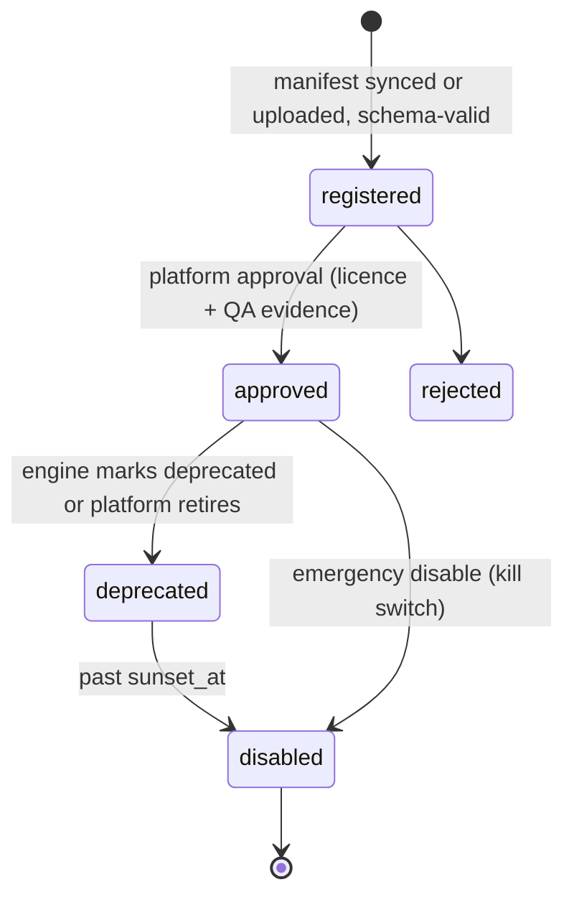
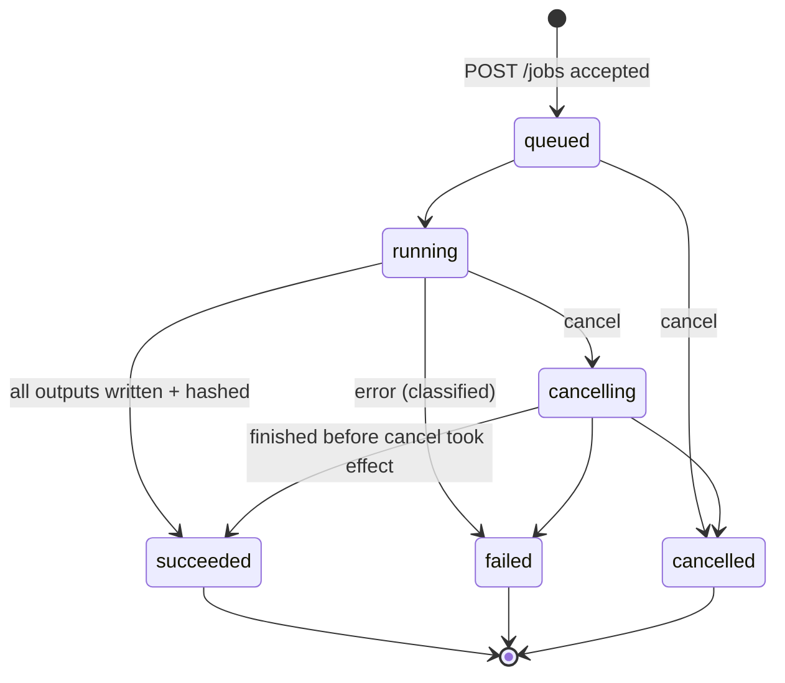
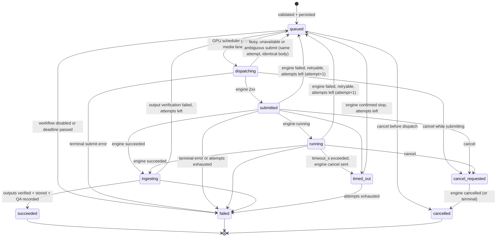

# Visual Engine Contract (VEC) — version 1.0

**Status:** Draft for Track A review · **Owners:** Track B (platform, author of the contract and its client) and Track A (visual engine, implementer of the server). Changes go through a PR to `contracts/visual-engine/` reviewed by both tracks.

| File | Purpose |
|---|---|
| `openapi.yaml` | OpenAPI 3.1 description of the engine API |
| `schemas/*.json` | JSON Schema 2020-12. **Single source of truth** for all payloads. |
| `examples/*.json` | Example payloads. Each one is validated against its schema in platform CI. |
| `fixtures/` | Conformance scenarios and submission fixtures |
| `CHANGELOG.md` | Contract history |

## 1. Purpose and ownership boundary

The platform (Track B) must produce, review and publish visual content **without knowing how it is made**. The visual engine (Track A) owns all of the following:

- ComfyUI;
- image and video models;
- workflows and nodes;
- LoRA training;
- GPU optimization of media workloads.

This contract is the only coupling between the two.

| Platform knows | Platform never knows |
|---|---|
| workflow key + semver, task, typed parameters (JSON Schema), output kinds/counts, resource figures, error classes | node graphs, model names/files, samplers, prompts used internally, custom nodes |

A new workflow version, or a completely new workflow, needs **no platform code change**. It needs:

1. registration of its manifest;
2. a platform-side approval;
3. a binding update for the influencer purpose that should use it.

## 2. Roles and deployment

- **Engine:** an HTTP service implemented by Track A in front of ComfyUI. It listens on localhost or LAN only.
  - Base path: `/vec/v1`.
  - JSON (UTF-8) for every endpoint except output downloads.
- **Platform gateway** (`apps/platform`, module `visual`): the only client. It registers engines, syncs manifests, validates parameters, submits jobs, polls status, downloads and verifies outputs, and records the audit trail.
- **Contract test adapter:** `apps/platform/src/testing/mock-visual-engine` implements this contract with `engine_kind: "contract_mock"`, for platform development and CI.
  - **Its outputs are synthetic, and the platform marks them as such.**
  - They never count as production validation and can't be published unless dev-only configuration allows it.

## 3. Authentication

| Direction | Mechanism |
|---|---|
| Platform → engine | `Authorization: Bearer <token>`: one secret per engine, at least 32 random bytes, base64url. Provisioned out of band and stored in the platform's encrypted secrets. Every endpoint requires it, including `/health`. Missing or invalid → `401 UNAUTHORIZED`. |
| Engine → platform (asset downloads) | Short-lived **signed URLs** created per job (`/v1/assets/{id}/content?exp=…&sig=…`). There are no long-lived credentials. |
| Engine → platform (optional callbacks) | `X-VEC-Signature: t=<unix>,v1=<hex HMAC-SHA256(secret, t + "." + raw_body)>`. Rejected if older than 300 s. |

The engine must not be reachable from the public internet. TLS is optional on localhost and required across hosts.

## 4. Versioning and compatibility

### 4.1 Contract version (`MAJOR.MINOR`, currently `1.0`)

- The engine lists supported versions in `GET /engine` → `contract_versions`. The platform sends `contract_version` in every submission.
- **MINOR changes are additive only:**
  - new optional fields;
  - new endpoints;
  - new error codes;
  - new enum values in fields documented as extensible (`task: other`, error `code`).
- **Tolerant reader.** Both sides MUST ignore unknown fields.
- **Unknown error codes** are handled by `class` and `retryable`.
- **MAJOR changes** (removing or renaming fields, changed semantics) get a new base path `/vec/v2`. Engines may serve several majors side by side during migration.

### 4.2 Workflow versions (`workflow_key` + SemVer)

| Change | Bump | Platform impact |
|---|---|---|
| Quality or performance improvement; same inputs and outputs | PATCH | Approved bindings (`^1.2`) may pick it up after **platform approval** of the new version |
| New *optional* parameter, new output metadata, new QA check | MINOR | Same as PATCH |
| Removed or renamed parameter, new required parameter, changed output kind or count semantics | MAJOR | Requires an explicit binding update by the platform. Existing bindings never move across a major. |

- **Immutability:** `(workflow_key, version)` must never change content. The platform stores `manifest_sha256` and refuses a re-registration with a different hash (`MANIFEST_IMMUTABLE` in the platform API).
- **Manifest hash:** `manifest_sha256` is the lowercase hex SHA-256 of the manifest serialised as RFC 8785 canonical JSON (JCS: keys sorted, no insignificant whitespace), **after removing the two lifecycle fields `deprecated` and `sunset_at`**. Deprecating a version therefore does not change its hash; any other change does.
- **Deprecation:** set `deprecated: true` and `sunset_at`. Engines keep accepting jobs until `sunset_at`. The platform alerts on bindings that point at deprecated versions.
- **Jobs pin an exact version.** Version ranges exist only in platform bindings and are resolved when the job is created.

## 5. Workflow registration lifecycle (platform side)



Only `approved` versions can be used by jobs. Approval is an audited human action on the platform. Track A provides the evidence (quality tests, licences of models used) out of band.

## 6. Job lifecycle

### 6.1 Engine job state machine (normative)



Rules:

- **Terminal states** are `succeeded`, `failed` and `cancelled`. They never change again.
- **`succeeded` requires** `outputs` (≥ 1) and `finished_at`. Each output must be downloadable with an exact `sha256`.
- **`failed` requires** `error` (ErrorObject) and `finished_at`.
- **`running` should report** `progress` when `capabilities.progress = true`.
- **Retention:** the engine keeps jobs and outputs available for ≥ 24 h after a terminal state.
- **No unsubmitted work:** the engine must not start work the platform didn't submit (§9).

### 6.2 Platform job state machine (informative)

The platform implementation (`apps/platform/src/modules/visual/state-machine.ts`) is tested to match this diagram exactly.



## 7. Idempotency

| Operation | Rule |
|---|---|
| `POST /jobs` | The idempotency key is `request_id` + `attempt`, sent in the body **and** as `Idempotency-Key: <request_id>:<attempt>`. An identical body returns the existing job (`200`). A different body under the same key returns `409 IDEMPOTENCY_CONFLICT`. |
| Retry after an engine-side failure | The platform re-submits with the **same `request_id` and `attempt + 1`**, which creates a new engine job. |
| Retry after an ambiguous submit (timeout, connection reset) | The platform re-sends the **same** `request_id` and `attempt`. The engine's idempotency guarantees at most one job. |
| `POST /jobs/{id}/cancel` | Idempotent. Cancelling a terminal job returns it unchanged (`200`). |
| Output download | Repeatable. The bytes must be identical every time (`sha256`). |

## 8. Timeouts, retries and failure classification

**Timeouts** (platform):

- **Per job:** `timeout_s` = min(manifest `timeouts.max_runtime_s`, platform policy), measured from dispatch. On expiry the platform cancels the engine job and classes the attempt as `timeout`.
- **Per HTTP call:** 10 s for control calls; downloads are size-dependent.

**Retries** (platform): classes `transient`, `resource` and `timeout` are retried with exponential backoff and full jitter, honouring `retry_after_ms` and `Retry-After`. The defaults are 3 attempts and a 10 s base delay; both are platform config. Every other class is terminal.

### 8.1 Error codes

| Code | HTTP (synchronous) | Class | Retryable | Meaning |
|---|---|---|---|---|
| `UNAUTHORIZED` | 401 | auth | no | Missing or invalid token |
| `FORBIDDEN` | 403 | auth | no | Token valid, operation not allowed |
| `INVALID_REQUEST` | 400 | invalid_input | no | Body is not schema-valid |
| `UNSUPPORTED_CONTRACT_VERSION` | 400 | invalid_input | no | `contract_version` not supported |
| `WORKFLOW_NOT_FOUND` | 404 | not_found | no | Unknown `workflow_key` |
| `WORKFLOW_VERSION_NOT_FOUND` | 404 | not_found | no | Unknown version |
| `WORKFLOW_DISABLED` | 409 | conflict | no | Version disabled or past sunset |
| `PARAMETER_VALIDATION_FAILED` | 422 | invalid_input | no | `parameters` violate the `input_schema`. `details.violations[]` has `path` and `message`. |
| `REFERENCE_UNAVAILABLE` | 422 | invalid_input | no | A reference asset couldn't be fetched or its sha256 didn't match |
| `ADAPTER_UNAVAILABLE` | 422 | invalid_input | no | An adapter `engine_ref` is unknown to the engine |
| `IDEMPOTENCY_CONFLICT` | 409 | conflict | no | Same key, different body |
| `JOB_NOT_FOUND` | 404 | not_found | no | Unknown `job_id` |
| `ENGINE_BUSY` | 429 | resource | yes | `max_concurrent_jobs` reached. Include `Retry-After`. |
| `ENGINE_UNAVAILABLE` | 503 | transient | yes | Engine starting, in maintenance, or ComfyUI down |
| `INTERNAL` | 500 | transient | yes | Unexpected engine error |
| `RESOURCE_EXHAUSTED` | — (job error) | resource | yes | Out of memory or similar. The engine may degrade the next attempt internally. |
| `EXECUTION_FAILED` | — (job error) | transient or permanent | per error | Workflow execution error. The engine sets `class` and `retryable` honestly. |
| `MODEL_UNAVAILABLE` | — (job error) | permanent | no | A required model or weights are missing on the engine |
| `OUTPUT_TRANSFER_FAILED` | — (job error) | transient | yes | Outputs couldn't be written |
| `TIMEOUT` | — (job error) | timeout | yes | The engine's own runtime limit was exceeded |
| `CANCELLED` | — (job error) | cancelled | no | The job was cancelled |

The platform adds its own codes:

| Code | Class | Meaning |
|---|---|---|
| `OUTPUT_VERIFICATION_FAILED` | transient | sha256, size or mime mismatch on download |
| `PLATFORM_TIMEOUT` | timeout | |
| `ENGINE_PROTOCOL_ERROR` | permanent | Non-conforming response |

## 9. GPU coordination (normative)

The platform runs a GPU-aware scheduler that owns the workstation's GPU budget across **all** workloads. Priority classes:

| Class | Workload | Reaches the engine? |
|---|---|---|
| P0 | Payment integrity and event processing | Never uses the GPU |
| P1 | Active fan conversations (local LLM) | No |
| P2 | Time-sensitive media | Yes (`priority: time_sensitive`) |
| P3 | Scheduled image generation | Yes (`priority: scheduled_image`) |
| P4 | Video generation | Yes (`priority: video`) |
| P5 | Training and maintenance | Yes (`priority: maintenance`) |

Engine obligations:

1. **Admission belongs to the platform.** The engine runs only jobs submitted through this API. It doesn't run other GPU work, such as background training or prefetching, unless it was submitted as a `maintenance` job.
2. **Respect `max_concurrent_jobs`.** It is advertised in `GET /engine`. Beyond it, return `429 ENGINE_BUSY` rather than queueing silently. The platform dispatches at most that many jobs.
3. **Publish measured resource figures** in each manifest (`resources.vram_mb_peak`, `est_seconds_*`, `measured_on`). These must be measured on the target workstation, or be `null` if not yet measured. **Never estimates presented as measurements.** If `vram_mb_peak` is null, the platform treats the workflow as needing the whole media lane.
4. **Release on request.** Support `POST /resources/release` when `capabilities.resource_release = true`. The platform calls it before it enlarges the chat (LLM) VRAM budget.
5. **Report `resource_usage`** (`gpu_seconds`, `wall_seconds`, `vram_peak_mb` when known) on terminal job states. The platform attributes GPU time to each influencer from it.
6. **Fail loudly.** An out-of-memory condition is a job error (`RESOURCE_EXHAUSTED`), not a silent fallback to system RAM.

## 10. References, persona identity and adapters

- **Persona identity is passed by reference** in `persona`:
  - `influencer_id`, `persona_version_id` and `persona_version`;
  - structured `visual_traits` from the approved persona version;
  - `reference_assets` (approved reference images);
  - `adapters` (e.g. character LoRAs) registered for that influencer.

  `identity_package_ref` is an optional opaque handle, if Track A packages identity differently.
- **Additional per-job references** go in `references` (roles: `source`, `outfit`, `pose`, `environment`, `mask`, …), within the manifest's `references.assets` limits.
- **Asset URIs** are short-lived signed platform URLs (`http_download`), or `file://` inside a shared content root that both sides have configured. The engine SHOULD verify `sha256`. On mismatch it fails with `REFERENCE_UNAVAILABLE`.
- **Adapter `engine_ref` values** are created by Track A when it trains or registers an adapter, and recorded on the platform via `POST /v1/influencers/{id}/adapters`. The platform never interprets them.
- **Isolation:** the engine MUST NOT cache identity material across influencers in a way that could leak one persona's identity into another persona's job.

## 11. Outputs, provenance and QA

- **Every output carries:**
  - `sha256` and `bytes` of the exact downloadable bytes;
  - `mime_type`, plus dimensions or duration;
  - `provenance`: engine id and version, workflow key and version, opaque model refs with hashes and licence refs, seed, C2PA status.
- **The platform downloads and verifies every output, then stores it in its own content store.** Engine URLs are never used for publishing.
- **`qa[]` is advisory.** It holds engine-side measurements, for example identity similarity. The platform applies **per-persona thresholds** configured in the platform and records each check in its validation results. The platform makes the approve/reject decision, which is human or policy-based.

## 12. Audit trail

The platform records each of these against the influencer, the requesting actor (user, agent run or system job), the workflow key and version, and the engine id and version:

- every submission (body hash), state transition, poll result, progress, error, retry, cancellation and timeout;
- every output download and verification;
- every QA result.

These go to `inference.visual_job_events` and `core.audit_log`. Engines SHOULD log `request_id` and `attempt` with every internal log line so that records can be correlated across both systems.

## 13. Conformance

- **Engines in conformance mode** MUST expose the normative workflow `__conformance__.solid_color@1.0.0`. Its manifest is `examples/workflow-manifest.conformance-solid-color.json`. It needs no models and no GPU.
- **Scenarios** C01–C16 are in `fixtures/conformance-scenarios.json`.
- **Runner** (from the repository root):

  ```bash
  cd apps/platform
  npm run conformance -- --engine-url http://127.0.0.1:8188/vec/v1 --token "$VEC_ENGINE_TOKEN"
  ```
- **A conformance pass is necessary but not sufficient** for production. Real workflows are additionally validated end-to-end on the workstation; contract-mock results never count.

## 14. Change process

1. Propose a change by PR to `contracts/visual-engine/`. Update the schemas, examples, CHANGELOG, and the rule text here.
2. Platform CI validates every example against the schemas.
3. A MINOR bump needs both tracks' approval. A MAJOR bump also needs a migration plan for in-flight jobs and existing bindings.
