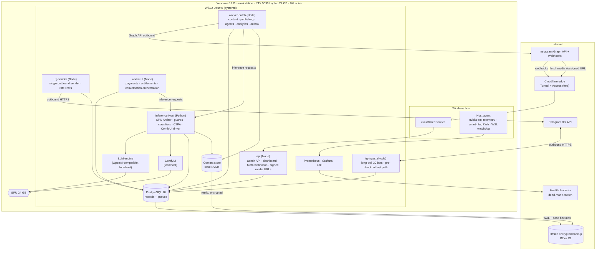
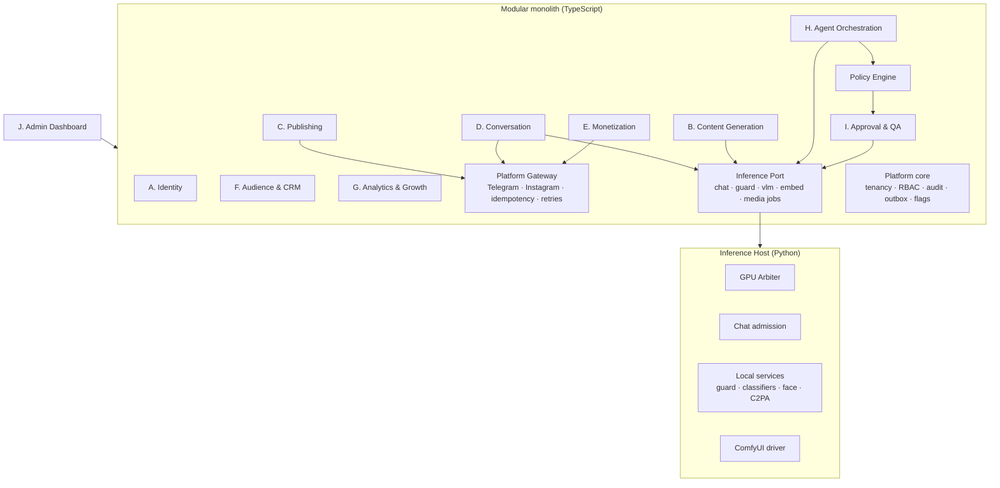
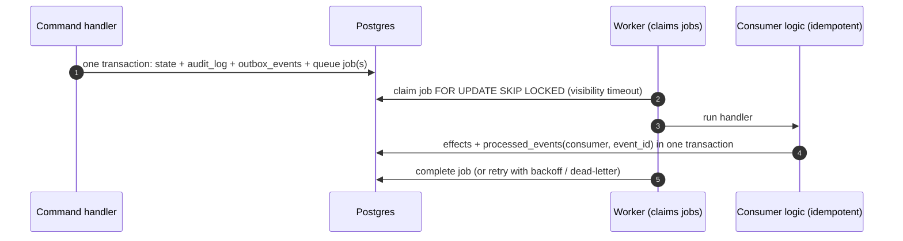

# 04 — System Architecture

> Status: **Proposed — revised 2026-10-18 for the single-workstation, local-inference MVP (20–30 personas)** · Owner: CTO
>
> **What changed from the 2026-10-14 version.** Hosting moved from cloud PaaS with paid AI APIs to **one Windows workstation** (RTX 5090 Laptop GPU, 24 GB VRAM). **All AI inference is local.** ComfyUI is the media engine. Postgres replaces Redis as the job queue. The module boundaries, command bus, policy engine, outbox, idempotency ledger, multi-tenancy model, consent gate, disclosure engine and audit design are **unchanged**.

## 1. Architectural stance

**A modular monolith plus one shared Inference Host, on one machine. Postgres is the system of record and the persistent queue. The local disk is the content store. No containers are required, there is no Kubernetes, and no paid AI APIs are used.**

Why this shape:

- **Shared inference services, not per-persona stacks.** The 30 personas differ in configuration, prompts, LoRAs and accounts, not in infrastructure. One chat model serves every persona through persona-specific prompt prefixes. One ComfyUI instance renders for every persona by hot-swapping LoRAs. Adding persona #31 is a database row plus a trained LoRA, not a new deployment.
- **One authority over the GPU.** The GPU is the scarcest resource and the one most likely to fail under contention. A single **GPU Arbiter** inside the Inference Host decides what runs, in which VRAM budget, in which order (doc 13).
- **Few processes, each with one job.** The process count is the minimum that still isolates failure domains:
  - a crashed ComfyUI must not stop payments;
  - a slow video job must not delay chat.
- **Extensible.** The queue already lives in Postgres and Inference Hosts register as nodes, so a second GPU machine can join over the LAN later (doc 13 §10) without re-architecture.

## 2. Technology choices

| Concern | Choice | Rationale | Changed? |
|---|---|---|---|
| Host OS | **Windows 11 Pro** (Group Policy / Update for Business deferrals; BitLocker) | Given hardware. Pro is required for update control and unattended operation. | New |
| Runtime environment | **WSL2 (Ubuntu LTS) with systemd** hosts all services; GPU via WSL CUDA (paravirtualized) | One Linux toolchain for Postgres, the LLM engine, ComfyUI and the app. Data lives on the WSL ext4 disk, which is faster than `/mnt/c`. **Stage-0 check:** benchmark ComfyUI inside WSL against native Windows (B-IMG-2). If native is materially faster, ComfyUI runs on Windows; nothing else changes, because the API is HTTP. | New |
| Application language | **TypeScript (Node.js 24 LTS)** for the domain monolith: API, workers, bots, dashboard | Unchanged domain design; grammY for Telegram; shared Zod schemas for API contracts and LLM structured outputs | Same |
| Inference Host | **Python 3.12** service (FastAPI) | The ML ecosystem (ComfyUI client, NVML, classifiers, C2PA, LoRA trainers) is Python. It is the single owner of GPU scheduling. | New |
| LLM / VLM serving | **OpenAI-compatible local engine, chosen by a Stage-0 bake-off** (B-LLM-3/4/5 + Q-CHAT-1, doc 14). Candidates: • **llama.cpp server** (MIT; GGUF incl. NVFP4; continuous batching, JSON-schema output, multimodal, sleep-on-idle). **Default if results tie**, because it has the fewest moving parts. • **vLLM** in WSL2 (Apache-2.0; prefix caching, xgrammar structured outputs, multi-LoRA, sleep mode, `kv_cache_memory_bytes` for a fixed KV budget). Details in doc 15. | The app calls one OpenAI-compatible endpoint, so the engine is swappable without code changes. | New |
| Media engine | **ComfyUI** (pinned commit, pinned custom nodes), localhost-only HTTP/WebSocket API | Primary local media engine for images, edits, video, upscaling and detailing | New |
| Database | **PostgreSQL 16** in WSL2, WAL archiving + PITR | Relational integrity for money; RLS; JSONB; `pgvector` available | Same engine, self-hosted |
| Jobs / queues | **Postgres-backed queue** (pg-boss for app jobs; `inference.gpu_jobs` for GPU work), claimed with `FOR UPDATE SKIP LOCKED` | Persistent by design; enqueue is part of the business transaction; one less stateful service than Redis | **Changed** (was BullMQ/Redis) |
| Rate limits / locks | In-process token buckets in the single **Telegram sender** process; Postgres advisory locks for leader election and per-conversation serialization | One host, so no distributed cache is needed | Changed |
| Media storage | **Local content-addressed store** on the data NVMe (`/srv/content/...`), served to platforms through signed, short-lived URLs on the tunnel | No egress or object-storage fees; offsite backup covers durability | **Changed** (was R2) |
| Ingress | **Telegram: long polling (`getUpdates`)**, so no inbound exposure is needed. **Meta webhooks + signed media URLs: Cloudflare Tunnel** (`cloudflared` as a Windows service, outbound-only). | Zero open inbound ports. Telegram retains updates for ≤ 24 h, which covers short outages. | **Changed** |
| Staff access | Dashboard and admin API behind **Cloudflare Access** (free tier ≤ 50 users) through the tunnel, with IdP SSO + MFA; LAN access for on-site staff | Tailscale's free plan is non-commercial, so it isn't used | Changed |
| Secrets | **SOPS + age**-encrypted config in the repo/host. App-level **envelope encryption** of platform credentials with a local master key (age/libsodium). **BitLocker** full-disk encryption (TPM protector) on the host. | No paid secret manager or KMS. At-rest encryption is required by Telegram's developer terms. | **Changed** (was Doppler/KMS) |
| Observability | **Prometheus + Grafana + Loki** (local); a Windows-side **host agent** exports GPU telemetry (`nvidia-smi` on the host, because NVML is limited inside WSL) and smart-plug energy readings; external dead-man's switch on **Healthchecks.io** (free tier) | Self-hosted; free | **Changed** |
| Admin dashboard | React + Vite SPA, served by `api` | Unchanged | Same |
| CI | GitHub Actions for tests, lint and schema checks; **deploy = pull a signed release onto the workstation** via a deploy script (no remote push into the host) | The production host is not reachable from CI | Changed |

## 3. Deployment topology

### Process inventory (systemd units inside WSL2 unless noted)

| Process | Responsibilities | Failure isolation |
|---|---|---|
| `api` | Admin REST API and SPA; Meta webhook receiver (verify → persist → 200); signed media URL endpoint for Instagram fetches; health | Stateless; restart-safe |
| `tg-ingest` | One long-poll loop per bot (30 loops in one process); persist updates → advance offset (`core.poll_cursors`); **answers `pre_checkout_query` inline**: a single indexed read, no GPU, inside 10 s | Payment fast path has **no dependency on the GPU or inference** |
| `tg-sender` | The **only** process that sends Telegram messages: per-bot and per-chat token buckets, `retry_after` handling, idempotency ledger | Centralizes platform rate limits on one host |
| `worker-rt` | Queues: `payments`, `entitlements`, `membership`, `conversation`. Conversation orchestration: consent gate, debounce, context assembly, guard calls, reply requests to the Inference Host | Never runs GPU work itself; isolated from batch backlog |
| `worker-batch` | Queues: `content`, `publishing`, `agents`, `analytics`, `reconciliation`, `events` (outbox fan-out), `maintenance`; the scheduler leader (advisory lock) | Batch-only |
| `inference-host` | **GPU Arbiter** (modes, leases, fair share, campaigns, thermal governor, OOM ladder); chat admission control; ComfyUI driver; guard, classifier, face-embedding and C2PA services; output registration into the content store | Sole GPU authority (doc 13) |
| `llm-engine` | Chat/agent/VLM model server (localhost only) | Restarted by the arbiter on mode change or fault |
| `comfyui` | Media workflows (localhost only, `--reserve-vram` per mode) | Restarted by the arbiter on mode change or fault |
| `postgres` | Records + queues | WAL archiving; PITR |
| `prometheus`, `grafana`, `loki`, `promtail` | Observability | Non-critical path |
| Windows: `cloudflared` service | Tunnel for Meta webhooks, signed media URLs, dashboard (Access-protected) | Survives WSL restarts |
| Windows: `host-agent` | GPU telemetry from the host, energy readings, **WSL keep-alive and watchdog** (logon-triggered task) | Restarts WSL if unhealthy |

## 4. Logical architecture (unchanged module boundaries)

Module responsibilities and owned schemas are unchanged (see the module table in the 2026-10-14 revision, preserved in §5).

**The former "Provider Gateway" splits in two:**

- **Platform Gateway:** Telegram and Instagram, with the same retries, idempotency and rate limits as before.
- **Inference Port:** a typed client to the Inference Host. It exposes the same operations the earlier vendor adapters did: `generateReply`, `classifyText`, `judgeImage`, `embed`, `submitMediaJob`, `getMediaJob`. **A vendor adapter can be re-added behind the same port later** without touching the domain, but none is used: paid AI APIs are excluded.

## 5. Module responsibilities and boundaries

| Module | Owns (schema) | Key responsibilities | Publishes events (examples) |
|---|---|---|---|
| **Platform core** | `core` | Workspaces, users, memberships, roles/permissions, audit log, outbox/inbox, idempotency ledger, integration accounts and encrypted credentials, poll cursors, feature flags, dead letters | `IntegrationTokenExpiring` |
| **A. Identity** | `identity` | Influencer profiles; versioned personas; canon facts; reference assets; LoRA adapters; **per-persona runtime config** (tier, quotas, workflows); objectives; content policies | `PersonaVersionActivated`, `PersonaRuntimeConfigChanged` |
| **B. Content Generation** | `content` | Plans, briefs, prompt templates, generation jobs (→ GPU jobs), media assets, validation results, captions, provenance | `ContentItemReadyForReview`, `ContentItemApproved` |
| **C. Publishing** | `publishing` | Channels, publications, scheduling, platform publish flows, reconciliation, comment ingestion and backfill | `PublicationSucceeded`, `PublicationFailed` |
| **D. Conversation** | `conversation` | Conversations, messages, consent gate, disclosure engine, context assembly, guards, reply generation (via the Inference Port), human takeover, memory | `MessageReceived`, `ReplySent`, `EscalationRaised` |
| **E. Monetization** | `monetization` | Catalog, offers, orders, payments, refunds, subscriptions, **entitlements**, credits and daily allowances, membership enforcement, Stars ledger, payouts, reconciliation | `PaymentSucceeded`, `EntitlementGranted`, `EntitlementRevoked` |
| **F. Audience & CRM** | `crm` | Fans, identities, consents, age status, segments, DSRs | `FanConsentChanged`, `FanErasureRequested` |
| **G. Analytics & Growth** | `analytics` | Metric snapshots, events, KPIs, **attributed cost** (GPU-seconds, energy), experiments, contribution margin | `KpiAnomalyDetected` |
| **H. Agent Orchestration** | `agents` | Agent definitions, tasks, runs, proposals, autonomy policies, evals. Model = a local model key. | `ActionProposed` |
| **I. Approval & QA** | `approvals` | Approvals bound to hashes, QA sampling, incidents, takedowns | `ApprovalGranted` |
| **Inference (platform)** | `inference` | Licence-gated model registry, ComfyUI workflows, GPU nodes and modes, GPU job queue | `GpuJobSucceeded`, `GpuJobDead`, `GpuModeChanged` |
| **Ops (platform)** | `ops` | Benchmarks, environment fingerprints, capacity snapshots, telemetry rollups, energy readings, cost ledger | `CapacitySnapshotComputed` |
| **J. Admin Dashboard** | — | Operator, reviewer, finance, compliance and **capacity/GPU** consoles | — |

### Cross-cutting components (unchanged unless noted)

- **Command bus.** Every state change goes through a typed command handler. Each handler:
  1. authorizes the actor;
  2. runs the Policy Engine;
  3. takes an idempotency key;
  4. writes state, audit and outbox (**and any queue job**) in one transaction.

  Humans and agents share this path.
- **Policy Engine.** It decides content rating vs. channel/fan/model eligibility, the autonomy level, and budget.
  - **Budgets are now expressed in GPU-seconds per persona per day**, plus the money budgets that still exist (doc 12).
  - Model eligibility per rating is read from `inference.models` (approved, licence-checked) instead of vendor policies.
- **Consent gate:** no AI processing of a fan's Telegram messages without `ai_processing` consent. The rule is unchanged. Local inference doesn't relax it: Telegram's terms govern *use of Telegram data for AI*, wherever the model runs.
- **Disclosure engine:** unchanged.
- **Inference Port** (new): the only way domain code reaches AI. It carries:
  - `influencer_id` for fair-share accounting;
  - the request class (I/N/B/H/A);
  - deadlines;
  - idempotency keys.

## 6. Event-driven workflows (simplified with a Postgres queue)

- **Enqueue is transactional.** No outbox relay is needed for jobs that belong to the same database.
- **The outbox is still kept** for domain events with multiple consumers. A fan-out job turns each event into per-consumer jobs keyed `event_id:consumer`.
- **Delivery semantics are unchanged:** at-least-once delivery, exactly-once effects through `processed_events` and idempotency keys.

### Inbound platform traffic

| Source | Mechanism | Durability |
|---|---|---|
| Telegram (30 bots) | `getUpdates` long polling. Each batch is **persisted first** (`core.inbound_webhooks`, dedup `telegram:{bot}:{update_id}`), then the offset advances (`core.poll_cursors`). One consumer per token is enforced by a Postgres advisory lock. | Telegram keeps unconfirmed updates ≤ 24 h, so a short outage loses nothing |
| `pre_checkout_query` | Answered **inline in `tg-ingest`** after persisting the update. Single indexed read; no inference. | 10 s platform limit; SLO p99 < 2 s |
| Meta webhooks | Cloudflare Tunnel → `api`: verify `X-Hub-Signature-256`, persist, 200 | Meta may disable a subscription after ~1 h of failed deliveries (doc 02). An **auto-resubscribe job** plus **backfill polling** of comments and conversations after any outage covers this. |
| Payment backfill | Daily, and immediately after any outage, `getStarTransactions` reconciliation grants anything missed (doc 08 §4.8) | Covers outages > 24 h |

## 7. Retry, idempotency and dead-letter policy

These are unchanged from the previous revision (error classes: rate-limited / transient / permanent / **ambiguous**, with no blind retries of non-idempotent calls). Additions:

- **GPU jobs** follow the arbiter lifecycle (doc 13 §6.1):
  - heartbeats;
  - lease expiry → requeue;
  - the OOM degradation ladder;
  - dead jobs mirrored to `core.dead_letter_jobs`.
- **Chat generation failures:** after the attempt budget runs out, the fan gets a persona-styled holding message and the conversation is flagged for an operator. Fans never see a silent failure.

## 8. Multi-tenancy model

Unchanged: workspace → influencer → channel, RLS on all tenant tables, influencer-scoped memory.

- **Platform schemas** (`inference`, `ops`) hold no fan data. They are accessed by the Inference Host and ops tooling under separate DB roles.
- **Content store paths** are tenant-prefixed (`ws/{workspace}/inf/{influencer}/…`).
- **Signed URLs** carry an HMAC over the path and expiry.

## 9. Integration architecture (per channel)

| Channel | Integration | Notes for 30 personas |
|---|---|---|
| Instagram Business accounts (one per persona) | Instagram API with Instagram Login via **one Meta app** (Standard Access: each account needs an app role). Publishing uses signed media URLs on the tunnel. | Up to 50 app testers without business verification (500 with it): **complete Business Verification before Stage 3** (doc 02). One account's enforcement must not cascade: no cross-persona engagement automation. |
| Telegram free + premium channels (2 per persona) | Bot is an admin; join-request gating for premium | 60 channels |
| Telegram bots (one per persona) | Long polling; Stars; paid media | ~20 bots per BotFather owner account (reported) → **2 owner accounts** for 30 bots, both company-controlled |
| Telegram Business account (optional per persona) | Connected business bot; human-operated, AI drafts only | Each needs a Telegram user account and phone number. **Enabled only for selected personas** (`business_account_enabled`). |
| Static legal & safety page | Cloudflare Pages (free) | Unchanged requirement |

## 10. Environments

| | Staging | Production |
|---|---|---|
| Where | A **separate WSL distro** on the same workstation, *or* any other machine. GPU-light: tiny models, synthetic data. | Production WSL distro on the workstation |
| Database | Separate Postgres cluster (port, data dir, roles) | Production cluster |
| GPU | **Staging inference is disabled by default on the production host.** It may run only in Mode T windows, so it never competes with production chat. | Production |
| Telegram / Meta | Separate test bots and channels; Telegram test environment where supported; separate Meta app or Development mode with test IG accounts | Real |
| Secrets | Separate SOPS files and master key | Production |
| Data | Synthetic only | Real |
| Release | A tagged build is installed into staging first, then promoted to production by the same script (same artifact hash) | — |

## 11. Scalability path (no redesign required)

| Trigger | Change |
|---|---|
| Measured `N_max` (doc 13 §7) below the persona target, or video demand exceeds the §5.4 rule | Add **inference node #2** (a second GPU machine on the LAN) that takes H/T classes; node #1 stays chat-first |
| Chat `A_max` below observed peak demand | Smaller/faster chat model per Q-CHAT-1 results, shorter outputs, priority tiers; then a dedicated chat node |
| Postgres load from queues | Archive succeeded jobs; partitioning (already on high-volume tables); separate the queue database |
| Single-host availability insufficient for revenue at stake | A warm-standby machine with streaming replication and a restore-tested content store; a documented failover runbook |
| Many workspaces (SaaS) | Already multi-tenant; adds per-tenant quotas in GPU-seconds |
