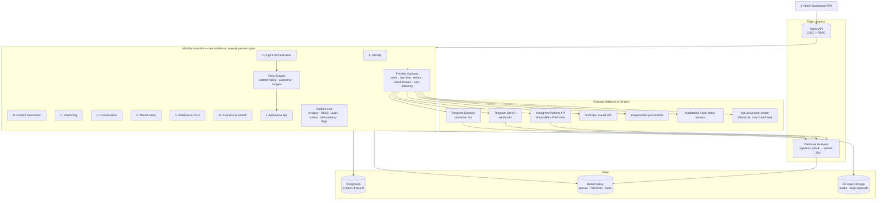
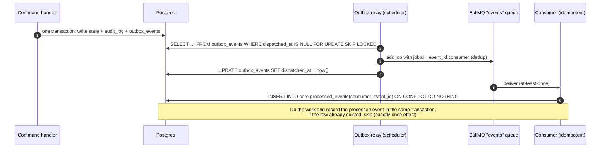

# 04 — System Architecture

> Status: **Proposed (Phase 1 design)** · Owner: CTO · Last updated: 2026-10-14

## 1. Architectural stance

**Recommendation: a modular monolith on managed infrastructure. Use PostgreSQL as the system of record, Redis (Valkey) for jobs and rate limits, and S3-compatible object storage for media.**

Why not microservices: we have one influencer, a small team, and workloads that are mostly I/O-bound calls to external APIs. The heavy GPU work happens at the AI vendors. Microservices would multiply the effort spent on deployment, observability and data consistency, and buy us nothing at this scale. Instead, the monolith has **hard module boundaries**:

- Each module owns one Postgres schema.
- Modules expose explicit in-process interfaces.
- Modules exchange domain events through a transactional outbox.

A module can therefore be extracted into its own service later, once there is a measured reason to do so.

Why not a durable-workflow engine (Temporal, etc.) on day one: our workflows are short state machines (content: draft → approved → published; payments: invoice → paid → entitled). They are easy to model as rows in Postgres moved forward by idempotent jobs. A workflow engine adds a second stateful system to operate. **Revisit this** when long-running, multi-day, branching agent workflows dominate (expected in Phase 4–5). Step handlers are written to be engine-agnostic: pure functions of (state, input) plus idempotent side effects.

## 2. Technology choices

| Concern | Choice | Rationale | Alternatives considered |
|---|---|---|---|
| Language/runtime | **TypeScript on Node.js 24 LTS** | One language across API, workers, bot and dashboard. Shared Zod schemas for API contracts *and* agent structured outputs. First-class SDKs for Anthropic and Telegram. | Python: stronger ML ecosystem, but we buy ML capabilities as APIs. A Python sidecar is allowed later if needed. |
| HTTP | Fastify | Fast, schema-first, mature | NestJS (heavier), Express |
| Telegram | grammY (Bot API), behind our own `TelegramGateway` port | Tracks Bot API releases quickly; webhook mode; typed | Telegraf, raw HTTP |
| Database | **PostgreSQL 16+** (managed, PITR) | Relational integrity for money and entitlements; JSONB for flexible persona/policy docs; RLS for tenant isolation; pgvector available later | — |
| ORM / migrations | Drizzle ORM + plain SQL migrations | Typed queries without hiding SQL; migrations reviewable | Prisma, Kysely |
| Jobs / queues | **BullMQ on Redis/Valkey** | Retries with backoff, delayed jobs, deduplication, rate limiting, repeatable schedules, dashboard. A failed-set acts as the DLQ, which we mirror to Postgres. | pg-boss / Graphile Worker (Postgres-only; a strong option if we want to drop Redis) |
| Cache / rate limits / locks | Redis/Valkey (same instance, separate key prefixes; separate instance at scale) | Token buckets per provider/account, short-lived locks, conversation debounce | — |
| Object storage | **Cloudflare R2** (S3 API) | Zero egress fees matter for video; S3-compatible so we can switch | AWS S3 |
| Media processing | sharp (images), ffmpeg (video), C2PA SDK for content credentials | Standard, runs in a worker container | Hosted transcoding |
| Admin dashboard | React + Vite SPA (TanStack Router/Query) | Internal tool; no SEO; static hosting | Next.js |
| Auth (staff) | **OIDC SSO** (Google Workspace / Entra ID) with MFA enforced at the IdP; optional Cloudflare Access perimeter | Don't build password auth; MFA is centrally enforced | Clerk / WorkOS |
| Secrets | **Doppler** (app/runtime secrets) + **AWS KMS envelope encryption** for tenant credentials stored in Postgres | Runtime secrets never in the repo; per-workspace data keys for OAuth/bot tokens | AWS Secrets Manager, Infisical |
| Hosting | **Render** (web services, background workers, Postgres, Key Value) — staging and production as separate projects | Lowest operational burden for a small team; Docker-based, so portable to AWS ECS later | AWS ECS Fargate + RDS (more control, more ops), Fly.io, Railway |
| Observability | OpenTelemetry → Sentry (errors/traces) + Better Stack or Grafana Cloud (logs/metrics/uptime); LLM traces in our own tables (Langfuse optional) | Vendor-neutral instrumentation | Datadog (cost) |
| CI/CD | GitHub Actions | Tests, migrations check, image build, deploy to staging, gated promotion to production | — |

## 3. Logical architecture

### Process types (same Docker image, different entrypoints)

| Process | Responsibilities | Scaling |
|---|---|---|
| `api` | Admin REST API, webhook ingestion, the Telegram `pre_checkout_query` fast path, health checks | ≥2 instances in prod, stateless |
| `worker-realtime` | Queues: `conversation`, `payments`, `entitlements`, `moderation-sync` | Scales with chat volume. **Isolated** so a content-generation backlog can never delay a fan reply or a payment. |
| `worker-batch` | Queues: `content-gen`, `validation`, `publishing`, `analytics-sync`, `agents`, `events` (outbox fan-out), `maintenance` | Scales with content volume |
| `scheduler` (lightweight; may run inside `worker-batch` with leader election) | Outbox relay; repeatable jobs (publication due-check, token refresh, reconciliation, KPI rollups, subscription expiry sweeps) | Exactly one active leader (Postgres advisory lock) |
| `admin-web` | Static SPA | CDN/static |

## 4. Module responsibilities and boundaries

Every module owns its Postgres schema. Other modules call it **only** through its service interface, never by querying its tables directly. Read-heavy cross-module views, such as the dashboard KPIs, are built from events or from read models that the Analytics module owns.

| Module | Owns (schema) | Key responsibilities | Publishes events (examples) |
|---|---|---|---|
| **Platform core** | `core` | Workspaces, users, memberships, roles/permissions, audit log, outbox/inbox, idempotency ledger (`external_operations`), integration accounts and encrypted credentials, feature flags, dead letters | `IntegrationTokenExpiring` |
| **A. Identity** | `identity` | Influencer profiles; versioned personas (personality, writing style, fictional biography, canon facts, visual identity); reference assets; model adapters (LoRA); objectives; content policies | `PersonaVersionActivated` |
| **B. Content Generation** | `content` | Content plans/slots, briefs, prompt templates, generation jobs, media assets, validation results, captions, provenance (C2PA) | `ContentItemReadyForReview`, `ContentItemApproved` |
| **C. Publishing** | `publishing` | Channels (IG account, TG channels, bot, business account), publications, scheduling, platform-specific publish flows, reconciliation, comment ingestion | `PublicationSucceeded`, `PublicationFailed` |
| **D. Conversation** | `conversation` | Conversations, messages, context assembly, LLM reply generation, input/output guards, disclosure tracking, human takeover, memory extraction | `MessageReceived`, `ReplySent`, `EscalationRaised` |
| **E. Monetization** | `monetization` | Product catalog, offers, invoices/orders, payments, refunds, subscriptions, **entitlements** (single source of truth), credit balances, membership enforcement, Stars ledger, payouts, reconciliation | `PaymentSucceeded`, `EntitlementGranted`, `EntitlementRevoked`, `SubscriptionExpired` |
| **F. Audience & CRM** | `crm` | Fans, cross-platform identities, consents, age status, segments, lifecycle stages, data-subject requests | `FanConsentChanged`, `FanErasureRequested` |
| **G. Analytics & Growth** | `analytics` | Metric snapshots from platforms, event stream, daily KPI rollups, cost attribution, experiments, contribution margin | `KpiAnomalyDetected` |
| **H. Agent Orchestration** | `agents` | Agent definitions (versioned), tasks, runs, steps, action proposals, autonomy policies, budgets, evals | `ActionProposed` |
| **I. Approval & QA** | `approvals` | Approval requests/decisions bound to payload hashes, QA sampling, incidents, policy-violation log | `ApprovalGranted`, `ApprovalRejected` |
| **J. Admin Dashboard** | — (UI) | Operator, reviewer, finance and compliance consoles | — |

### Cross-cutting components

- **Command bus.** Every state-changing action goes through a typed command handler, whether it comes from a human in the dashboard, an agent proposal, or a system job. Examples: `PublishContent`, `SendReply`, `GrantEntitlement`, `RefundPayment`. Each handler:
  1. authorizes the actor (RBAC for humans, agent permissions for agents),
  2. runs the **Policy Engine**,
  3. takes an idempotency key,
  4. writes state, an audit entry and outbox events in **one transaction**.

  Because humans and agents share the same path, a "Level 0 → Level 4" autonomy change is a policy change, not a code change.
- **Policy Engine** (pure, deterministic, unit-tested). It answers three questions:
  1. *Is this content allowed on this channel, for this audience?* (content rating vs. channel policy vs. fan eligibility vs. provider eligibility)
  2. *What autonomy level applies to this action?* (agent cap ∧ influencer policy ∧ kill switches ∧ risk overrides ∧ budget state)
  3. *Is there budget?*

  It returns `ALLOW` | `REQUIRE_APPROVAL(role, n)` | `DENY(reason)`, and its evaluation trace is stored with the decision.
- **Consent gate** (Conversation + CRM). It runs before any AI processing of fan-authored text. Telegram's terms require explicit, per-chat consent before Telegram data is used to deploy AI. No `ai_processing` consent means the message never reaches an LLM: it is routed to human-only handling or the consent prompt. The gate is enforced in the conversation pipeline and covered by an integration test.
- **Disclosure engine.** Per-conversation timers and rules decide when an AI disclosure must accompany a message: first contact, every 3h of continuing conversation, after gaps, on handover, and on "are you human?" questions. Intervals are jurisdiction-configurable.
- **Provider Gateway.** All outbound calls to vendors and platforms go through adapters that implement ports such as `ImageGenerator`, `VideoGenerator`, `LlmClient`, `Moderator`, `FaceMatcher`, `InstagramPublisher`, `TelegramGateway`, `PaymentRail` and `ObjectStore`. The gateway applies the cross-cutting concerns once, for every adapter:
  - credential lookup (decrypt via KMS data key)
  - rate limiting (Redis token buckets per provider and account)
  - timeouts, a retry policy per error class, and a circuit breaker
  - cost metering (`usage_events`)
  - tracing and redacted request/response logging

  To replace a vendor, we add an adapter and change a row in the routing config.

## 5. Event-driven workflows

- **Delivery semantics:** at-least-once delivery, with exactly-once *effects* through the inbox table plus idempotency keys.
- **Ordering:** we never rely on global ordering. Where order matters, we serialize explicitly:
  - messages within one conversation: a per-conversation debounced job plus a lock;
  - payments: unique keys on Telegram charge IDs and monotonic subscription period checks.

### Inbound webhooks

1. Verify authenticity:
   - **Telegram:** check the `X-Telegram-Bot-Api-Secret-Token` header against the per-bot secret set with `setWebhook`.
   - **Meta:** check the `X-Hub-Signature-256` HMAC against the app secret.
2. Persist the raw payload to `core.inbound_webhooks`, using a dedup key such as `telegram:{bot_id}:{update_id}` or `meta:{object}:{entry.id}:{field}:{hash}`.
3. Return `200` quickly, so the platform does not retry and duplicate the update.
4. Enqueue processing.

**Exception:** Telegram `pre_checkout_query` must be answered within 10 seconds, so `api` answers it synchronously. It does a single indexed read of the order, checks validity, and replies. This path has its own SLO and alert.

## 6. Retry, idempotency and dead-letter policy

| Error class | Examples | Policy |
|---|---|---|
| Rate limited | HTTP 429, Telegram `retry_after`, Meta throttling codes | Wait for the server-provided delay (plus jitter). This does not count against the attempt budget, up to a time cap. |
| Transient | 5xx, connection reset, vendor "processing" timeouts | Exponential backoff with full jitter. Attempts by class: chat replies 3 within 60s; payments/entitlements 10 within 1h; publishing 6 within 2h; generation 4. |
| Permanent | 4xx validation, permission revoked, content rejected by vendor | No retry. Mark failed, emit event, alert if business-critical. |
| **Ambiguous** | Timeout *after* a non-idempotent call may have succeeded (e.g. Instagram `media_publish`, Telegram `sendMessage` to a channel) | **Never blind-retry.** Mark the `external_operations` row `UNKNOWN` and run a reconciliation step: for Instagram, list recent media and match on our caption marker or timestamp; for Telegram channel posts, which have no read-back API, escalate to a human. |

- **Idempotency ledger.** Every side-effecting external call first claims a row in `core.external_operations`. The row is keyed by a deterministic idempotency key such as `publish:{publication_id}:attempt-scope`, `refund:{payment_id}` or `invite:{entitlement_id}`. A retry reads that row before acting.
- **Dead-letter queue.** A job that exhausts its attempts lands in BullMQ's failed set and is mirrored to `core.dead_letter_jobs` with its payload, error and attempt history. An alert fires per queue severity; payments and entitlements page someone immediately. From the dashboard, an operator can **inspect → fix → replay** (same idempotency key) or **discard with reason**. Both actions are audited.

## 7. Multi-tenancy model

- **Hierarchy:** `workspace` (tenant) → `influencer` → `channel`. Every tenant-owned row carries `workspace_id`. Rows that belong to an influencer also carry `influencer_id`.
- **Isolation, in layers:**
  1. The repository layer requires a tenant context on every query.
  2. **Postgres Row-Level Security** is defense in depth. Each transaction runs `SET LOCAL app.workspace_id = …`. Policies on every tenant table check it. The application role is `NOBYPASSRLS`.
  3. Object storage keys are prefixed `ws/{workspace_id}/inf/{influencer_id}/…`. Presigned URLs are short-lived.
  4. Credentials are encrypted with per-workspace KMS data keys.
- **Shared database, shared schema ("pool" model).** This scales comfortably to hundreds of workspaces. A large customer can later be moved to a dedicated database (the "silo" model) without code changes, because the tenant context is already explicit.
- **Per-influencer isolation inside a workspace:**
  - Persona, memory, conversation history and entitlements are always scoped by `influencer_id`.
  - A fan who interacts with two influencers has **separate memories per influencer**.
  - Staff access can be restricted to specific influencers (`membership_influencer_scopes`).

## 8. Integration architecture (per channel)

| Channel | Integration method | Notes |
|---|---|---|
| Instagram Professional account | Official Instagram Platform API ("Instagram Login", no Facebook Page needed) + Webhooks via a Meta app we own; the persona account is a **Business** account (API Stories are Business-only) | Publishing, comments, DMs within the 24h window, insights. See [02-platform-capabilities](02-platform-capabilities.md). |
| Free Telegram channel | Bot API: our bot is a channel admin (post, edit, delete, invite links) | The bot cannot read channel history or view counts through the Bot API. Analytics are limited (see doc 02). |
| Premium Telegram channel | Bot API: bot is admin; **join-request-gated** invite links; bot approves only entitled users and removes expired ones | Entitlements are enforced by our system. See [08-telegram-monetization](08-telegram-monetization.md). |
| Telegram AI bot | Bot API webhooks; Stars payments (`XTR`); paid media | One bot per influencer (separate brand, token, Stars balance) |
| Telegram personal/business account | **Telegram Business + a connected bot** (Bot API business connection; Telegram Premium no longer required since Bot API 10.0). A human operates the account; the AI drafts replies. | **No MTProto "userbots"** for automation. AI drafts only after the counterpart consents. See doc 02 §2.3 and doc 08 §6. |
| Static legal & safety page | Static hosting (no app logic) | Required by the Meta app (privacy policy and data-deletion URLs) and CA SB 243 (published crisis protocol). **Not a marketing website.** |

## 9. Environments

| | Staging | Production |
|---|---|---|
| Hosting project | Separate Render project | Separate Render project |
| Database / Redis / bucket | Separate instances | Separate instances, PITR, HA (from scale phase) |
| Secrets | Separate Doppler config; separate KMS key | Separate Doppler config; separate KMS key |
| Telegram | Separate bots; Telegram **test environment** where supported, plus test channels | Real bots and channels |
| Meta | Separate Meta app (or Development mode) with test IG professional accounts | Live Meta app |
| AI vendors | Separate API keys with low spend caps | Production keys with spend caps and alerts |
| Data | Synthetic only. **Production data never copied to staging.** | Real |
| Deploy | Auto on merge to `main` | Manual promotion of the same image digest after staging checks |

## 10. Scalability path (no redesign required)

| Trigger | Change |
|---|---|
| >5 influencers or chat p95 latency degrading | Scale `worker-realtime` horizontally; split Redis into queue and cache instances |
| Messages table >50M rows | Already partitioned monthly; archive cold partitions to object storage (Parquet) |
| Analytics queries slow down the OLTP database | Add a read replica for the dashboard; later stream events to a warehouse (BigQuery/ClickHouse) |
| Many workspaces (SaaS) | Workspace-level billing, quotas and SSO per tenant. Schema already multi-tenant. |
| Multi-day branching agent workflows | Adopt a durable execution engine (Temporal/DBOS) for the agent layer only |
| One module needs independent scaling or deployment | Extract along its schema boundary; the outbox events are already the integration contract |
