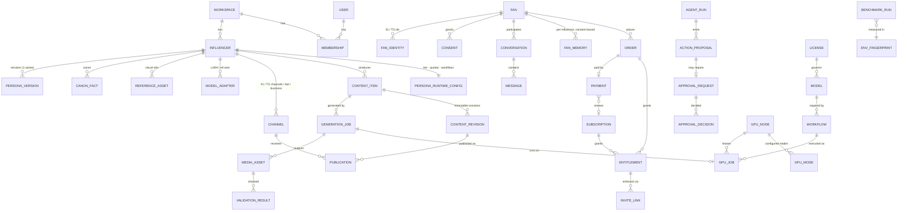
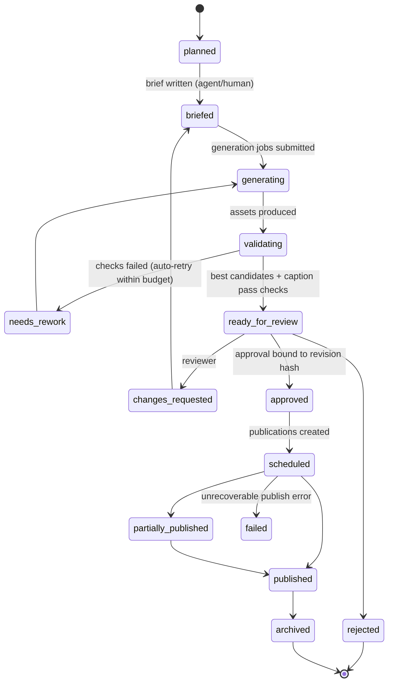
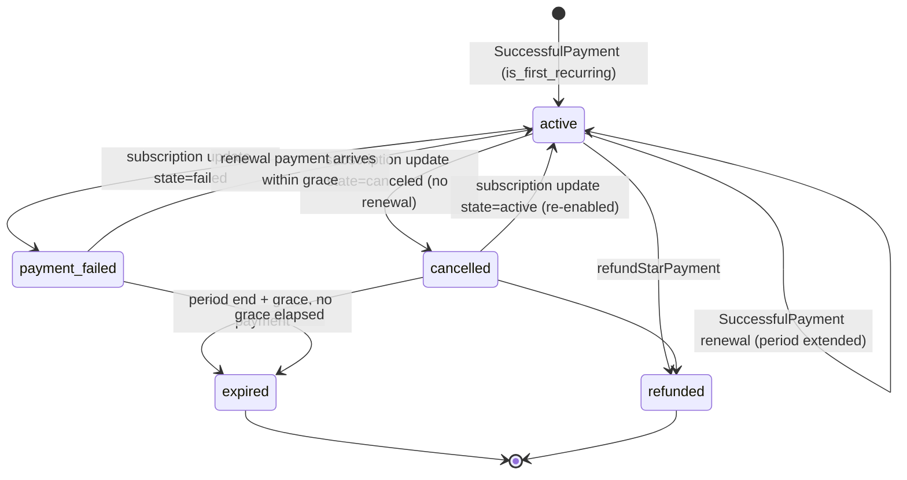

# 05 — Data Model

> Status: Proposed — **revised 2026-10-18 for the single-workstation, local-inference MVP** · Reference DDL: [`schema/schema.sql`](schema/schema.sql), applied cleanly to PostgreSQL 16 · Invariant tests: [`schema/invariants_test.sql`](schema/invariants_test.sql) (§4)

## 1. Principles

1. **Postgres is the system of record *and* the persistent job queue.** There is no Redis.
   - Jobs are rows, claimed with `FOR UPDATE SKIP LOCKED` (doc 04 §2).
   - GPU work lives in `inference.gpu_jobs`.
   - Pull cursors (Telegram offsets, backfills) live in `core.poll_cursors`.
   - Daily allowances live in `monetization.daily_allowances`.
   - Enqueueing a job is part of the same transaction as the business change that causes it.
2. **One schema per module.** `core`, `identity`, `content`, `publishing`, `conversation`, `crm`, `monetization`, `analytics`, `agents`, `approvals`, plus two **platform-level** schemas:
   - `inference`: model registry, licenses, ComfyUI workflows, GPU nodes/modes/jobs;
   - `ops`: benchmarks, capacity snapshots, telemetry rollups, energy and the cost ledger.

   Cross-schema foreign keys point only at stable roots: workspace, user, influencer, fan, channel, media asset and model.
3. **Tenant column everywhere.** `workspace_id` on every tenant row, plus Row-Level Security policies. `influencer_id` wherever data belongs to a persona.
4. **Immutable facts and mutable projections.** The following are append-only:
   - payments
   - credit ledger
   - audit log
   - approval decisions
   - content revisions
   - usage events
   - metric snapshots

   Their current state is projected into mutable tables: subscriptions, entitlements, balances and daily KPIs.
5. **Bind approvals to bytes.** Approvals reference `payload_hash` and `content_hash`. A publication cannot reach `scheduled` without an `authorized_content_hash`, which is enforced by a CHECK constraint.
6. **Money.** Telegram Stars are `bigint` whole units. Fiat is `numeric`, and is labelled an estimate unless it comes from `monetization.payouts`.
7. **Large payloads go to the local content store**, a content-addressed directory tree on the data NVMe, backed up offsite (doc 09 §9). Rows keep `*_ref` / `storage_key` pointers to media, LLM transcripts and raw payloads.
8. **Measured before used.** These rows can't be activated without measured values, enforced by CHECK constraints:
   - models (licence must be reviewed and commercial: trigger);
   - workflows (measured peak VRAM);
   - GPU modes (all budgets measured).

## 2. Entity overview

### Module tables at a glance

| Schema | Tables | Notes |
|---|---|---|
| `core` | workspaces, users, roles, role_permissions, memberships, membership_influencer_scopes, integration_accounts, audit_log (partitioned), audit_seals, outbox_events, processed_events, inbound_webhooks, external_operations, dead_letter_jobs, feature_flags | Platform plumbing |
| `identity` | influencers, persona_versions, canon_facts, reference_assets, model_adapters, business_objectives, content_policies | One active persona per influencer (partial unique index) |
| `content` | prompt_templates, content_plans, content_items, generation_jobs, media_assets, validation_results, content_revisions, revision_assets | Revisions are immutable |
| `publishing` | channels, publications, quota_snapshots, comments, comment_actions | Rating and audience-gate CHECKs on channels |
| `crm` | fans, fan_identities, fan_influencer_profiles, policy_documents, consents, link_tokens, segments, segment_members, data_subject_requests | IG ids are scoped to our IG account |
| `conversation` | conversations, messages (partitioned), message_external_ids, conversation_summaries, fan_memories, escalations, crisis_referrals | Special-category memory blocked by CHECK |
| `monetization` | products, offers, orders, payments, refunds, subscriptions, entitlements, credit_balances, credit_ledger, invite_links, channel_memberships, star_transactions, payouts, star_valuations | Entitlements are the access source of truth |
| `analytics` | metric_snapshots (partitioned), events (partitioned), price_book, usage_events (partitioned), budgets, daily_influencer_kpis, experiments, experiment_assignments | Cost per influencer comes from `usage_events` |
| `agents` | agent_definitions, autonomy_policies, tasks, runs, run_steps, action_proposals, eval_runs | Every decision is traceable |
| `approvals` | approval_requests, approval_decisions, qa_reviews, incidents, takedown_requests | Approvals bind to hashes |
| `inference` (platform) | licenses, models, workflows, gpu_nodes, gpu_modes, mode_transitions, gpu_jobs | Licence-gated model approval; persistent GPU queue (doc 13) |
| `ops` (platform) | environment_fingerprints, benchmark_runs, capacity_snapshots, gpu_daily, energy_readings, cost_entries | Every capacity and cost figure traces to a measurement (docs 12, 14) |

Also new or changed in tenant schemas:

- `identity.persona_runtime_config`: per-persona tier, GPU quota, reply allowances, workflows, rollout stage, pause flag.
- `core.poll_cursors`
- `monetization.daily_allowances`
- `content.generation_jobs.gpu_job_id` / `gpu_seconds` / `energy_wh`
- `core.integration_accounts.wrapping_key_id`, which records the local master key, not a cloud KMS key.

## 3. State machines

### 3.1 Content item

### 3.2 Publication (per channel)

`pending_authorization → scheduled → publishing → published`. Side branches:

- `publishing → unknown`: an ambiguous timeout. A reconciliation job resolves it to `published` or `failed`.
- `publishing → failed`: permanent error, or retries exhausted. Goes to the DLQ and raises an alert.
- `scheduled → cancelled`: a human or a kill switch cancelled it.
- `published → removed`: takedown or manual removal.

The DB rejects any status past `pending_authorization` unless `authorized_content_hash` is set.

### 3.3 Subscription (bot Star subscription)

Each transition updates the linked entitlement(s) in the **same transaction**. It also emits outbox events, which drive membership enforcement (approve join, remove member) and fan notifications.

### 3.4 Entitlement

`active → expired` when the sweeper finds `valid_until` has passed, or `active → revoked` (refund, fraud, erasure, operator). Entitlements are never deleted. The exclusion constraint prevents overlapping active grants for the same fan, resource and source.

### 3.5 Approval request

`pending → approved | rejected | changes_requested | expired | cancelled | superseded`. An edit never changes an approved payload. It creates a new revision and a new request, and the old request is marked `superseded`.

## 4. Invariants enforced in the database (tested: [`schema/invariants_test.sql`](schema/invariants_test.sql))

| # | Invariant | Mechanism | Test result |
|---|---|---|---|
| I1 | A channel with a `mature` or higher ceiling must be adult-gated; `explicit` needs verified-adult gating | CHECK on `publishing.channels` | ✅ rejected |
| I2 | No overlapping active entitlements for the same fan/resource/source | `EXCLUDE USING gist` | ✅ rejected |
| I3 | Special-category memory cannot be stored | CHECK `sensitivity = 'normal'` | ✅ rejected |
| I4 | A publication can't be scheduled or published without an authorization hash | CHECK on `publishing.publications` | ✅ rejected |
| I5 | At most one active persona per influencer | Partial unique index | ✅ rejected |
| I6 | Tenant isolation: the app role sees only its workspace and cannot write into another | RLS policies, `NOBYPASSRLS` role | ✅ 1 row visible; cross-tenant insert rejected |
| I7 | One payment record per Telegram charge | UNIQUE `telegram_payment_charge_id`, UNIQUE `external_dedup_key` | Constraint present |
| I8 | One live subscription per fan per product | Partial unique index | Constraint present |
| I9 | Credit balances never negative; credit debits idempotent per message | CHECK + UNIQUE `idempotency_key` | Constraint present |
| I10 | Active products, personas, policies and agent definitions must have an approver | CHECK constraints | Constraint present |
| I11 | A model can be approved only under a **reviewed licence that permits commercial use of weights and outputs** | Trigger `inference.assert_model_license` | ✅ rejected (non-commercial and unreviewed) |
| I12 | A GPU mode can't be activated with unmeasured budgets | CHECK on `inference.gpu_modes` | ✅ rejected |
| I13 | A ComfyUI workflow can't be approved without a measured peak VRAM | CHECK on `inference.workflows` | ✅ rejected |
| I14 | GPU jobs are idempotent | UNIQUE `idempotency_key` | ✅ rejected duplicate |
| I15 | Reply allowances are consumed atomically and never exceed the limit | Conditional `UPDATE … WHERE used < daily_limit` | ✅ second consume returns 0 rows |

Application-level invariants that the DB doesn't enforce get property-based tests (doc 09 §7). Examples:

- the approver is not the requester;
- the approved hash equals the published revision hash;
- a memory's consent is granted at the time of write.

## 5. Indexing and partitioning

- **Partitioned monthly** (high-volume, append-mostly): `core.audit_log`, `conversation.messages`, `analytics.events`, `analytics.metric_snapshots`, `analytics.usage_events`. A maintenance job creates partitions 3 months ahead, and exports cold partitions to compressed Parquet in the local archive volume (then offsite backup) after the retention window.
- **Hot-path indexes:**
  - GPU scheduler: `gpu_jobs` ready queue `(job_class, priority, due_at) WHERE status='queued'`, plus in-flight heartbeats
  - due publications: partial index on `scheduled_for WHERE status='scheduled'`
  - pending outbox: `WHERE dispatched_at IS NULL`
  - active entitlement checks: `(fan_id, kind, resource_id) WHERE status='active'`
  - subscription expiry sweeps
  - open escalations by severity and SLA
  - approval queue
- **Dedup across partitions:** `conversation.message_external_ids`, because unique constraints on partitioned tables must include the partition key.
- **Vector search:** `pgvector` is installed but used only if the Stage-1 memory evals show structured facts plus summaries are insufficient. Embeddings come from the local embedding model (doc 15).
- **Queue tables under load:** job tables are append/update-heavy. Succeeded jobs older than 7 days are moved to an archive table nightly, keeping the hot queue small. Autovacuum is tuned per table.

## 6. Data classification and retention

| Class | Examples | Storage | Retention (default, configurable) |
|---|---|---|---|
| **Secrets** | IG tokens, bot tokens | `core.integration_accounts` (envelope-encrypted) | Until revoked; rotate on staff change |
| **Fan personal data** | Telegram/IG ids, usernames, display names | `crm.*` | Life of relationship + 12 months inactivity, then anonymized |
| **Conversation content** | Message bodies | `conversation.messages` | 12 months, then deleted (summaries kept while consent holds) |
| **Memory** | Consented facts | `conversation.fan_memories` | Until consent withdrawn or fan requests deletion; reviewed yearly |
| **Financial records** | Payments, refunds, payouts, ledger | `monetization.*` | Statutory period (assume 7–10 years; confirm with accountant). Fan reference pseudonymized on erasure. |
| **Audit** | Audit log, approvals | `core.audit_log`, `approvals.*` | 7 years; sealed and exported to WORM storage |
| **Raw webhooks** | Platform payloads | `core.inbound_webhooks` | 30 days |
| **Generated media** | Images, videos | Local content store (data NVMe) + `content.media_assets`; offsite encrypted backup of published and approved assets | Published: indefinitely. Rejected candidates: 30 days (storage pressure is real on one machine; doc 13 §7). |
| **Model weights** | Base models, persona LoRAs | Local model volume; LoRAs also backed up offsite | Base models: re-downloadable (pinned hash). LoRAs and character sheets: indefinitely (irreplaceable brand assets). |
| **Benchmarks / telemetry** | `ops.*`, raw bench results, Prometheus | Local | Benchmark runs: indefinitely. Raw telemetry: 30 days. Daily rollups: indefinitely. |
| **Analytics events** | Funnel events (pseudonymous) | `analytics.events` | 25 months |
| **Usage/cost** | `usage_events` | `analytics.usage_events` | 7 years (finance) |

## 7. Erasure cascade (fan "delete my data")

Triggered by `/deletemydata` in the bot, by an operator recording a DSR, or by a platform data-deletion callback.

1. Create `crm.data_subject_requests(kind='erasure')`. Verify the requester controls the platform identity; a request from inside the chat counts as verification.
2. Cancel renewals: `editUserStarSubscription(is_canceled=true)` for live subscriptions. Revoke non-financial entitlements, with a message to the fan that prepaid access ends.
3. Delete message bodies, summaries, memories, consents (keep a minimal consent-withdrawal proof), segment memberships, experiment assignments and link tokens.
4. Pseudonymize financial rows: keep the payment facts, replace the fan reference with a tombstone id, and drop usernames.
5. Set `crm.fans.status = 'erased'` and null out identifying fields. Keep `fan_identities` only as a salted hash to block silent re-linking. The fan can start fresh, but data doesn't reattach.
6. Remove the fan from analytics events (`fan_id` → NULL) and from the transcript files in the local content store.
7. Backups age out under the backup retention window (35 days, local and offsite), which is documented in the privacy policy.
8. Audit-log the action without the deleted content, and close the DSR.

## 8. Migration and evolution rules

- Migrations are forward-only SQL, reviewed in PRs, and run by a dedicated migrator role in CI/CD before the app deploys.
- Use expand → migrate → contract for breaking changes. Never rename a column in one step.
- Status values are `text + CHECK`, so they can be added without enum migrations. `content_rating` is an enum on purpose, because its ordering is used in comparisons.
- Every new tenant table must include `workspace_id`. A CI check fails the build when a table lacks it or lacks an RLS policy.
