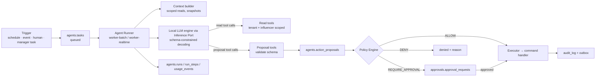
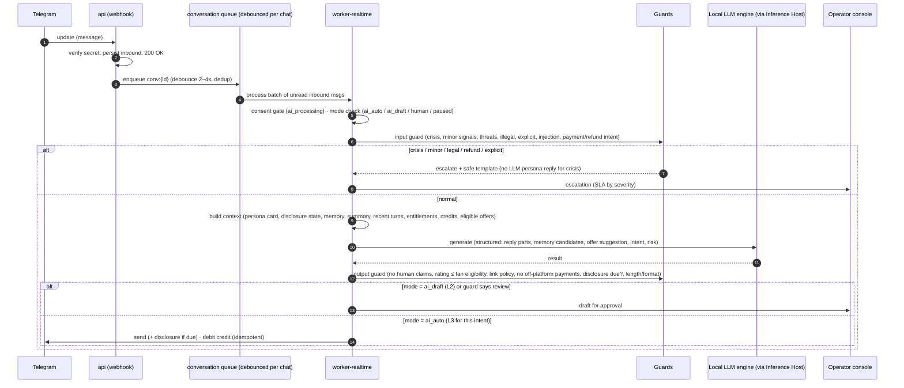

# 06 — Agent System

> Status: Proposed — **revised 2026-10-18: all agents run on local models through the Inference Port; no paid AI APIs** · Related: [04 architecture](04-system-architecture.md), [07 content pipeline](07-content-pipeline.md), [08 monetization](08-telegram-monetization.md)

## 1. Design principles

1. **Agents propose; the executor acts.** No agent holds a tool that changes the outside world. Agents have:
   - **read tools**, which are scoped queries;
   - **proposal tools**, which emit typed `ActionProposal`s.

   A deterministic **executor** runs each proposal through the same command handlers humans use. It does so only after the **Policy Engine** allows it, directly or through an approval.
2. **Structured outputs everywhere.** Every agent returns a schema-validated result. Zod schemas are compiled to JSON Schema and enforced by the local engine's **schema-constrained decoding** (`response_format: json_schema`; xgrammar in vLLM, grammar in llama.cpp; doc 15). Results are validated again in the runner. Invalid output is a failure, never "best effort".
3. **Bounded autonomy.** Every proposal resolves to an autonomy level before execution:

   `effective = min(agent max level, policy level for the action and influencer, kill switches, risk overrides, budget state)`
4. **Traceable decisions.** Every run stores:
   - model, effort, prompt version and tool schemas;
   - token usage and cost;
   - each tool call and result;
   - a full transcript reference.

   Every proposal stores its rationale, evidence references, confidence, risk level and the policy trace that produced its disposition.
5. **Asymmetric authority for safety.** The QA & Compliance agent can **block, hold or escalate** autonomously at any level. It can never approve or publish.
6. **Deterministic orchestration, not free-form agent chatter.** Agents don't talk to each other directly. They coordinate through **tasks**: rows in `agents.tasks` created by schedules, events, humans, or the Influencer Manager. The result is a task graph that can be inspected, retried and audited.
7. **Fail safe.** On timeout, refusal, invalid output or exhausted budget, the default is *do nothing and tell a human*. For live chat, the default is a safe holding reply plus an escalation.

## 2. Runtime architecture



### Agent Runner responsibilities

- **Tenant and influencer injection.** The runner binds `workspace_id` and `influencer_id` into every tool handler. Tool schemas don't contain these fields, so an agent cannot address another tenant.
- **Budgets.** Enforced per run: max steps, max tokens, wall-clock timeout, and **max GPU-seconds**. Also per day per agent and influencer, from `agent_definitions.budgets` and the persona's GPU quota. When a run exceeds its budget it ends with status `budget_exceeded`, and no partial proposals are executed.
- **Model configuration** is versioned in `agents.agent_definitions`. `model` is an `inference.models` key, which must be approved and licence-checked.
  - **Default:** the resident chat model (doc 15 §2.1, e.g. Qwen3.5-9B) for every agent. Agents run as **class A** work (doc 13 §3), using only idle chat-engine concurrency, so they never delay fans.
  - **Heavy reasoning** (weekly planning, analytics narratives) may use a larger model, e.g. gpt-oss-20b. It is loaded **only in Mode T or idle windows**, never alongside media, and agent tasks that need it are scheduled into those windows.
  - **Tools:** OpenAI-compatible tool calling with JSON-schema arguments. The final result is always a schema-constrained structured output.
  - **Prefix reuse:** the static part of each agent prompt (system prompt, tool schemas, persona card) comes first, to maximize engine prefix caching. Its real benefit is measured (B-LLM-4).
  - **No vendor batch discount exists locally.** "Batch" means scheduling into low-traffic windows (memory extraction, evals, narratives).
- **Model per route** is an eval-backed decision, recorded as a new agent-definition version. Examples: a smaller model for classification-like agents, a larger one for planning. Its cost is GPU time, quantified by doc 13 §7. No code change is needed.
- **Prompt-injection posture.**
  - Fan messages, comments and any platform text are inserted as clearly delimited *data*, never as instructions.
  - Agents that read untrusted text (Conversation, Social Media, Community) have **no proposal tools above medium risk**.
  - All outputs pass the output guard.
  - The red-team suite runs in CI.

## 3. Agent catalog

Legend for autonomy columns: **MVP** = the maximum level the policies allow at launch; **Target** = the planned ceiling once QA evidence supports it.

| Agent | Mission | Triggers | Read tools (examples) | May propose (action types) | MVP | Target |
|---|---|---|---|---|---|---|
| **Influencer Manager** | Keep the influencer on strategy: translate objectives into weekly plans and tasks; arbitrate priorities | Weekly plan (Mon), daily stand-up job, KPI anomaly events | objectives, KPI rollups, budgets, task backlog, persona summary, last week's reports | `task.create` (internal), `objective.propose_change`, `persona.propose_update`, `budget.propose_change` | L1 (tasks L3: internal and harmless) | L3 for tasks; L1 for persona/budget forever |
| **Content Strategist** | Content calendar and briefs that serve objectives within policy | Weekly plan task; performance events | calendar, past performance by format/theme, canon facts, content policy, trending themes we curate | `content_plan.propose`, `content_item.create_brief` | L2 | L3 for briefs inside an approved plan |
| **Image/Video Production** | Turn briefs into on-model assets within budget | `content_item.briefed` event | brief, persona visual identity, reference set, adapter info, provider eligibility, validation results | `generation.start` (within item budget), `candidates.select`, `content_item.submit_for_review` | L3 within per-item budget (no external effect beyond paid generation) | L3 |
| **Social Media** | Captions, scheduling, IG comment handling, story sequencing | Asset approved; new comment; schedule gaps | approved assets, writing style, best times, comment thread, link policy | `caption.propose`, `publication.propose`, `comment.reply`, `comment.hide`, `comment.private_reply` | L2 | L3 for benign comment replies and spam hiding; L2 for publication until promoted |
| **Conversation** | Real-time persona chat in the bot (and drafts for IG DMs and the Business account) | Inbound message (debounced) | persona card, consented memory, summary, recent turns, entitlements, credits, eligible offers | `reply.send`, `memory.save`, `offer.present` (catalog only), `escalation.raise` | L2 (drafts) in closed beta; escalation always L4 | L3 for low-risk intents; offers L3 within caps |
| **Community** | Free/premium channel engagement: welcome posts, polls, FAQs, moderation of a linked discussion group | Schedule; new members; reports | channel stats, community guidelines, queued announcements | `community_post.propose`, `message.delete_spam`, `member.restrict` | L2 (spam delete L3) | L3 for scheduled community posts from approved templates |
| **Monetization** | Offer strategy, pricing experiments, win-back, bundles | Weekly; churn events; experiment readouts | funnel metrics, cohort retention, price history, offer performance, ethical-monetization rules | `product.propose`, `price.propose_change`, `campaign.propose`, `experiment.propose` | L1 / L2 (price changes need 2 approvals) | L2. **Never L3+ for pricing or refunds.** |
| **Analytics** | Explain performance; detect anomalies; read out experiments | Daily rollup done; experiment end | KPIs, metric snapshots, costs, events | `report.publish` (internal), `alert.raise`, `experiment.propose_readout` | L3 (internal only) | L3 |
| **QA & Compliance** | Second-line automated review: pre-screen approvals, sample autonomous actions, audit disclosures | Before every approval request; QA sampling schedule; new agent version | policies, content, conversation samples, disclosure records | `item.block`, `item.hold`, `escalation.raise`, `policy.propose_update`, `qa_review.record` | Block/hold/escalate **L4**; policy changes L1 | same |

### Output contract (all agents)

Every run ends with a structured result:

```json
{
  "summary": "string (≤ 600 chars, for the dashboard)",
  "proposals": [
    {
      "action_type": "publication.propose",
      "payload": { "...": "action-specific, schema-validated" },
      "rationale": "why this, why now (≤ 1,000 chars)",
      "evidence": [ { "type": "metric_snapshot", "ref": "uuid" }, { "type": "canon_fact", "ref": "uuid" } ],
      "confidence": 0.0,
      "risk_self_assessment": "low|medium|high|critical"
    }
  ],
  "needs_human": [ { "question": "string", "options": ["..."] } ],
  "no_action_reason": "string|null"
}
```

The **risk level** stored on a proposal is the **maximum** of the agent's self-assessment and the Policy Engine's rule-based risk for that action type and payload. An agent can raise its own risk level but can never lower it.

## 4. Autonomy levels and the action catalog

### 4.1 Levels

| Level | Name | Meaning in this system |
|---|---|---|
| **L0** | Human-controlled | Agents don't run for this action. Humans act in the dashboard. |
| **L1** | Recommend | The agent produces a recommendation. A human must re-create the action manually: no one-click execution, so a deliberate decision is made. |
| **L2** | Execute after approval | The proposal becomes an approval request with the exact payload. On approval the executor runs it, with no further human steps. |
| **L3** | Autonomous, low risk | The executor runs it immediately within the policy conditions (caps, ratings, segments, quiet hours). A QA sample is reviewed afterwards. |
| **L4** | Autonomous within strict policies | Like L3, but for medium-risk actions under tighter, measurable policies with continuous monitoring and automatic demotion. Reserved for mature, evidence-backed cases. |

### 4.2 Action catalog (MVP defaults)

| Action type | Risk | MVP level | Approver role | Notes |
|---|---|---|---|---|
| `persona.activate` / `persona.propose_update` / `canon_fact.add` | high | L1 / L2 | compliance + content manager (2 approvals) | Identity is a brand asset |
| `content_plan.propose` | medium | L2 | content manager | Weekly batch approval |
| `generation.start` | low | L3 | — | Within the per-item and daily media budget |
| `content_item.submit_for_review` | low | L3 | — | |
| `publication.propose` (IG feed/Reel/Story, TG posts) | high | **L2** | reviewer | Approval bound to `content_hash` |
| `comment.reply` (IG) | medium | L2 | reviewer/operator | Candidate for L3 on benign intents |
| `comment.hide` (spam/abuse) | low | L2 → L3 after 2 weeks of data | operator | |
| `comment.private_reply` | medium | L2 | operator | One per comment, within 7 days |
| `reply.send` (Telegram bot) | medium | **L2 in closed beta** → L3 per intent class | chat operator | Escalation intents never auto-reply beyond the safe template |
| `reply.send` (IG DM) | medium | L2 | chat operator | Within the 24h window only |
| `reply.send` (Telegram Business account) | medium | **L2 always in MVP** | chat operator | Human-operated account |
| `memory.save` | low | L3 | — | Only with `memory_personalization` consent; categories allowlisted |
| `offer.present` (catalog product, catalog price) | medium | L2 → L3 with caps | chat operator | Caps: ≤2/day/fan, none in escalated conversations, none to `risk_flags` fans |
| `product.create` / `price.change` | high | L1/L2 | finance + admin (2 approvals) | |
| `refund.issue` | high | L2 | finance | Fan-initiated `/paysupport` refunds of unused credits may be L3 later |
| `member.remove` (premium expiry enforcement) | low | **system (deterministic)** | — | Not an agent action. The entitlement engine does it. |
| `escalation.raise` | — | L4 | — | Always allowed |
| `item.block` / `item.hold` (QA) | — | L4 | — | Always allowed |
| `broadcast.send` (bot re-engagement) | high | L2 | admin | Opted-in users only; rate-limited |
| `policy.*`, `autonomy_policy.*`, `budget.*` changes | critical | L1 | owner/admin + compliance | Agents can only recommend |

### 4.3 Resolution algorithm (Policy Engine)

```text
resolve(proposal):
  if kill_switch(global | workspace | influencer | agent | channel): return DENY("kill switch")
  if not agent_def.allowed_action_types ∋ proposal.action_type: return DENY("not permitted")
  if content_rating(payload) > min(channel.max_rating, policy.max_rating, provider_max): return DENY("rating")
  if fan_target and fan.age_status in (suspected_minor, confirmed_minor) and action ∉ SAFE_SET: return DENY("minor protection")
  if requires_consent(action) and not consent_granted(fan, purpose): return DENY("no consent")
  if budget_exceeded(scope): return DENY("budget") or REQUIRE_APPROVAL (per budget.hard_action)
  level = min(agent_def.max_autonomy_level,
              autonomy_policy(workspace, influencer, action_type, agent).level,
              risk_override(proposal.risk_level))      # high → ≤2, critical → ≤1
  if level >= 3 and conditions_met(policy.conditions, proposal): return ALLOW
  if level == 2: return REQUIRE_APPROVAL(policy.required_approver_role, policy.required_approvals)
  return DENY("recommendation only (L1/L0)")  # surfaced as a recommendation in the dashboard
```

The full evaluation trace (each rule, input values, outcome) is stored in `action_proposals.policy_trace`.

## 5. Promotion and demotion (evidence-based autonomy)

Autonomy changes are made by **editing `agents.autonomy_policies`**. That is itself an L1 action: an agent may recommend a change, but only owners or admins together with compliance approve it.

**Promotion criteria** (to move one action type for one influencer from L2 to L3):

| Metric (rolling window) | Threshold |
|---|---|
| Volume of L2 decisions observed | ≥ 300 (chat replies: ≥ 1,000) |
| Approval-without-edit rate | ≥ 97% (chat: ≥ 98%) |
| Critical QA findings | 0 in the window |
| Major QA findings | ≤ 0.5% |
| Shadow-mode agreement (agent decision vs. human decision) | ≥ 95% |
| Eval suite for the current agent version | 100% on critical cases; ≥ 95% overall |

**Automatic demotion:** the level drops back to L2 immediately when any of these happens:

- a critical QA finding;
- a sev1 or sev2 incident involving the action;
- a platform enforcement notice (strike or warning);
- a new agent or prompt version that hasn't passed shadow evaluation.

**Post-promotion QA sampling** (L3/L4): 10% random sample for the first 30 days, then 3%, plus 100% of risk-flagged items.

### 5.1 Autonomy is a scaling prerequisite (30 personas)

**Operator-approved chat drafts (L2) don't scale to 20–30 personas.** The operator workload is roughly drafts per day × median review seconds, both measured in Stage 1. The rollout plan therefore makes autonomy promotion a **gate**, not an aspiration (doc 10):

| Gate | Autonomy requirement |
|---|---|
| Stage 1 → 2 (1 → 5 personas) | Chat L2 drafts measured: approval-without-edit rate and review seconds per draft |
| Stage 2 → 3 (5 → 10) | `reply.send` promoted to **L3 for the low-risk intent classes** (greeting, small talk, persona Q&A, content questions) per §5 criteria; L2 remains for offers and sensitive intents |
| Stage 3 → 4 (10 → 20–30) | Offers at L3 within caps; benign IG comment replies and spam hiding at L3; projected operator minutes per day fit staffed hours with ≥ 30% margin |

Safety-critical paths stay deterministic or human at every stage:

- crisis templates;
- escalations;
- minors restriction;
- refunds;
- prices.

Promotion never removes the guard, the output checks or QA sampling.

## 6. Conversation agent (real-time pipeline)

The conversation path is latency-sensitive and safety-critical, so it is a specialized pipeline. It is not the generic batch runner.



### Mandatory behaviors

These are enforced by code, not only by prompt.

1. **Consent gate.** Without `ai_processing` consent for this chat, the AI never sees the message. The bot shows a consent prompt (buttons) and nothing else. `/stopai` withdraws consent; after that the conversation is human-only or closed.
2. **Disclosure.**
   - An explicit AI disclosure message precedes the first AI reply.
   - It repeats at least every **3 hours** of continuing conversation, and after a ≥24h gap.
   - It is shown when switching human → AI.
   - Any "are you real/human/AI?" question gets an immediate truthful answer.

   Tracked via `conversations.ai_disclosed_at` / `last_disclosure_at`. Intervals are jurisdiction-configurable (e.g. hourly for minors in WA from 2027; minors are not served in our design).
3. **Never claim to be human.** Never claim to have a body, real-world location, or meet-ups. Never ask for off-platform contact or payment.
4. **Rating ceiling.** Content is capped at `min(channel ceiling, fan eligibility, model policy)`. With the SFW product decision (D1) this is warm, friendly and playful: **never erotic**.
   - Moving to local models removes the *vendor's* usage policy but **not** the platform, legal and age-assurance reasons for SFW (doc 03).
   - Local models also have **no vendor-side safety layer**, so the guard model, the output guard and the eval suite carry the whole burden. That is why Q-CHAT-1 critical cases are 100%.
5. **Crisis protocol.**
   - Self-harm signals → a localized crisis-resources message (template, not LLM-written) and a critical escalation.
   - AI persona replies pause for that fan until a human clears them.
   - No offers for 72h.
   - A de-identified `crisis_referrals` row is written.
6. **Minor signals** → restricted mode (no offers, neutral tone), human review, closure if confirmed.
7. **Memory.** Memory candidates go through an allowlist of categories, a sensitivity classifier (special-category data dropped), and the consent check. They are written at L3. Fans can see and delete their memory (`/memory`, `/forget`).
8. **Ethical monetization.** Offers come only from the active catalog at catalog prices, within caps, and never in escalated or distressed conversations. Copy rules forbid guilt, fake scarcity and exclusivity pressure.

### Human takeover

An operator can switch a conversation between modes: `ai_auto` → `ai_draft` → `human` → `paused`. In `human` mode the AI still produces *suggested replies* for the operator, which saves time without autonomy. Takeover is visible in the audit log. On Instagram it follows Conversation Routing semantics.

## 7. Orchestration patterns

| Pattern | Example | Mechanism |
|---|---|---|
| **Scheduled** | Weekly planning (staggered across personas, so 30 personas don't all plan at 06:00), daily KPI analysis, nightly memory extraction (class A in low-traffic windows) | Postgres job scheduler → `agents.tasks` → GPU jobs (class A) |
| **Event-driven** | `ContentItemBriefed` → Production agent; `CommentReceived` → Social Media agent; `KpiAnomalyDetected` → Analytics → Manager | Outbox consumers create tasks with deterministic idempotency keys |
| **Manager delegation** | Influencer Manager creates `content_strategist:weekly_calendar` and `monetization:winback_review` tasks | `task.create` proposals at L3 (internal only) |
| **Pipeline step** | Production agent → QA pre-screen → approval request | Deterministic workflow code calls agents as steps |
| **Human request** | "Draft 3 caption options" from the dashboard | Task with `requested_by_type='user'` |

There are no unbounded loops. Every task has a `deadline_at`, and each workflow has a maximum fan-out per day.

## 8. Failure recovery

| Failure | Detection | Recovery |
|---|---|---|
| Engine timeout / crash / restart (mode switch) | Inference Port errors, arbiter events | Retry with backoff (bounded); the task waits while the engine restarts; chat path sends a holding message after `hold_after_s` (doc 13 §6.3) |
| Model declines or produces unsafe output | Output guard / guard model verdict | The run ends `refused`. Chat: safe deflection template. Content: item marked `needs_rework` with the reason. |
| Invalid structured output | Schema validation | One repair attempt with the validation error; then `invalid_output` → task failed → human notified |
| Tool error | Tool handler result | Returned to the model as an error result (bounded retries); the agent may choose an alternative or end |
| Budget exceeded | Runner accounting | Run stops; no proposals executed; alert; task can be retried with an explicit budget override by an admin |
| Proposal denied by policy | Policy Engine | Recorded with the reason; agents see denial reasons in later context to avoid repeating them |
| Executor failure after approval | Command handler error | Standard retry/DLQ (doc 04 §6); the approval stays valid only for the same payload hash |
| Poison task (fails repeatedly) | Attempts > max | Task `dead_lettered` + DLQ entry + alert |
| Bad agent version in production | QA signals, eval regressions | Roll back `agent_definitions` to the previous version (one row update); autonomy auto-demotes |
| Kill switch | Flag | All proposals for the scope are denied; running tasks finish their current step and stop; chat falls back to `ai_draft` or `human` |

## 9. Agent lifecycle and evaluation

1. **Author:** prompt template plus tools plus output schema, as a new `agent_definitions` version with status `draft`.
2. **Evaluate (`evaluating`):** offline eval suites per agent, run as class A/T GPU jobs in low-traffic windows.

   | Agent | Example eval cases |
   |---|---|
   | Conversation | ~300 cases (Q-CHAT-1): persona fidelity *per persona* (30 personas share one model, so persona bleed-over is tested explicitly), disclosure, refusal of erotic content, crisis handling, minors signals, injection attempts, offer etiquette, memory extraction precision, multilingual |
   | Strategist | Plan validity vs. policy and budgets |
   | Social Media | Link-policy compliance, disclosure, sponsored-content handling |

   Graded by deterministic checks plus an LLM judge with a rubric, with spot human review. **Critical cases must be 100%.**
3. **Shadow (`shadow`):** runs on live inputs with `mode='shadow'`. Proposals are recorded but never executed. Agreement is measured against human decisions.
4. **Activate (`active`):** approved by owner or admin plus compliance. The previous version stays available for instant rollback.
5. **Monitor:** QA sampling, GPU-seconds per run, denial rates, escalation rates and guard-block rates are on the agent dashboard.

## 10. Example: weekly cycle for one influencer

1. **Mon 06:00.** The Influencer Manager reads objectives and last week's KPIs, then creates tasks for the Strategist (calendar) and Monetization (win-back review).
2. **The Strategist proposes** the weekly plan: 4 feed posts, 3 Reels, 15 Stories, 8 TG posts, 10 premium items and 1 PPV set. This becomes an approval request. The content manager approves it in one batch, editing two briefs.
3. **The Production agent generates candidates** for each brief, within budget. Validators run, QA pre-screens, and the best two candidates plus a caption go to the reviewer queue.
4. **The reviewer approves** each item, with the approval bound to its hash. Publications are scheduled and the executor publishes them at the slot times. Insights are then snapshotted at +1h, +24h and +7d.
5. **Conversation runs continuously.** It works in L2 drafts during the beta; later, low-risk intents move to L3. Escalations go to operators.
6. **Sun.** The Analytics agent publishes the weekly report; QA sampling results update the promotion metrics.
