# 07 — Content Production Pipeline

> Status: Proposed · Related: [02 capabilities](02-platform-capabilities.md) §1.2, §3; [06 agents](06-agent-system.md)

## 1. Pipeline overview

```mermaid
flowchart LR
  P[Plan<br/>weekly calendar] --> B[Brief<br/>scene · outfit · shot · angle · CTA · target rating]
  B --> C[Prompt compile<br/>persona visual canon + template + refs/adapter]
  C --> G[Generate N candidates<br/>provider router]
  G --> V[Validate<br/>technical · identity · moderation · rating · resemblance · IP · duplicate]
  V -->|fail, budget left| C
  V --> S[Select & rank<br/>VLM vs brief]
  S --> K[Caption & copy<br/>style · disclosure · CTA · link policy]
  K --> R[Renditions & provenance<br/>per-placement JPEG/MP4 · C2PA · IPTC]
  R --> QA[QA & Compliance pre-screen]
  QA --> A{Human approval<br/>bound to content hash}
  A -->|changes| B
  A -->|approved| SCH[Schedule publications]
  SCH --> PUB[Publish per channel<br/>idempotent]
  PUB --> POST[Post-publish<br/>insights snapshots · comment intake]
```



Each box is an **idempotent job** keyed by `(content_item_id, step, revision)`. The pipeline state lives on `content.content_items.status` (doc 05 §3.1). A crash at any point resumes from the persisted state.

## 2. Identity system (visual consistency)

**Assets per influencer** (in `identity.*`):

1. **Character sheet.** A human-approved canonical set of 12–20 images: neutral face front and ¾ left/right, smile, profile, full body, signature outfits, and the hair, eye and skin references. Each is marked `face_canonical` or another kind.
2. **Visual identity spec** (`persona_versions.visual_identity`): a structured attribute list that validators can check, for example:
   - `hair: {color: "copper", length: "shoulder", texture: "wavy"}`
   - `eyes: "green"`
   - `marks: ["small mole left cheekbone"]`
   - `age_presentation: "adult, mid-20s"`
   - `build`, `style_palette`, `photography_style`
3. **Identity adapter strategy:** the cheapest method that passes the identity bar wins.
   - **Tier A (default): multi-reference prompting.** FLUX.2 [pro] takes up to 8 reference images; Nano Banana takes up to 14. No training, quick to adopt, and the vendor applies C2PA.
   - **Tier B (if Tier A's pass rate is below 70%): a trained LoRA.** For example a FLUX.2 [klein] LoRA. Train on the approved character sheet plus approved outputs (fal ≈ $4–6 per run). Licensing must be cleared first; see doc 02 §8 #8.
   - Adapters are versioned in `identity.model_adapters`, with the dataset manifest and evaluation metrics.
4. **Calibration set.** About 200 labelled images:
   - *positives*: approved on-model outputs;
   - *hard negatives*: similar-looking synthetic faces;
   - *off-model*: candidates rejected for identity.

   It sets the thresholds (§4) and is **re-run whenever a vendor model version changes** (T2 in the risk register).
5. **Real-person safety.** Run once at persona creation, then on every asset:
   - celebrity and real-person resemblance check (AWS `RecognizeCelebrities`, no match above the threshold; any hit goes to human review);
   - no reference images of real people are ever used.

## 3. Workflows

### W1 — Image generation

| Step | Detail |
|---|---|
| Input | Brief, target rating, format/placements, persona version, adapter tier, budget (default: ≤ 12 candidates per item, ≤ $1.50) |
| Prompt compile | Deterministic template (`content.prompt_templates`) + visual canon + scene from brief + negative constraints (no text/logos, no minors, no real people, rating guard phrases). The rendered prompt is stored on `generation_jobs.prompt`. |
| Provider routing | `router(capability='image', rating, needs_refs, budget)` → primary **FLUX.2 [pro] (BFL API)**, fallback **Nano Banana 2.1**. Only providers whose `max_rating ≥ target_rating` are eligible. |
| Generation | Submit async with a webhook or polling; `external_job_id` recorded; outputs downloaded **as-is** (C2PA preserved) to R2 as `origin='generated'` |
| Cost | `usage_events` row per job from the price book |

### W2 — Character consistency and asset validation

All checks write `content.validation_results`. **Hard checks** fail an asset immediately. **Soft checks** reduce its rank.

| Check | Method (primary / fallback) | Threshold (initial; calibrated) | Hard? |
|---|---|---|---|
| Technical | sharp metadata: resolution, aspect vs. placement, colour profile, size | Placement spec | Hard |
| Identity: face | Rekognition `CompareFaces` vs. 3 canonical refs (max similarity) / self-hosted SFace (Apache-2.0) | ≥ 90 similarity (calibrate so FAR ≤ 5% on hard negatives) | Hard |
| Identity: attributes | Claude vision with a structured checklist built from `visual_identity` (hair colour/length, eyes, marks, age presentation) | All "must" attributes true | Hard |
| Artifacts | Claude vision checklist: hands, eyes, teeth, limbs, warped text, background anomalies | No "severe" findings | Soft (severe = hard) |
| Moderation | OpenAI `omni-moderation` (image) + Rekognition `DetectModerationLabels` | No nudity / sexual / violence / self-harm labels above thresholds | Hard |
| Rating classification | Claude vision rubric → `general` / `suggestive` / `mature` / `explicit` | `assessed_rating ≤ target_rating ≤ channel ceiling` | Hard |
| Minor safety | Prompt-level check (text `sexual/minors`) + age-presentation attribute + Rekognition `DetectFaces` AgeRange as a signal | Any minor signal → quarantine + human | Hard |
| Real-person resemblance | Rekognition `RecognizeCelebrities` | No match ≥ threshold; any match → human | Hard |
| IP / brand / text | Rekognition `DetectText` + VLM logo/brand check | No third-party logos or legible brand marks unless sponsored and approved | Hard |
| Duplicate | Perceptual hash vs. last 180 days of published media | Hamming distance > 8 | Soft |
| Brief fit | Claude vision scores the candidate against the brief rubric | Rank only | Soft |

A candidate set where everything fails triggers **regeneration with feedback**: failed attributes are added to the prompt, and the seed and references are varied. This stays within the item budget. When the budget is exhausted, the item goes to `needs_rework` with a summary for the content manager.

### W3 — Video generation (Reels, Stories, Telegram video)

1. **Keyframe first.** Generate the key still(s) through W1 and pass W2. Video always starts from an approved, on-model still. This is the main cost-control and consistency lever.
2. **Image-to-video.** Primary **Veo 3.1 Fast** (720p/1080p, native audio, first/last-frame control); fallback **Kling 3.0** (lip-sync available). Duration is 6–8s per shot. Longer Reels are assembled from 2–4 shots with ffmpeg (cuts, captions burned in, generated or licensed-free music only, loudness normalization).
3. **Video validation:**
   - Frames are sampled at 2 fps, and the identity check runs on every sampled face frame. The **median** and the **5th-percentile** similarity must both pass.
   - Moderation and rating checks run per frame, plus a transcript of the audio track with text moderation.
   - Temporal consistency: face-embedding variance across frames stays under the threshold, so there is no "face morphing".
4. **Budget:** ≤ 3 generations per shot, at most $6 per Reel by default (configurable).
5. **Note:** do not build on the OpenAI Sora API (discontinued 2026-09-24).

### W4 — Instagram content

| Placement | Rendition | API flow |
|---|---|---|
| Feed image | JPEG ≤ 8 MB, 4:5 (1080×1350) | `POST /{ig-id}/media` (`image_url`, `caption`, `alt_text`, `is_ai_generated`*) → poll `status_code` → quota check → `POST /{ig-id}/media_publish` |
| Carousel | 2–10 JPEG items, consistent aspect | child containers (`is_carousel_item=true`) → parent `media_type=CAROUSEL` → publish (counts as 1 post) |
| Reel | MP4 9:16, 3s–15min, ≤ 300 MB, cover JPEG | `media_type=REELS`, `video_url`, `cover_url`, `share_to_feed` → poll until `FINISHED` → publish |
| Story | JPEG 9:16 ≤ 8 MB, or MP4 3–60s ≤ 100 MB | `media_type=STORIES` → publish. No link or poll stickers via API. |

\* `is_ai_generated` is used only once Phase 0 confirms it. Until then: disclosure in the caption plus C2PA, and for photorealistic video the reviewer applies the in-app AI label. The publish checklist enforces this.

**Publishing rules:**

- Media URLs are short-lived presigned R2 URLs (TTL 2h).
- The container is created ≤ 30 min before the slot.
- The 100-per-24h quota is checked first and recorded in `quota_snapshots`.
- Idempotency key: `ig.publish:{publication_id}`. If `media_publish` times out, the publication goes to `unknown`. The reconciler then lists recent media (`GET /{ig-id}/media?fields=id,caption,timestamp`) and matches on the exact caption and timestamp window, never re-publishing blindly.
- Captions carry the AI disclosure (`#AIgenerated` plus a short line, per policy). The bio carries the persona disclosure, and the **"AI-generated profile" label** is enabled in the app.
- **Link policy:** captions and Stories may reference the **SFW** Telegram channel and bot only. No CTA may imply adult content.

### W5 — Telegram exclusive content

| Destination | Mechanism | Revenue attribution |
|---|---|---|
| Free channel posts | `sendPhoto` / `sendVideo` / `sendMediaGroup` (album ≤ 10) with caption and deep link `t.me/<bot>?start=<campaign_token>` | Funnel attribution via the start token |
| Free channel teaser (paid media) | `sendPaidMedia` in the channel (optional) | Stars go to the **channel** balance; no per-user event → aggregate only |
| Premium channel posts | Same send methods to the private channel | Covered by the subscription entitlement |
| **PPV sets in bot DMs** | `sendPaidMedia(chat_id=fan, star_count, payload=signed offer id)` | `purchased_paid_media` → payment + perpetual `media_unlock` entitlement |

- After the first upload, Telegram `file_id`s are stored per bot and reused, which avoids re-uploads. They are not portable across bots.
- Files ≤ 50 MB via the Bot API; above that, a local Bot API server (post-MVP).
- The same approval and hash binding applies: premium content is still published content.

### W6 — Caption and copy generation

- Generated by the Social Media agent with the persona writing style (few-shot examples from `persona_versions.writing_style`), per platform:
  - IG caption ≤ 2,200 chars, ≤ 30 hashtags (policy limits lower);
  - Telegram caption ≤ 1,024 chars for media.
- Every caption passes these checks, recorded in `validation_results` (subject = revision):
  - text moderation;
  - **disclosure present** check;
  - **link policy** (allowlisted domains and handles only);
  - **sponsored-content** rule (if `is_sponsored`, the disclosure text must be present);
  - **canon consistency**: claims cross-checked against `canon_facts` by a Claude check, which flags contradictions;
  - banned-claims list (medical, financial, "I'm a real person", meet-ups).

### W7 — Content moderation layers (defense in depth)

1. **Prompt layer:** the brief and the compiled prompt are checked against banned themes and the rating ceiling before any spend.
2. **Vendor layer:** each provider's own safety system (we don't depend on it).
3. **Asset layer:** W2 checks.
4. **Copy layer:** W6 checks.
5. **QA agent pre-screen:** a policy rubric over the whole package (asset + caption + channel + schedule).
6. **Human approval** (L2) with a checklist.
7. **Post-publish:** comment and complaint monitoring; takedown intake (48h).

### W8 — Human approval

The reviewer UI shows, for one revision:

- the selected assets and runner-up candidates, plus the validation results with scores;
- the caption diff against the previous revision, the target channel(s) and schedule, and the rating;
- the disclosure elements, sponsored status, and the QA agent's findings.

Actions:

- **Approve.** Binds `payload_hash = content_hash` and creates publications with `authorized_content_hash`.
- **Request changes.** Free text and structured reasons go back to the brief.
- **Reject.**
- **Edit caption inline.** This creates a new revision and re-runs the W6 checks, then approves in one step if they pass.

Batch approval is available for calendars and Stories sequences. **Two approvals are required** when the item is sponsored or is the influencer's first post in a new format.

### W9 — Scheduled publication

- `publications_due_idx` is polled every minute by the scheduler, which **re-checks before enqueueing**:
  - the kill switches and the channel's `publish_frozen`;
  - that the authorization hash still equals the revision hash;
  - that the integration token is valid;
  - the platform quota;
  - that `content_policies` hasn't changed in a way that now fails the item. If it has, the item goes back to review.
- Publish jobs run with idempotency keys. Results update the publication, emit `PublicationSucceeded`, and schedule insights snapshots at +1h, +24h and +7d (IG Stories via the `story_insights` webhook).
- **Manual fallback:** if the API is down past the slot window, the dashboard offers a "download package" (asset + caption) for manual posting. The publication is then marked `published` with `authorization_kind` unchanged and a manual-post note.

## 4. Provider routing and eligibility

The router config is data (DB/feature flags), so swapping a vendor is a config change.

| Capability | Primary | Fallback | Max rating allowed (initial, pending Phase 0 policy review) | Notes |
|---|---|---|---|---|
| Image (refs) | BFL FLUX.2 [pro] | Google Nano Banana 2.1 | `suggestive` | Both apply C2PA; Google adds SynthID |
| Image (identity LoRA) | FLUX.2 [klein] LoRA (BFL beta or fal) | — | `suggestive` | Only if Tier A fails; license check |
| Video (i2v) | Google Veo 3.1 Fast | Kling 3.0 | `suggestive` (Runway excluded: its policy bars lingerie-type content) | Veo needs `allow_adult` person generation |
| Lip-sync / talking | Kling lip sync | Hedra Character-3 | `general` | Post-MVP |
| Moderation (image) | OpenAI omni-moderation (free) | Rekognition `DetectModerationLabels` | — | Both run; either can fail an asset |
| Face match | Rekognition `CompareFaces` | SFace (self-hosted) | — | Not InsightFace pretrained (non-commercial) |
| Resemblance | Rekognition `RecognizeCelebrities` | Human review | — | |
| Vision QA (attributes, rating, artifacts, brief fit) | Claude (vision) | — | — | Structured output rubric |
| Captions | Claude | — | `suggestive` | Anthropic AUP |

## 5. Configurable content policy (example)

Stored in `identity.content_policies.rules`; the version is pinned on each approval.

```json
{
  "max_rating": "suggestive",
  "channel_max_rating": {
    "instagram_account": "suggestive",
    "telegram_public_channel": "suggestive",
    "telegram_premium_channel": "suggestive",
    "telegram_bot": "suggestive"
  },
  "banned_themes": ["minors", "school_settings", "real_people", "weapons", "drugs", "self_harm",
                    "medical_claims", "financial_advice", "political_campaigning", "hate", "gore"],
  "required_disclosures": {
    "instagram_caption": "#AIgenerated",
    "telegram_caption_suffix": "🤖 AI-generated",
    "on_image_mark": { "enabled": true, "style": "corner_small", "channels": ["telegram_*"] }
  },
  "sponsored": { "require_disclosure": "#ad", "blocked_categories": ["adult", "gambling", "crypto_trading", "weight_loss_claims"] },
  "link_policy": { "allowed": ["t.me/<free_channel>", "t.me/<bot>"], "forbid_adult_cta": true },
  "generation_budgets": { "image_item_usd": 1.5, "reel_usd": 6.0, "daily_media_usd": 40 },
  "identity_thresholds": { "face_similarity_min": 90, "video_face_p5_min": 85 }
}
```

## 6. Provenance and disclosure

- **Keep the vendor-signed original** (C2PA from BFL, Google, etc.) untouched in R2.
- **Derived renditions** (resize, crop, JPEG for IG, burned captions) lose the vendor manifest. We **re-sign them with our own C2PA manifest**: an ingredient reference to the original, plus `digitalSourceType = trainedAlgorithmicMedia`. IPTC metadata carries the same, so platforms like Meta can auto-detect AI content.
- Visible disclosure: captions on every channel, plus the configurable small on-image mark. EU Art. 50 guidelines treat photorealistic invented people as deepfakes, so counsel decides the final default.
- `media_assets.provenance` records the vendor, model, version, seed, prompt reference and manifest id. Any published asset can be traced to its generation job and approval.

## 7. Throughput and timing (MVP)

| Format | Candidates | Typical wall-clock to "ready for review" | Human review time target |
|---|---|---|---|
| Feed image | 6–8 | 3–8 min | ≤ 2 min |
| Carousel (5) | 5 × 4 | 10–20 min | ≤ 4 min |
| Story image | 3–4 | 2–5 min | batch |
| Reel (3 shots) | keyframes 6 + 3 × ≤ 3 videos | 20–45 min | ≤ 5 min |
| Premium set (8 images) | 8 × 4 | 15–30 min | ≤ 5 min |

The weekly calendar is generated 3–5 days ahead, so vendor slowdowns never threaten a slot.
