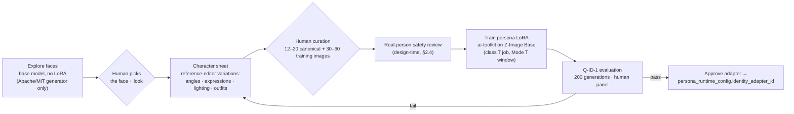

# 07 — Content Production Pipeline

> **Ownership (2026-10-18 update):** everything in this document that happens inside ComfyUI is Track A's: graphs, models, LoRA training and swaps, degradation ladders and identity scoring. The platform side (job orchestration, contract gateway, ingestion, QA decision, approvals, publishing) is implemented in [`apps/platform`](../apps/platform/README.md) against the [Visual Engine Contract](../contracts/visual-engine/README.md). Status: [doc 16](16-implementation-status.md).

> Status: Proposed — **revised 2026-10-18: all generation and validation run locally in ComfyUI and the Inference Host** · Related: [13 GPU scheduling](13-gpu-scheduling-and-capacity.md), [15 local model stack](15-local-model-stack.md), [06 agents](06-agent-system.md)
>
> Model names refer to the **recommended candidates** in doc 15. Production uses whichever candidate wins the Stage-0 bake-off; the workflow keys stay the same.

## 1. Pipeline overview


- **Idempotent steps.** Each box is a job keyed by `(content_item_id, step, revision)`. Pipeline state lives on `content.content_items.status` (doc 05 §3.1), so a crash resumes from persisted state.
- **GPU work is a queue row.** Every GPU step is an `inference.gpu_jobs` row, scheduled by the arbiter (doc 13 §6.2):
  - fair share across personas;
  - deadline-aware;
  - grouped into **model campaigns** (all image jobs on the loaded base model, then edits, then video), so expensive model loads are amortized across all 30 personas.
- **Generated ahead.** The calendar is produced 3–5 days ahead, so GPU contention never threatens a publish slot.

## 2. Identity system (visual consistency without non-commercial dependencies)

**Constraint (doc 15 §2.4):** the popular face-identity adapters (IP-Adapter FaceID, InstantID, PuLID, InfiniteYou, ReActor) depend on InsightFace models, whose pretrained weights are **non-commercial**. They are not used. Consistency comes from these instead:

1. **A per-persona LoRA** on the licence-clean base model.
2. **A reference-edit model** for controlled variations.
3. **A detail pass** with the persona LoRA.
4. **Automated identity scoring** with commercially licensed face models, then human approval.

### 2.1 Persona onboarding (one-time per persona, Mode T for training)



- **Dataset hygiene.** Training images come only from Apache/MIT generators and editors (doc 15 §1, principle 5). The dataset manifest is stored in `identity.model_adapters.dataset_manifest_ref`.
- **Training cost** is a measured GPU-time quantity (B-TRN-1) and is scheduled in Mode T windows. Onboarding 30 personas is a **multi-week training campaign**. The rollout plan (doc 10) paces it.
- **LoRA versions** are kept with their eval metrics. Retraining triggers:
  - a base-model upgrade;
  - an identity pass rate below threshold for 7 days;
  - a persona look change, which needs a new persona version and approval.

### 2.2 Visual identity spec

Same as before: `persona_versions.visual_identity` holds machine-checkable attributes, for example:

- hair colour, length and texture;
- eye colour;
- distinguishing marks;
- `age_presentation: "adult, mid-20s"`;
- build, palette, photography style.

### 2.3 Calibration set and thresholds

About 200 labelled images per persona:

- *positives*: approved outputs;
- *hard negatives*: other personas and similar synthetic faces;
- *off-model*: rejected candidates.

They set the face-similarity threshold (target false-accept rate ≤ 5%) and the VLM attribute-check agreement (Q-VLM-1). The set is **re-run on any base model, LoRA, quantization or ComfyUI change** (re-benchmark triggers, doc 14 §6).

### 2.4 Real-person safety (local)

No commercially licensed **local** celebrity-recognition model was identified (doc 15), so the control is layered:

1. **The persona face originates from synthetic exploration.** No real-person photos are ever used as references or training data. Recorded in the persona's onboarding record.
2. **Design-time review:**
   - a human performs manual reverse-image searches of the canonical face on public search engines;
   - counsel signs off on the persona likeness;
   - the result is stored as evidence on the persona version.
3. **Per-asset canon lock.** Every output must be close to the persona's *own* approved canon (face-similarity threshold). Drift away from canon is rejected, which bounds the risk of a resemblance appearing later.
4. **Takedown intake** with a 48 h SLA (unchanged).

The **residual risk is accepted and recorded** (doc 03, R8).

## 3. Workflows

*(Superseded on the platform side by `inference.visual_workflows`, which holds contract manifests with no graphs; see doc 16 §6. The list below is guidance for Track A's engine.)* All ComfyUI workflows are versioned:

- the API-format graph and parameter bindings;
- pinned models and custom nodes;
- measured VRAM and time;
- degradation profiles (OOM ladder).

**A workflow can't be approved without measured peak VRAM** (DB constraint).

### W1 — Image generation (`img.persona.*`)

| Step | Detail |
|---|---|
| Input | Brief, target rating, placements, persona version, identity adapter, candidate cap (default ≤ 8 per final; config), GPU-second budget per item (= cap × measured unit cost) |
| Prompt compile | Deterministic template (`content.prompt_templates`) + visual canon + LoRA trigger token + scene from the brief + negative constraints (no text/logos, no minors, no real people, rating guard phrases). Rendered prompt and seed stored on `generation_jobs.prompt`. |
| Workflow | Base generator (Z-Image-Turbo or bake-off winner) + persona LoRA → sampler at the placement resolution → **face detail pass**: face detection with MediaPipe/YuNet, inpaint at higher resolution with the same LoRA → save original PNG |
| Execution | One `inference.gpu_jobs` row per candidate batch (class B, `est_vram_mb` / `est_gpu_seconds` from the workflow's measured profile). The ComfyUI driver binds parameters, submits `/prompt`, tracks the websocket, collects `/history` outputs, and registers them atomically into the content store and `content.media_assets`. |
| Variations | **W1b reference edit** (`img.edit.*`, e.g. Qwen-Image-Edit-2511 or FLUX.2 klein 4B multi-reference): outfit, scene or pose changes from an approved still with the persona references. Output re-enters W2 like any candidate. |
| Accounting | `gpu_seconds` and attributed energy per job → `analytics.usage_events` (category `image_generation`) |

### W2 — Character consistency and asset validation (all local)

All checks write `content.validation_results`. **Hard** checks fail an asset; **soft** checks rank.

> **Local models have no vendor safety layer.** Cloud generators refuse many prohibited prompts; local models don't. Our prompt-layer checks and these validators are therefore the *only* automated barrier before human approval. They are stricter than the cloud design.

| Check | Method | Threshold (initial; calibrated) | Hard? |
|---|---|---|---|
| Technical | Pillow/sharp metadata: resolution, aspect vs. placement, colour profile, size | Placement spec | Hard |
| Identity: face | YuNet face detection + **SFace** embedding cosine vs. 3 canonical references (max) | Calibrated threshold, FAR ≤ 5% on hard negatives (§2.3) | Hard |
| Identity: attributes | **VLM** (the multimodal chat model or a dedicated VLM, doc 15) with a structured checklist from `visual_identity` | All "must" attributes true | Hard |
| Artifacts | VLM checklist: hands, eyes, teeth, limbs, warped text, background anomalies | No "severe" findings | Soft (severe = hard) |
| NSFW | Ensemble: **opennsfw2 + Falconsai** classifier | Either above threshold → fail | Hard |
| Rating classification | VLM rubric → `general` / `suggestive` / `mature` / `explicit` | `assessed_rating ≤ target_rating ≤ channel ceiling`. If the VLM and the NSFW ensemble disagree, the asset goes to a human. | Hard |
| Minor safety | Prompt-layer guard (Qwen3Guard + deterministic rules) + VLM age-presentation attribute | Any minor signal → quarantine + human | Hard |
| IP / brand / text | VLM logo/brand/legible-text check + OCR (Tesseract, Apache-2.0) | No third-party logos or legible brand marks unless sponsored and approved | Hard |
| Duplicate | Perceptual hash vs. the last 180 days of published media, **across all personas** (also catches cross-persona reuse) | Hamming distance > 8 | Soft |
| Brief fit | VLM score against the brief rubric | Rank only | Soft |
| Aesthetic | LAION improved-aesthetic-predictor | Rank only | Soft |

**Where the checks run:**

- SFace, YuNet, opennsfw2, Falconsai, pHash and OCR run in the Inference Host. GPU vs. CPU placement comes from benchmarks.
- **VLM checks go through the chat engine at background priority.** They use only idle concurrency (doc 13 §6.3), so validation never delays fans. Under sustained chat load, validation waits within the publish-deadline slack.

When every candidate fails, the item **regenerates with feedback**: failed attributes are added to the prompt, and seeds and references are varied, all within the item's GPU-second budget. When the budget is exhausted → `needs_rework`, with a summary for the content manager.

### W3 — Video generation (`vid.i2v.*`) — Reels, Stories, Telegram video

1. **Keyframe first.** The key still(s) go through W1/W2 and are approved. **Video always starts from an approved, on-model still.** This is the main consistency and GPU-cost lever.
2. **Image-to-video, class H GPU job:**
   - **Primary:** Wan2.2-I2V-A14B (fp8) with step-distill LoRAs (Lightning/lightx2v, Apache).
   - **Drafts and volume:** Wan2.2-TI2V-5B.

   The default shot is the model's native length, about 5 s. Profiles (resolution, frames, offload/block-swap) are defined per mode in the workflow's `degradation_profiles`, and **which profiles fit in Mode S vs. M is measured** (B-VID-1).
3. **Post-processing (CPU/NVENC or small GPU jobs):**
   - RIFE frame interpolation to 30 fps;
   - optional upscale (SeedVR2/FlashVSR);
   - ffmpeg assembly of 2–3 shots into a Reel (cuts, burned captions, loudness normalization).
   - **Audio:** none, or royalty-free tracks we hold rights to. No platform music via API. TTS voice-over is post-MVP (doc 15).
4. **Video validation:**
   - frames sampled at 2 fps;
   - SFace identity on each face frame: the **median** and the **5th percentile** must pass;
   - NSFW ensemble + VLM rating on sampled frames;
   - temporal consistency: face-embedding variance below threshold, so there is no "face morphing".
5. **Budget:** ≤ 3 attempts per shot (config), within the persona's GPU-second quota.

### W4 — Instagram content

| Placement | Rendition | API flow |
|---|---|---|
| Feed image | JPEG ≤ 8 MB, 4:5 (1080×1350) | `POST /{ig-id}/media` (`image_url`, `caption`, `alt_text`, `is_ai_generated`*) → poll `status_code` → quota check → `POST /{ig-id}/media_publish` |
| Carousel | 2–10 JPEG items, consistent aspect | child containers (`is_carousel_item=true`) → parent `media_type=CAROUSEL` → publish (counts as 1 post) |
| Reel | MP4 9:16, 3s–15min, ≤ 300 MB, cover JPEG | `media_type=REELS`, `video_url`, `cover_url`, `share_to_feed` → poll until `FINISHED` → publish |
| Story | JPEG 9:16 ≤ 8 MB, or MP4 3–60s ≤ 100 MB | `media_type=STORIES` → publish. No link or poll stickers via API. |

\* `is_ai_generated` is used only once Stage 0 confirms it. Until then: disclosure in the caption plus C2PA, and for photorealistic video the reviewer applies the in-app AI label. The publish checklist enforces this.

**Publishing rules:**

- **Media URLs** are **signed, short-lived URLs served by `api` through the Cloudflare Tunnel** (`/m/{path}?exp&sig`, TTL ≤ 2 h, only for assets on an approved publication). Meta's fetcher downloads from them.
- The container is created ≤ 30 min before the slot. The 100-per-24h quota is checked first and recorded in `quota_snapshots`.
- **Idempotency key** `ig.publish:{publication_id}`. A timeout on `media_publish` → `unknown`, then the reconciler matches recent media on caption and timestamp. Never re-publish blindly.
- **Disclosure:** captions carry the AI disclosure; the bio carries the persona disclosure; the **"AI-generated profile"** label is enabled in the app.
- **Link policy:** SFW Telegram channel and bot only. No adult CTAs.
- **No cross-persona engagement automation:** personas don't like, comment on or promote each other's posts automatically. This avoids patterns resembling a coordinated network (doc 03).

### W5 — Telegram exclusive content

| Destination | Mechanism | Revenue attribution |
|---|---|---|
| Free channel posts | `sendPhoto` / `sendVideo` / `sendMediaGroup` (album ≤ 10) with caption and deep link `t.me/<bot>?start=<campaign_token>` | Funnel attribution via the start token |
| Free channel teaser (paid media) | `sendPaidMedia` in the channel (optional) | Stars go to the **channel** balance; no per-user event → aggregate only |
| Premium channel posts | Same send methods to the private channel | Covered by the subscription entitlement |
| **PPV sets in bot DMs** | `sendPaidMedia(chat_id=fan, star_count, payload=signed offer id)` | `purchased_paid_media` → payment + perpetual `media_unlock` entitlement |

- Files are uploaded **directly from the local content store** (multipart). After the first upload, the `file_id` is stored per bot and reused; file IDs aren't portable across bots.
- Files ≤ 50 MB through the Bot API (larger needs a local Bot API server; post-MVP).
- The same approval and hash binding applies.

### W6 — Caption and copy generation

- Generated by the **local chat model** (Social Media agent) in the persona's writing style, per platform.
- Limits: IG ≤ 2,200 chars, ≤ 30 hashtags (policy limit is lower); Telegram media captions ≤ 1,024 chars.
- Checks, recorded in `validation_results`:
  - text guard (Qwen3Guard);
  - **disclosure present**;
  - **link policy**;
  - **sponsored-content** rule;
  - **canon consistency** against `canon_facts`, a local LLM check that flags contradictions;
  - banned claims (medical, financial, "I'm a real person", meet-ups).

### W7 — Content moderation layers (defense in depth)

1. **Prompt layer:** brief and compiled prompt checked against banned themes and the rating ceiling **before any GPU time is spent**.
2. **Workflow layer:** negative prompts; only approved models and LoRAs. No model can be loaded unless it is approved in `inference.models`.
3. **Asset layer:** W2 checks.
4. **Copy layer:** W6 checks.
5. **QA agent pre-screen:** a policy rubric over the whole package.
6. **Human approval** (L2) with a checklist.
7. **Post-publish:** comment and complaint monitoring; takedown intake (48h).

### W8 — Human approval

Unchanged: one revision at a time, with assets, runner-up candidates, validation scores, caption diff, channels, schedule, rating, disclosures and QA findings.

- Actions: approve, request changes, reject, edit caption inline.
- Batch approval for calendars and Story sequences.
- Two approvals for sponsored items and a persona's first post in a new format.
- **Scale note:** at 20–30 personas the reviewer workload is a capacity limit like the GPU. Review minutes per item are measured. The persona count per stage is bounded by staffed review hours (doc 10).

### W9 — Scheduled publication

The scheduler polls `publications_due_idx` every minute and re-checks before enqueueing:

- kill switches and `publish_frozen`;
- the authorization hash vs. the revision hash;
- token validity;
- the platform quota;
- that the content policy is unchanged.

Publish jobs are idempotent; insights snapshots follow at +1h, +24h and +7d.

**Manual fallback:** if the API is down past the slot, the dashboard offers a "download package" for manual posting.

## 4. Model routing and eligibility

Routing is data: `identity.workflow_bindings` (per influencer, per purpose, SemVer range) → `inference.visual_workflows` (approved contract manifest). Behind the contract, Track A maps a workflow version to its models; licence evidence is part of the platform approval. Swapping the base generator is a new workflow version plus a new LoRA per persona, so it is a **campaign**, not a toggle. That is why the bake-off happens before persona onboarding scales (doc 10).

| Capability | Workflow key | Default model (doc 15) | Rating ceiling (our policy) |
|---|---|---|---|
| Persona image | `img.persona` | Z-Image-Turbo + persona LoRA (bake-off winner) | `suggestive` |
| Reference edit | `img.edit` | Qwen-Image-Edit-2511 / FLUX.2 klein 4B | `suggestive` |
| Upscale / detail | `img.upscale`, `img.detail` | Real-ESRGAN; MediaPipe/YuNet + LoRA inpaint | — |
| Image-to-video | `vid.i2v` | Wan2.2-I2V-A14B fp8 + distill LoRA | `suggestive` |
| Draft video | `vid.draft` | Wan2.2-TI2V-5B | `suggestive` |
| Lip-sync (post-MVP) | `vid.lipsync` | InfiniteTalk | `general` |

## 5. Configurable content policy (example)

Stored in `identity.content_policies.rules`; the version is pinned on each approval. Budgets are **counts and GPU-second multipliers of measured unit costs**, not money.

```json
{
  "max_rating": "suggestive",
  "channel_max_rating": {
    "instagram_account": "suggestive",
    "telegram_public_channel": "suggestive",
    "telegram_premium_channel": "suggestive",
    "telegram_bot": "suggestive"
  },
  "banned_themes": ["minors", "school_settings", "real_people", "weapons", "drugs", "self_harm",
                    "medical_claims", "financial_advice", "political_campaigning", "hate", "gore"],
  "required_disclosures": {
    "instagram_caption": "#AIgenerated",
    "telegram_caption_suffix": "🤖 AI-generated",
    "on_image_mark": { "enabled": true, "style": "corner_small", "channels": ["telegram_*"] }
  },
  "sponsored": { "require_disclosure": "#ad", "blocked_categories": ["adult", "gambling", "crypto_trading", "weight_loss_claims"] },
  "link_policy": { "allowed": ["t.me/<free_channel>", "t.me/<bot>"], "forbid_adult_cta": true },
  "generation_limits": {
    "max_candidates_per_final_image": 8,
    "max_video_attempts_per_shot": 3,
    "item_gpu_seconds_cap_multiplier": 1.5
  },
  "identity_thresholds": { "face_similarity_min": "calibrated", "video_face_p5_min": "calibrated" }
}
```

`item_gpu_seconds_cap_multiplier` × (measured `c_img_final` or `c_vid_second`, doc 13 §7.2) = the hard per-item cap.

## 6. Provenance and disclosure

- **Local models don't sign their outputs.** We sign. At generation time the Inference Host writes a **C2PA manifest** (c2pa-rs, our own certificate) on the original. It contains:
  - `digitalSourceType = trainedAlgorithmicMedia`;
  - the generator model and version, workflow key/version, LoRA version, and generation job id.
- **Derived renditions** (resize, JPEG, burned captions, video assembly) are re-signed with an ingredient link to the original. IPTC metadata carries the same digital-source type, so platforms such as Meta can auto-detect AI content.
- **Visible disclosure:** captions on every channel, plus the configurable on-image mark. Under EU Art. 50 guidelines a photorealistic invented person is a deepfake, so counsel decides the final default.
- `media_assets.provenance` records model, workflow, LoRA, seed, prompt reference and manifest id. Any published asset traces back to its GPU job and approval.

## 7. Throughput, timing and review load

**No timings are asserted here.** Per-workflow GPU time (`t_img`, `t_edit`, `t_vid`) comes from doc 14 (B-IMG-2/3, B-VID-2). Per-persona and total feasibility comes from the doc 13 §7.2 capacity model.

Human review targets are **process goals**, measured from `approval_decisions` timestamps:

| Format | Review target |
|---|---|
| Feed image | ≤ 2 min |
| Carousel | ≤ 4 min |
| Story sequence | batch |
| Reel | ≤ 5 min |
| Premium set | ≤ 5 min |

At Stage 4 (20–30 personas), daily review minutes = Σ items × measured review time. This must fit staffed reviewer hours, which is a gate input (doc 10/11).
