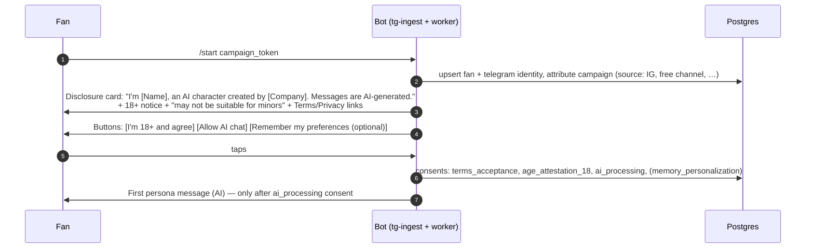
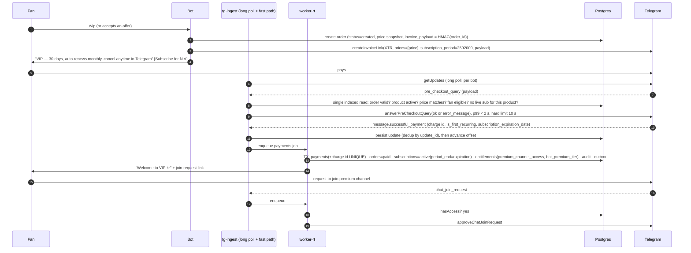
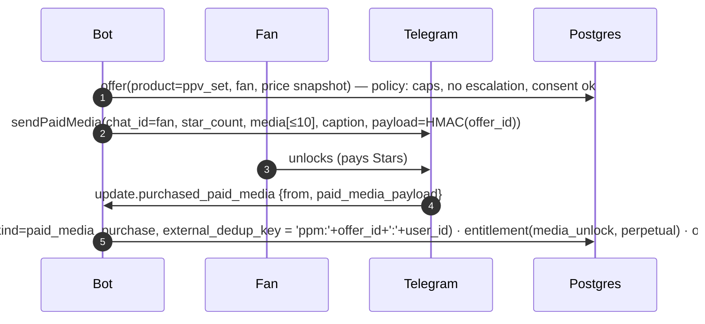

# 08 — Telegram Monetization & Entitlements

> Status: Proposed — **revised 2026-10-18: 30 personas (30 bots) on one workstation; ingestion by long polling; payments never depend on the GPU** · Evidence base: [02-platform-capabilities](02-platform-capabilities.md) §2 (mostly **V**, verbatim Bot API 10.3 text)

## 1. Key decisions

| # | Decision | Why |
|---|---|---|
| M1 | **Stars (`XTR`) is the only payment rail** inside Telegram | Telegram requires Stars for digital goods (V) |
| M2 | **The premium channel is sold as a bot Star subscription**, and channel access is enforced by **join requests the bot approves** | Native channel-subscription links give the bot no payment or renewal events, and their revenue isn't in the bot's ledger (V). With a bot subscription we see `SuccessfulPayment`, renewals and `subscription` state updates (V). |
| M3 | **PPV (locked media) is sold in bot DMs** via `sendPaidMedia` with a payload | `purchased_paid_media` events and bot-balance revenue only exist outside channels (V) |
| M4 | **Paid AI interactions = message credits + premium-tier allowance**, not per-message invoices | Avoids an invoice per message; credits are refundable when unused, which addresses Telegram's caution about non-reclaimable real-time services (V) |
| M5 | **One entitlement engine** is the single source of truth for every access decision | Bundles, promos, refunds, erasure and audits all work the same way |
| M6 | **Revenue is accounted in Stars.** Fiat is an estimate under a named valuation; realized fiat comes only from recorded payouts. | Stars have no fixed USD value (V: "sole discretion", "no inherent value") |
| M7 | **Never enable topics in private chats** | Triggers a 15% non-refundable fee on all Stars purchases (V) |

## 2. Product catalog (MVP)

Prices are **placeholders in Stars**, to be set by the Monetization agent's proposals and experiments (L2, two approvals). Rules:

- subscriptions are fixed at 30 days and capped at 10,000 Stars;
- paid media is 1–25,000 Stars.

| SKU | Kind | Grants | Notes |
|---|---|---|---|
| `vip_monthly` | `premium_channel_subscription` (bot Star subscription, 30d) | `premium_channel_access` (period) + `bot_premium_tier` (period) | Bundle: premium channel + higher daily chat allowance |
| `ppv_<set>` | `paid_media` | `media_unlock` (perpetual) | 5–10 photos or 1 short video, sent as paid media in the bot DM |
| `chat_100` / `chat_300` | `message_pack` | +100 / +300 credits | Credits don't expire for 12 months (configurable); unused credits are refundable |
| `tip_*` | `tip` | none (thank-you message) | Optional; capped frequency |
| `custom_request` | `custom_request` | `custom_request` entitlement | **Post-MVP.** Personalized SFW content with a human-approved production SLA. |

**Free tier:** after consent, *N* free AI replies per day (e.g. 15). The premium tier allows, say, 150 per day. Credits apply beyond that. Allowances are configurable per influencer.

## 3. Entitlement engine

```text
EntitlementService
  hasAccess(fan, kind, resourceId, at = now) -> boolean        // indexed query, cached ≤ 30 s
  grantFromOrder(orderId)                                    // idempotent on (source_type, source_id)
  extendFromSubscription(subscriptionId, periodEnd)          // idempotent on payment charge id
  revoke(entitlementId | source, reason)                     // emits EntitlementRevoked
  consumeCredits(fan, influencer, n, idempotencyKey)         // row-locked balance + ledger insert
  sweepExpired(now)                                          // active → expired; emits events
```

Enforcement adapters subscribe to entitlement events, so access changes propagate to the platforms:

| Adapter | On `EntitlementGranted` | On `EntitlementExpired/Revoked` |
|---|---|---|
| `PremiumChannelEnforcer` | DM the fan the channel's join-request link; approve their pending join request if one exists | `banChatMember` + `unbanChatMember(only_if_banned)` (removes the fan and lets them rejoin later); update `channel_memberships` |
| `BotTierGate` | Raise the daily allowance immediately | Drop to the free allowance |
| `MediaUnlock` | Nothing; Telegram enforces paid-media access itself. Record only. | Perpetual by Telegram's rules (buyers keep access); on refund we revoke our record only |

The premium channel's **only** invite link is a join-request link (`creates_join_request=true`). Every `chat_join_request` is checked against `hasAccess(fan, 'premium_channel_access', channel)`:

- **entitled** → `approveChatJoinRequest`;
- **not entitled** → `declineChatJoinRequest`, followed by a DM to the fan with the VIP offer. Messaging a fan who sent a join request is a documented Bot API behavior (`user_chat_id`, short window), but it must be **verified in Stage 0**.

## 4. Flows

### 4.1 Onboarding, consent and disclosure (prerequisite for everything)



- Without `ai_processing` consent, the fan can only browse menus (`/vip`, `/about`, `/paysupport`). No AI reads their messages.
- Commands are always available:
  - `/about`: what this is, who operates it, that it is AI;
  - `/memory` and `/forget`: view or delete stored memory;
  - `/stopai`: withdraw AI-processing consent;
  - `/deletemydata`: full erasure;
  - `/paysupport`: payment support (mandatory);
  - `/terms`, `/privacy`.

### 4.2 VIP subscription purchase (bot Star subscription)



**Failure handling:**

- If `successful_payment` processing fails, the inbound row persists and the job retries. A DLQ entry pages someone immediately, because the fan paid.
- The daily reconciliation (§4.8) catches any payment that never reached `payments`.

### 4.3 Renewal, cancellation, failed renewal

| Telegram signal (V) | Our transition | Side effects |
|---|---|---|
| `SuccessfulPayment` with `is_recurring=true`, `is_first_recurring=false` | `active` (period extended to the new `subscription_expiration_date`); `renewal_count++` | Extend entitlements (new rows per period, sourced from the payment) |
| `subscription` update, `state="canceled"` | `cancelled` (access until period end) | Optional "sorry to see you go" message (no pressure); win-back eligibility after expiry, only with marketing opt-in |
| `subscription` update, `state="active"` (re-enabled) | `active` | — |
| `subscription` update, `state="failed"` | `payment_failed`; grace window = 48h | Notify the fan once with neutral wording |
| Period end + 1h skew with no renewal payment (cancelled), or grace elapsed (failed) | `expired` | Revoke entitlements → `PremiumChannelEnforcer` removes the fan from the channel |

**Stage 0 test item:** confirm whether renewals send a `pre_checkout_query`. The fast path accepts renewal pre-checkouts for live subscriptions either way.

### 4.4 Expiry sweeper and membership audit

- **Every 5 minutes:** `entitlements` with `valid_until < now()` and `status='active'` → `expired`. Events drive removal from the channel.
- **Every 6 hours:** for each `channel_memberships` row with `status='member'`, check `getChatMember` for anyone without an active entitlement. Remove them, or flag them for review if the rows disagree (e.g. a manual admin add). Because entry is only through approved join requests, the expected discrepancy count is 0. Any discrepancy raises an alert.
- **Admins** (staff, test accounts) are allowlisted in config and never removed.

### 4.5 PPV (locked media in bot DMs)



- The `purchased_paid_media` update carries no charge id (V: fields are `from` and `paid_media_payload`). The dedup key is therefore derived from our signed payload plus the user id. The daily reconciliation matches the bot's `StarTransaction` (partner User, `transaction_type=paid_media_payment`) to the payment by user and time window.
- A PPV set is approved content (W5/W8) with its own `content_item`. The same set can be offered to many fans; each offer is a separate payload.

### 4.6 Message credits (paid AI interactions)

1. Each AI reply that goes out (not drafts or failures) calls `consumeCredits(fan, influencer, 1, 'consume:' + message_id)` **unless** it is inside the day's free or premium allowance.
2. Allowance usage lives in `monetization.daily_allowances`: one row per fan, persona and day, consumed atomically with `UPDATE … WHERE used < daily_limit`. It is persistent, auditable, and survives restarts. Daily limits come from `persona_runtime_config` and may be lowered intra-day by load shedding (doc 13 §6.4). Already-consumed replies are never clawed back.
3. When the allowance and credits are both exhausted, the persona sends **one** neutral message showing the options:
   - wait until tomorrow;
   - buy a credit pack (invoice link);
   - or VIP.

   No repeated nagging: the offer caps apply.
4. Credit pack purchase: a normal one-time invoice. On `successful_payment`, `credit_ledger +N` and the balance is updated in the same transaction.
5. **Escalation, disclosure and safety messages never consume credits.**

### 4.7 Refunds and `/paysupport`

- `/paysupport` opens a support conversation, assigned to a human queue (the finance or operator role). It shows the fan's recent purchases (Stars amounts, dates) and asks what went wrong.
- **Refund decision** is L2 (finance). Guidelines, to be confirmed by counsel:
  - full refund on technical failure (paid but not delivered);
  - unused credits are refundable;
  - subscription refunds are discretionary within 7 days.
- Execution, as one idempotent sequence:
  1. `refundStarPayment(user_id, charge_id)` with the idempotency key `refund:{payment_id}`;
  2. `refunds=completed`;
  3. revoke the related entitlements;
  4. for subscriptions, `editUserStarSubscription(is_canceled=true)`;
  5. for credits, reverse the unused portion in the ledger.
- **Chargebacks** (debited by Telegram, V) appear in the `getStarTransactions` reconciliation as unmatched outflows. They raise an alert, revoke the access and flag the fan.

### 4.8 Daily reconciliation

1. Page through `getStarTransactions` since the last cursor and upsert into `monetization.star_transactions`.
2. Match incoming transactions to `payments` (`StarTransaction.id` = `telegram_payment_charge_id`; paid-media purchases by user and time). Match outgoing transactions to refunds, withdrawals (partner Fragment) and other debits.
3. Raise an alert on:
   - unmatched incoming transactions (a missed grant → auto-repair job);
   - unmatched outgoing ones (chargeback, unexpected debit);
   - `payments` without a transaction after 24h.
4. Snapshot `getMyStarBalance` for finance.
5. KPI rollups for the day run **after** reconciliation, so revenue numbers match Telegram's ledger.

### 4.8a Payment integrity on a single host (outage recovery)

Payments never touch the GPU. The single workstation can still be offline, so recovery is designed in:

| Outage length | What happens | Recovery |
|---|---|---|
| Inference engines down, host up | Payments, entitlements and membership work normally; chat sends holding messages | None needed for money paths |
| Host/internet down < 24 h | `pre_checkout_query` gets no answer, so Telegram fails the checkout and **the fan isn't charged**. Updates (incl. `successful_payment` for checkouts approved just before the outage) stay queued at Telegram for ≤ 24 h. | On restart, `tg-ingest` drains each bot's queue in order; idempotent grants; then **immediate reconciliation** against `getStarTransactions` for all 30 bots |
| Host down > 24 h | Telegram may drop queued updates | `getStarTransactions` is the authority: any incoming transaction without a `payments` row → auto-repair job creates the payment and grants the entitlement; the fan gets an apology plus the access message. Subscription state is re-derived from transactions and `subscription` updates. |
| Expiry sweeps missed during the outage | Expired fans stay in the premium channel longer than intended | Sweeper catches up on restart (idempotent); the membership audit runs immediately |

Drills B-FAIL-4/5/6 (doc 14) prove these paths before each rollout gate. **The acceptance bar is zero payment discrepancies after reconciliation.**

### 4.8b Thirty bots

- One bot per persona means separate Stars balances, transaction ledgers and payouts **per bot**.
- Reconciliation iterates all bots (cursor per bot in `core.poll_cursors`).
- Finance records payouts per bot owner account. ~20 bots per BotFather owner (reported), so there are two company-controlled owner accounts (doc 04 §9).
- Private-chat topics must stay disabled on **every** bot (15% fee rule). The startup assertion checks all 30.

### 4.9 Optional experiment: native channel subscription link

`createChatSubscriptionInviteLink` can be tested on a *separate* premium channel variant for funnel comparison.

- **Known trade-offs (V):** no payment or renewal events for the bot; revenue goes to the channel balance; the only per-user signals are `chat_member` updates with the `invite_link.subscription_*` fields and `ChatMemberMember.until_date`.
- **Implementation:** `rail='channel_subscription_link'` subscriptions are inferred from membership events. Their revenue is reported as *estimated*, from the price × joins, and reconciled with channel-balance snapshots by finance.
- Not in the MVP critical path.

### 4.10 Funnel attribution

| Source | Mechanism |
|---|---|
| Instagram bio / Story / caption | `t.me/<bot>?start=<token>`. The token is created per campaign or placement (`crm.link_tokens`, purpose `campaign_attribution`). IG DMs can carry a per-fan token to link identities, with the fan's consent. |
| Free channel posts | Per-post start tokens |
| Premium channel | Join-request approvals carry `invite_link` → entitlement source |
| Bot | `analytics.events`: `bot_started`, `consent_given`, `first_ai_reply`, `offer_shown`, `invoice_created`, `pre_checkout_ok`, `paid`, `renewed`, `cancelled`, `expired`, `refunded` |

## 5. Metrics definitions

All metrics are computed per influencer per day (`analytics.daily_influencer_kpis`) and rolled up. Stars are the primary unit.

| Metric | Definition |
|---|---|
| Gross revenue (⭐) | Σ `payments.amount_stars` by `received_at` |
| Net revenue (⭐) | Gross − completed refunds − chargeback debits (from reconciliation) |
| Purchases | Count of payments of kind `one_time` + `paid_media_purchase` (subscriptions are reported separately) |
| New subscriptions | Count of `subscription_initial` payments |
| Renewals | Count of `subscription_renewal` payments |
| Active subscribers (t) | Subscriptions with status ∈ {active, cancelled, payment_failed within grace} and `current_period_end > t` |
| Renewal rate | Renewals in period ÷ subscriptions whose period ended in that period |
| Subscriber churn (monthly) | Subscriptions that expired during the month ÷ active subscribers at month start |
| Conversion: start → consent | Fans with `consent_given` ÷ fans with `bot_started` |
| Conversion: consent → first purchase (30d) | First paying fans within 30d ÷ consenting fans in the cohort |
| Conversion: free channel → bot | `bot_started` with a channel token ÷ new free-channel members (member counts via `getChatMemberCount` deltas) |
| ARPPU (⭐) | Net revenue ÷ paying fans in period |
| Revenue per influencer | All revenue metrics grouped by `influencer_id` |
| AI operating cost ($) | Σ `usage_events.cost_usd` by category (llm, image, video, moderation, face_check, …) |
| Cost per active chatter ($) | LLM + guard costs for conversations ÷ fans with ≥ 1 AI reply |
| **Est. contribution margin ($)** | Net revenue (⭐) × fiat-per-Star (valuation *v*) − variable costs (AI + media + moderation + vendor fees) |
| Realized contribution margin ($, monthly) | Payout fiat realized − variable costs, for the Stars withdrawn in the month (finance view) |

### Star valuation (no fixed USD value)

- `monetization.star_valuations` stores dated fiat-per-Star values, each with a **method**:
  - `platform_quoted_rate`: Telegram's developer terms quoted "an equivalent of 0.013 USD" per Star as of 2026-10-14, at Telegram's sole discretion (V). It must be re-entered when Telegram changes it.
  - `realized_payouts_trailing_90d`: computed from `payouts` once withdrawals exist. **This becomes the default** after the first two payouts.
  - `finance_manual`.
- Every fiat KPI stores `star_valuation_id`. The dashboard labels these as **estimates** and shows the method.
- Treasury notes: a 21-day hold before Stars can be withdrawn, and Stars expire after 3 years (V). Finance withdraws on a regular schedule, and an accountant defines revenue recognition (risk R9).

## 6. Telegram personal/business account (Module 5)

| Aspect | Design |
|---|---|
| Account | Company-owned phone number and Telegram account for the persona; 2FA; recovery in the vault; bio: "AI character · messages are AI-assisted and managed by <Company>" |
| Automation method | **Telegram Business → Chat Automation → connect our business bot.** No Premium required (V, Bot API 10.0). One bot per account. **No userbots.** |
| Rights requested | `can_reply`, `can_read_messages` only |
| Operation mode | **Human-operated; AI drafts (L2) only** in the MVP. The operator approves drafts in the dashboard; the bot sends via `business_connection_id`. |
| Constraints | `can_reply` only in chats with an incoming message in the last 24h (V). The owner can pause the bot per chat. |
| Consent | Before AI drafts for a counterpart: a consent request explaining that AI assists and data is processed by our provider. Until consent is given, the chat is human-only with no AI processing (Telegram business-bot ToS: no third-party API sharing without authorization; never conceal activity; V). |
| Shared identity and memory | The counterpart's Telegram user id maps to the same `crm.fans` row as the bot. Memory is per influencer, so persona continuity holds across bot and business account. Memory use still requires `memory_personalization` consent. |
| Monetization | Post-MVP: invoice links and paid media on the account's behalf (V). Requires the same entitlement flow. |

## 7. Abuse and safety controls in monetization

- **Offer caps**, enforced by the Policy Engine:
  - ≤ 2 offers per day per fan, and ≤ 1 unsolicited offer per 48h;
  - none during escalations or within 72h of a crisis flag;
  - none to `restricted` fans or suspected minors.
- **Spend protection:**
  - optional user-set monthly cap (`/limits`);
  - an alert to an operator when a fan's 7-day spend exceeds a configurable threshold;
  - no "streak" or "loss" mechanics.
- **Copy rules:** prices always shown in Stars with the period; renewal terms are explicit; cancellation instructions are in the welcome message.
- **Refund-dispute monitoring:** the dispute rate per influencer is on the finance dashboard, with an alert at 1%.
