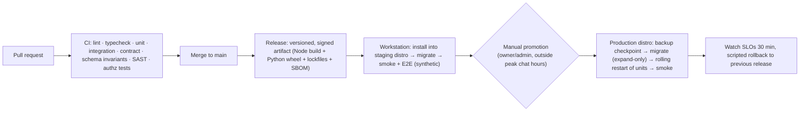

# 09 — Operational & Security Requirements

> Status: Proposed — **revised 2026-10-18 for the single Windows workstation with local inference** · Applies to staging and production unless stated otherwise

## 1. Identity and access

| Requirement | Design |
|---|---|
| Staff authentication | OIDC SSO (Google Workspace or Entra ID); **MFA enforced at the IdP** (phishing-resistant keys for owner/admin/finance). **Cloudflare Access** (free tier ≤ 50 users) in front of the dashboard and admin API on the tunnel; on-site LAN access still requires SSO. No local passwords. The workstation's Windows login uses a dedicated service account with a long random password (auto-login, §12); interactive admin logins use separate named accounts. |
| Sessions | Server-side sessions with an 8h idle / 24h absolute timeout; re-auth for critical actions (refunds, price changes, policy/autonomy edits, credential changes) |
| Authorization | RBAC with permission strings checked **server-side in command handlers**. Membership can be narrowed to specific influencers. |
| Separation of duties | Requester ≠ approver (DB trigger + app check). Two approvals for critical actions. Finance can't edit policies; compliance can't issue refunds. |
| Break-glass | A sealed owner account with hardware key; usage alerts all admins; reviewed in postmortem |
| Access reviews | Quarterly membership review; immediate offboarding runbook (revoke IdP, rotate shared platform credentials the person had seen) |
| Service identities | Each process type has its own DB role (`app_rw`, `app_ro`, `migrator`, `inference_svc`, `ops_ro`) and runs as its own Linux user under systemd. The Inference Host and engines bind to **localhost only**. |

### RBAC matrix (system roles)

| Permission ↓ / Role → | owner | admin | compliance_officer | content_manager | reviewer | chat_operator | finance | analyst | viewer |
|---|---|---|---|---|---|---|---|---|---|
| Workspace settings, members | ✅ | ✅ | — | — | — | — | — | — | — |
| Persona edit / activate (2 approvals) | ✅ | ✅ | approve | edit | — | — | — | — | — |
| Content policy & autonomy policies | ✅ | ✅ | ✅ (co-approve) | — | — | — | — | — | — |
| Kill switches | ✅ | ✅ | ✅ | — | — | — | — | — | — |
| Plan / brief / generate content | ✅ | ✅ | — | ✅ | — | — | — | — | — |
| Approve publications | ✅ | ✅ | ✅ | — | ✅ | — | — | — | — |
| Conversation inbox, takeover, approve drafts | ✅ | ✅ | read | — | — | ✅ | — | — | — |
| Fan PII view (identities, messages) | ✅ | ✅ | ✅ | — | — | ✅ (assigned influencers) | — | — | — |
| Products, prices (2 approvals) | ✅ | ✅ | — | — | — | — | ✅ | — | — |
| Refunds | ✅ | — | — | — | — | — | ✅ | — | — |
| Payouts & valuations | ✅ | — | — | — | — | — | ✅ | — | — |
| DSR / takedown handling | ✅ | ✅ | ✅ | — | — | — | — | — | — |
| Analytics & costs | ✅ | ✅ | ✅ | ✅ | — | — | ✅ | ✅ | ✅ (no PII) |
| Audit log search | ✅ | ✅ | ✅ | — | — | — | ✅ (finance scope) | — | — |
| Integration credentials (connect/rotate) | ✅ | ✅ | — | — | — | — | — | — | — |

Agents are principals with **action-type permissions** (`agent_definitions.allowed_action_types`), not human roles. They never read secrets.

## 2. Secrets and key management

| Secret class | Storage | Rotation |
|---|---|---|
| App runtime secrets (DB passwords, Meta app secret, HMAC keys for invoice payloads, link tokens and signed media URLs, Cloudflare tunnel token) | **SOPS + age** encrypted files per environment, decrypted at service start into a tmpfs (`/run/aios/secrets`, mode 0400, per-service user). The age private key lives in a root-only file on the BitLocker-encrypted disk, and a **paper/USB backup is held offline by two admins**. | HMAC keys with key-id versioning (old keys still verify during the overlap); Meta app secret on staff change |
| Platform credentials per persona (IG tokens, 30 Telegram bot tokens) | `core.integration_accounts`, **envelope-encrypted**: AES-256-GCM data key per workspace, wrapped by the **local master key** (`wrapping_key_id` records its version). Decrypted in memory only when needed; plaintext never logged. | IG tokens refreshed ~every 30 days; bot tokens rotated on staff change or suspicion (BotFather runbook); master key rotation re-wraps data keys (no data re-encryption) |
| BotFather owner accounts (2, ~20 bots each) and persona Telegram/IG accounts | Password manager (2 admins), 2FA everywhere, company-owned phone numbers, recovery codes offline | On staff change |
| Persona Telegram account / Meta Business account recovery | Vault (password manager with shared access for 2 admins), recovery codes, company-owned phone numbers | On staff change |

Controls:

- Secret scanning in CI (and GitHub push protection).
- Logs are redacted by a structured-logger allowlist (no raw payloads with tokens).
- Only the `worker-*`, `tg-*` and `api` service users can read the decrypted secrets for their own service. The Inference Host has **no platform credentials at all**: it can't post, message or charge.

## 3. Data protection and privacy

- **Encryption.**
  - In transit: TLS for every external connection (Telegram, Meta, tunnel, backups). Local services bind to localhost/Unix sockets.
  - At rest: **BitLocker** (TPM protector) on all workstation volumes; **client-side encryption** (restic/age) for every offsite backup. Telegram's developer terms require encryption at rest (V).
  - Field level: integration credentials and DSR claimant contacts.
- **Minimization.**
  - No phone numbers, emails or real names of fans are collected.
  - No fan media is retained in the MVP (AS6).
  - Message bodies are kept for 12 months.
  - Memory is consent-bound, with special-category data impossible to store (DB constraint).
- **Records.**
  - **DPIA** before launch (companion-chatbot, memory and vulnerable-user risks).
  - Record of processing activities.
  - **Sub-processors shrink sharply: no AI vendor ever receives fan data.** What remains:
    - Cloudflare (tunnel/Access; transit only);
    - the offsite backup provider (Backblaze B2 or Cloudflare R2; client-side encrypted);
    - Healthchecks.io (heartbeat pings, no personal data);
    - Telegram and Meta themselves.

    The list is published on the legal page.
- **Data residency.** Primary data lives on the workstation (its physical location is recorded in the DPIA). The offsite backup region is chosen to match (EU if the workstation is in the EU).
- **No training on fan data.** Telegram's terms prohibit it (V). Evals use synthetic or explicitly consented data only.
- **Meta platform data obligations:**
  - a privacy-policy URL and a data-deletion callback or instructions URL for the Meta app (served from the minimal legal page);
  - deletion of IG data when a user asks.
- **DSR handling:** `crm.data_subject_requests` with SLA timers. The erasure cascade is in doc 05 §7.

## 4. Application security

| Area | Requirement |
|---|---|
| Webhooks | Verify the Telegram secret header and Meta `X-Hub-Signature-256` (constant-time compare). Reject and alert on spikes of failures. Persist-before-ack. |
| Input validation | Zod schemas for every API input, webhook payload and agent output; size limits; reject unknown fields on admin APIs |
| Prompt injection | Untrusted text is delimited as data. Agents that read untrusted text have no high-risk tools. Output guard. Red-team suite in CI (doc 06 §9). |
| SSRF | No user-supplied URLs are fetched. Model downloads happen only in a maintenance procedure, from pinned sources, verified by SHA-256 (`inference.models.file_sha256`). |
| Local AI services | ComfyUI, the LLM engine and the Inference Host bind to **127.0.0.1**. ComfyUI's Manager / auto-install is **disabled in production**. Custom nodes are pinned by commit, reviewed and recorded in `custom_nodes_lock`, because custom nodes execute arbitrary code. Model files are read-only to engine users. |
| Signed media URLs | `/m/{path}?exp&sig`: HMAC over path + expiry, TTL ≤ 2 h, only for assets attached to an approved publication. Served through the tunnel for Meta's fetcher. Everything else on `api` requires Access + SSO. |
| File handling | MIME sniffing + size limits; images re-encoded via sharp; videos probed with ffprobe before processing |
| Admin web | CSP, HttpOnly/SameSite cookies, CSRF tokens, no third-party scripts except monitoring |
| Rate limiting | Per-user and per-IP on the admin API; per-fan on bot interactions (anti-abuse, cost protection) |
| Dependencies | Lockfiles (npm + Python `uv`/pip hashes), Renovate/Dependabot, `npm audit` / `pip-audit` gates (high/critical), SBOM per release; ComfyUI and custom nodes pinned by commit |
| Multi-tenancy | Tenant context required by the repository layer; RLS as backstop; automated cross-tenant access tests in CI |
| Telegram config guard | Startup assertion, per bot: private-chat topics **disabled** (15% fee rule); **no webhook set** (long polling and webhooks are mutually exclusive); exactly one poller per token (advisory lock) |

## 5. Audit logging

- **Every command** writes an audit row with:
  - the actor (user, agent run, system, external), action, subject and influencer;
  - the approval and proposal references;
  - request and trace ids;
  - redacted before/after values.
- **Append-only:** the app role lacks UPDATE, DELETE and TRUNCATE on `core.audit_log`, `monetization.payments`, `monetization.credit_ledger` and `approvals.approval_decisions`.
- **Tamper evidence:** an hourly sealing job hash-chains new rows per workspace (`core.audit_seals`). It exports seals and audit partitions to an **offsite object-lock bucket** (B2 Object Lock or R2 bucket lock) under a separate account. The workstation's credentials for that account are **write-only**: they can't delete.
- **Search:** the dashboard's audit search by subject, actor or time. Exports are available for counsel and regulators.
- **Also logged:** disclosures shown (time, conversation, jurisdiction rule) and consent events, which give compliance evidence for companion-chatbot laws.

## 6. Observability

### 6.1 Telemetry

- **Traces:** OpenTelemetry across api → queue → worker → Inference Host → engines. Trace ids are propagated in job data and in `audit_log.trace_id`. Traces are stored locally (Tempo or Jaeger, optional in Stage 1).
- **Logs:** structured JSON (pino / structlog) → Loki, PII-redacted, 30-day local retention.
- **Errors:** captured as log events with release tags, alerted from Grafana. Sentry's free tier is optional; we don't depend on it.
- **GPU and host telemetry:** the Windows-side **host agent** exports `nvidia-smi` metrics from the host (power, temperature, SM/memory clocks, VRAM, throttle reasons; NVML is limited inside WSL2) and smart-plug kWh. Prometheus scrapes it; the arbiter reads its latest values (doc 13 §6.5).
- **Metrics:**
  - queue depth, age and failure rate per queue;
  - webhook latency and verification failures;
  - pre-checkout latency;
  - publish success rate and lateness;
  - LLM latency, tokens, admitted concurrency, queue wait, holding messages and guard blocks;
  - GPU-seconds, energy and attributed cost per item and per persona; arbiter mode, leases, OOMs, engine restarts;
  - escalation counts and SLA breaches;
  - reconciliation discrepancies.
- **Business KPIs:** from `analytics.daily_influencer_kpis` on the dashboard.

### 6.2 SLOs and alerts

| Signal | SLO / threshold | Severity | Channel |
|---|---|---|---|
| Pre-checkout answered | p99 < 2s; any timeout | sev2 (sev1 if > 5 in 10 min) | Pager |
|  | *Paging channel:* Grafana alerting → a private **ops Telegram bot** plus email. Healthchecks.io (external) alerts by email/SMS when the whole host is down. | | |
| Payment → entitlement | p95 < 5s; any DLQ in `payments` | sev1 | Pager |
| Reconciliation discrepancy | Any unmatched incoming Star tx after auto-repair | sev2 | Pager (business hours) |
| Premium membership audit discrepancy | > 0 | sev3 | Slack/email |
| Conversation reply latency | p95 < 12s (MVP) | sev3 if breached for 15 min | Slack |
| Critical escalation (crisis) unacknowledged | > 15 min in staffed hours | sev1 | Pager |
| Publication late | > 15 min past schedule | sev3; sev2 if 3+ | Slack |
| Publication `unknown` | Any | sev3 | Slack |
| Instagram token expiry | < 10 days | sev3; < 3 days sev2 | Slack/pager |
| Webhook verification failures | > 20 in 5 min | sev2 (possible attack) | Pager |
| DLQ (non-payment queues) | > 0 new | sev3 | Slack |
| Persona GPU quota / media backlog | Projected publish-deadline miss; persona at 0% progress for 24 h | sev3 | Ops chat |
| Chat capacity | `λ` > 0.8 × `ρ·μ*` for 15 min; holding-message rate > threshold; load shedding active > 15 min | sev3 / sev2 | Ops chat / pager |
| GPU health | Thermal throttle beyond threshold; temperature ≥ `T_warn` / `T_crit`; ≥ 3 engine restarts in 15 min (Safe mode) | sev3 / sev1 | Pager |
| Host health | Heartbeat to Healthchecks.io missing > 5 min (Windows, WSL, each poller); disk free < 15%; NVMe SMART warnings; on battery (AC lost) | sev1 / sev2 | Pager (external) |
| Telegram update backlog age | Oldest unprocessed update > 10 min; any outage approaching the **24 h retention** | sev2; sev1 at 6 h | Pager |
| Meta webhook subscription | "Webhooks disabled" / delivery failures → auto-resubscribe failed | sev2 | Pager |
| Backup freshness | WAL archive lag > 15 min; nightly backup missing; restic check failure | sev2 | Pager |
| Guard-block rate | > 2× 7-day baseline | sev3 | Ops chat |
| Platform enforcement notice (IG warning, Telegram report) | Any | sev2 | Pager |
| Error rate (5xx) API | > 2% for 5 min | sev2 | Pager |

### 6.3 Incident management

- **Severities:**
  - **sev1**: fan harm risk, payment loss, data breach, or platform ban;
  - **sev2**: major function down;
  - **sev3**: degraded;
  - **sev4**: minor.
- **Response targets:** acknowledge sev1 in 15 min (staffed hours) or 60 min (off hours); kill switches available to on-call.
- **Records:** every sev1/sev2 gets an `approvals.incidents` record and a blameless postmortem within 5 business days. Data breaches follow the GDPR 72-hour notification assessment.
- **Runbooks** (written in Stage 1, before the closed beta):
  1. payment received but no access;
  2. mass publish failure;
  3. IG token expired;
  4. bot token compromised;
  5. Telegram bot/channel restricted;
  6. IG account restricted;
  7. chat engine down, or holding messages sustained;
  8. ComfyUI down, OOM storm, or workflow regression;
  9. crisis escalation handling;
  10. erasure request;
  11. takedown request;
  12. reconciliation discrepancy;
  13. kill-switch activation;
  14. restore from backup;
  15. GPU thermal emergency / Safe mode;
  16. Windows Update reboot window (planned);
  17. WSL failure / VHDX corruption → restore;
  18. internet outage > 1 h (Meta resubscribe + backfill);
  19. hardware failure → rebuild on replacement machine.

## 7. Testing strategy

| Layer | What | Tooling | Gate |
|---|---|---|---|
| Unit | Domain logic: policy engine, entitlement engine, state machines, pricing, disclosure timers | Vitest + property-based tests (fast-check) | ≥ 90% coverage for `policy`, `entitlements`, `payments`, `disclosure` modules; ≥ 80% overall domain |
| Integration | Repositories, RLS, outbox/inbox, idempotency ledger, Postgres queue semantics (claim, visibility timeout, retry, DLQ), GPU job lifecycle with a **fake inference engine** | Testcontainers (Postgres 16); schema invariant suite (`docs/schema/invariants_test.sql`) | Required on every PR |
| Contract | Platform adapters against recorded fixtures (Telegram updates incl. payments, Meta webhooks); **ComfyUI API contract** (prompt/history/ws/free) and **OpenAI-compatible engine contract** against small CPU-runnable stand-ins | Fixtures + nightly live checks in staging | Fixture tests on PR; live smoke nightly |
| End-to-end (staging) | Bot onboarding → consent → chat → VIP purchase → join approval → expiry removal → refund; content → approval → publish to test IG + test channels | Playwright for the dashboard; scripted Telegram test clients (Telegram test environment where Stars testing is supported, else small real-Stars tests with test accounts) | Before every production promotion |
| Model evals (local) | Q-CHAT-1, Q-GUARD-1, Q-VLM-1, Q-ID-1, Q-IMG-1, Q-VID-1 (doc 14 §4) | Eval harness run as **class A/T GPU jobs** in low-traffic windows; deterministic checks + local LLM judge + human panels where specified | Critical cases 100%; thresholds per doc 14; run on any model, quantization, prompt or workflow change |
| Hardware benchmarks | Doc 14 suites (B-*) | `bench` harness on the production workstation | Required before each rollout gate and after any re-benchmark trigger |
| Load | Telegram update burst (10× expected), conversation throughput at 1×/1.5×/2× stage target **with media running** (B-E2E-1), publish batch | Replay harness | Before each rollout gate |
| Security | SAST, dependency audit, secret scan, authz tests (each role × endpoint), cross-tenant tests; host exposure check (no listening ports beyond localhost + tunnel) | CodeQL/Semgrep, pip-audit, nmap from LAN | Required on PR; external review of tunnel/Access config before public launch |
| DR | B-FAIL-1…7 drills (doc 14 §3.7), including a full restore onto a clean WSL distro from offsite backup | Runbook | Before each rollout gate; quarterly |

## 8. Environments, CI/CD and change management

- **Feature flags** for: new providers, autonomy changes (also policy-gated), new formats, experiments.
- **Prompt and agent changes** ship as data (new `agent_definitions` / `prompt_templates` versions). They go through the same promotion: eval → shadow → active. The change is reviewable in the dashboard and audited.
- **Staging uses synthetic data only.** It has separate bots, channels, IG test accounts, SOPS keys and Postgres cluster. Staging GPU work runs only in Mode T windows, or with CPU stand-ins (doc 04 §10).
- **Model, workflow and engine upgrades are releases too.** New `inference.models`/`workflows` versions go through: licence review → benchmark (doc 14) → quality evals → approval → activation. The previous version stays installed for instant rollback.
- **Deploys are pulled by the workstation** (deploy script fetches and verifies the signed release). CI never holds credentials to the production host.

## 9. Backup and disaster recovery

**The single workstation is a single point of failure.** The design accepts that for the MVP, bounds the blast radius, and makes recovery fast and **tested**.

| Component | Mechanism | RPO target | RTO target (verified by B-FAIL-7) |
|---|---|---|---|
| Postgres | Continuous **WAL archiving** + nightly base backup (pgBackRest, MIT, inside WSL) to (a) a second local disk/USB and (b) offsite encrypted storage. Apply pgBackRest ≥ 2.59.3 (encryption advisory 2026-10-04), or encrypt offsite copies with restic as well. | ≤ 15 min | Process failure: minutes. Disk/VHDX loss: ≤ 4 h on the same machine. |
| Content store (media, LoRAs, character sheets) | **restic** (BSD-2) snapshots, hourly incremental, to local secondary disk + offsite (B2 or R2). Retention 35 days, plus monthly for 12 months for brand assets. | ≤ 1 h | ≤ 8 h (bulk restore bandwidth-bound; restore published/approved assets first) |
| Model weights (base models) | Not backed up; re-downloaded from pinned sources and verified by SHA-256. A local "model cache" copy on the secondary disk speeds rebuilds. | n/a | Hours (download-bound) |
| Configuration (SOPS files, `.wslconfig`, unit files, host-agent config, tunnel config) | Git (encrypted secrets) + restic | ≤ 1 h | Part of rebuild |
| Telegram updates during an outage | Retained by Telegram ≤ 24 h; payments recoverable from `getStarTransactions` afterwards | 0 for outages < 24 h | n/a |
| Platform accounts | Recovery codes and company-owned numbers in the vault; 2 admins | — | Platform-dependent |

**Whole-machine loss** (theft, failure):

1. Rebuild on a replacement machine using the documented script: Windows Pro + WSL distro import + restore Postgres to the latest WAL + restore the content store + re-download pinned models. Target **≤ 24 h on replacement hardware with a comparable GPU**.
2. During the rebuild, all bots are silent. Telegram queues updates for 24 h. A pre-written status post goes to each free channel. **Payments are not taken** while down: pre-checkouts fail, so no fan is charged without service.
3. **Mitigation option (decision D10, README):** a warm-standby second GPU machine with streaming replication. Recommended once monthly revenue exceeds the cost of a day of downtime.

## 10. Cost controls

- **There are no per-call AI fees.** The scarce resource is GPU time, metered as **GPU-seconds per job** (`inference.gpu_jobs.gpu_seconds`) and attributed to personas. Chat GPU time is apportioned by tokens processed per persona.
- **Energy** is measured at the wall (`ops.energy_readings`) and reconciled with NVML-integrated GPU energy (`ops.gpu_daily`).
- **Recurring cash costs** are recorded monthly in `ops.cost_entries`, each with evidence: electricity, connectivity, backup storage, phone numbers, domain, hardware amortization/reserve (doc 12).
- **Budgets** are GPU-second quotas per persona per day (fair share) plus the monthly cash budget lines. Over-quota media jobs wait; they don't spill into other personas' share.
- **The cost dashboard shows:**
  - GPU-seconds and attributed cost per persona, per published item and per active chatter;
  - energy per final image and per video second;
  - cost per Star of revenue (estimated).

## 11. Workstation host hardening & operations (new)

| Area | Requirement |
|---|---|
| OS edition & updates | **Windows 11 Pro.** Windows Update for Business: defer feature updates (up to 365 days) and quality updates (up to 30 days). Active hours cover peak fan hours. A **monthly planned reboot window** at the lowest-traffic hour, announced to operators; drivers updated only in that window and only after re-benchmark (doc 14 §6). |
| GPU driver settings | NVIDIA Control Panel: **"CUDA – Sysmem Fallback Policy: Prefer No Sysmem Fallback"** for engine processes, so VRAM overflow fails loudly (the arbiter handles OOM) instead of silently slowing to system RAM. Applicability inside WSL is verified in Stage 0. OEM performance mode fixed and recorded in the benchmark fingerprint. **Display on the integrated GPU** (Optimus/hybrid). |
| Power & lid | Power plan "never sleep/hibernate" on AC; lid-close = do nothing; `powercfg /hibernate off`; OEM **battery charge limit ~80%** (24/7 AC); the laptop battery acts as a short UPS; **router/ONT on a small UPS**. |
| Boot & recovery | BitLocker with a TPM-only protector (unattended reboot), recovery key offline. Auto-login of the service account (Autologon/ARSO). A **logon-triggered scheduled task** starts WSL with a keep-alive and starts the host agent, because WSL doesn't reliably start in session 0 or stay alive on systemd alone. BIOS auto-power-on after AC loss if the model supports it (verify in Stage 0). |
| WSL configuration | `.wslconfig`: explicit `memory` (leave headroom for Windows and ComfyUI if it runs natively), `swap`, `vmIdleTimeout`/`instanceIdleTimeout` = -1, plus the keep-alive task as the reliable mechanism; `networkingMode=mirrored` if needed for local access; data on the WSL ext4 VHDX (not `/mnt/c`); a second VHDX for the content store if disk layout benefits. |
| Network | No inbound ports opened on the router or Windows firewall. `cloudflared` runs as a Windows service (outbound only). Optional dual-WAN router with 4G/5G failover. |
| Defender | Exclusions **only** for model-weight folders (performance); never for folders receiving downloads or uploads. |
| Physical | Secured location, ventilation and cooling stand; ambient temperature logged (affects the thermal benchmark); access restricted. |
| Watchdogs | Host agent: WSL liveness, GPU visibility, disk SMART, AC/battery state → Prometheus + Healthchecks.io heartbeats (Windows, WSL, each poller, backup jobs). |

## 12. Compliance operations calendar

| Cadence | Activity |
|---|---|
| Per release | Eval suites; disclosure regression tests |
| Weekly | QA sampling review; escalation SLA review |
| Monthly | Risk register review; vendor usage-policy check; reconciliation sign-off (finance) |
| Quarterly | Access review; DR drill; legal review of new chatbot/AI laws (jurisdiction config update); pen-test findings review |
| Annually | DPIA refresh; SB 243 annual report (from 2027-07-01, if applicable); policy document versions |
