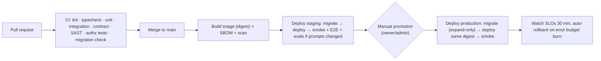

# 09 — Operational & Security Requirements

> Status: Proposed · Applies to staging and production unless stated otherwise

## 1. Identity and access

| Requirement | Design |
|---|---|
| Staff authentication | OIDC SSO (Google Workspace or Entra ID); **MFA enforced at the IdP** (phishing-resistant keys for owner/admin/finance). Optional Cloudflare Access in front of the dashboard and admin API. No local passwords. |
| Sessions | Server-side sessions with an 8h idle / 24h absolute timeout; re-auth for critical actions (refunds, price changes, policy/autonomy edits, credential changes) |
| Authorization | RBAC with permission strings checked **server-side in command handlers**. Membership can be narrowed to specific influencers. |
| Separation of duties | Requester ≠ approver (DB trigger + app check). Two approvals for critical actions. Finance can't edit policies; compliance can't issue refunds. |
| Break-glass | A sealed owner account with hardware key; usage alerts all admins; reviewed in postmortem |
| Access reviews | Quarterly membership review; immediate offboarding runbook (revoke IdP, rotate shared platform credentials the person had seen) |
| Service identities | Each process type has its own DB role (`app_rw`, `app_ro`, `migrator`) and its own vendor API keys where vendors support it |

### RBAC matrix (system roles)

| Permission ↓ / Role → | owner | admin | compliance_officer | content_manager | reviewer | chat_operator | finance | analyst | viewer |
|---|---|---|---|---|---|---|---|---|---|
| Workspace settings, members | ✅ | ✅ | — | — | — | — | — | — | — |
| Persona edit / activate (2 approvals) | ✅ | ✅ | approve | edit | — | — | — | — | — |
| Content policy & autonomy policies | ✅ | ✅ | ✅ (co-approve) | — | — | — | — | — | — |
| Kill switches | ✅ | ✅ | ✅ | — | — | — | — | — | — |
| Plan / brief / generate content | ✅ | ✅ | — | ✅ | — | — | — | — | — |
| Approve publications | ✅ | ✅ | ✅ | — | ✅ | — | — | — | — |
| Conversation inbox, takeover, approve drafts | ✅ | ✅ | read | — | — | ✅ | — | — | — |
| Fan PII view (identities, messages) | ✅ | ✅ | ✅ | — | — | ✅ (assigned influencers) | — | — | — |
| Products, prices (2 approvals) | ✅ | ✅ | — | — | — | — | ✅ | — | — |
| Refunds | ✅ | — | — | — | — | — | ✅ | — | — |
| Payouts & valuations | ✅ | — | — | — | — | — | ✅ | — | — |
| DSR / takedown handling | ✅ | ✅ | ✅ | — | — | — | — | — | — |
| Analytics & costs | ✅ | ✅ | ✅ | ✅ | — | — | ✅ | ✅ | ✅ (no PII) |
| Audit log search | ✅ | ✅ | ✅ | — | — | — | ✅ (finance scope) | — | — |
| Integration credentials (connect/rotate) | ✅ | ✅ | — | — | — | — | — | — | — |

Agents are principals with **action-type permissions** (`agent_definitions.allowed_action_types`), not human roles. They never read secrets.

## 2. Secrets and key management

| Secret class | Storage | Rotation |
|---|---|---|
| App runtime secrets (DB URL, Redis URL, vendor API keys, webhook secrets, HMAC keys for invoice payloads and link tokens) | **Doppler** configs per environment, injected as env vars at runtime; never in the repo or images | Vendor keys every 90 days; HMAC keys with key-id versioning (old keys still verify during the overlap) |
| Platform credentials per influencer (IG tokens, Telegram bot tokens) | `core.integration_accounts`, **envelope-encrypted**: AES-256-GCM data key per workspace, wrapped by **AWS KMS** (separate key per environment). Decrypted in memory only when needed; plaintext never logged. | IG tokens refreshed ~every 30 days; bot tokens rotated on staff change or suspicion via BotFather (runbook) |
| Telegram webhook secret tokens | Per bot, generated, stored encrypted; verified on every request | On bot token rotation |
| Persona Telegram account / Meta Business account recovery | Vault (password manager with shared access for 2 admins), recovery codes, company-owned phone numbers | On staff change |

Controls:

- Secret scanning in CI (and GitHub push protection).
- Logs are redacted by a structured-logger allowlist (no raw payloads with tokens).
- KMS key policies allow decrypt only to production compute roles.

## 3. Data protection and privacy

- **Encryption.**
  - In transit: TLS 1.2+ everywhere, including DB and Redis connections.
  - At rest: managed Postgres and R2 encryption. Telegram's developer terms also require encryption at rest (V).
  - Field level: integration credentials and DSR claimant contacts.
- **Minimization.**
  - No phone numbers, emails or real names of fans are collected.
  - No fan media is retained in the MVP (AS6).
  - Message bodies are kept for 12 months.
  - Memory is consent-bound, with special-category data impossible to store (DB constraint).
- **Records.**
  - **DPIA** before launch (companion-chatbot, memory and vulnerable-user risks).
  - Record of processing activities.
  - DPAs with every sub-processor: Anthropic, BFL, Google, Kling/fal, AWS, Cloudflare, Render, Doppler, Sentry, Better Stack. The sub-processor list is published on the legal page.
- **Data residency.** Default region: EU (Frankfurt) for the DB and object storage, to simplify GDPR. Vendor processing locations are listed in the DPIA.
- **No training on fan data.** Telegram's terms prohibit it (V). Evals use synthetic or explicitly consented data only.
- **Meta platform data obligations:**
  - a privacy-policy URL and a data-deletion callback or instructions URL for the Meta app (served from the minimal legal page);
  - deletion of IG data when a user asks.
- **DSR handling:** `crm.data_subject_requests` with SLA timers. The erasure cascade is in doc 05 §7.

## 4. Application security

| Area | Requirement |
|---|---|
| Webhooks | Verify the Telegram secret header and Meta `X-Hub-Signature-256` (constant-time compare). Reject and alert on spikes of failures. Persist-before-ack. |
| Input validation | Zod schemas for every API input, webhook payload and agent output; size limits; reject unknown fields on admin APIs |
| Prompt injection | Untrusted text is delimited as data. Agents that read untrusted text have no high-risk tools. Output guard. Red-team suite in CI (doc 06 §9). |
| SSRF | The server only fetches media from an allowlist of vendor domains and our R2; no user-supplied URLs are fetched |
| File handling | MIME sniffing + size limits; images re-encoded via sharp; videos probed with ffprobe before processing |
| Admin web | CSP, HttpOnly/SameSite cookies, CSRF tokens, no third-party scripts except monitoring |
| Rate limiting | Per-user and per-IP on the admin API; per-fan on bot interactions (anti-abuse, cost protection) |
| Dependencies | Lockfiles, Renovate/Dependabot, `npm audit` gate (high/critical), container image scanning, SBOM per release |
| Multi-tenancy | Tenant context required by the repository layer; RLS as backstop; automated cross-tenant access tests in CI |
| Telegram config guard | Startup assertion that private-chat topics are **disabled** for each bot (15% fee rule) and that the webhook secret is set |

## 5. Audit logging

- **Every command** writes an audit row with:
  - the actor (user, agent run, system, external), action, subject and influencer;
  - the approval and proposal references;
  - request and trace ids;
  - redacted before/after values.
- **Append-only:** the app role lacks UPDATE, DELETE and TRUNCATE on `core.audit_log`, `monetization.payments`, `monetization.credit_ledger` and `approvals.approval_decisions`.
- **Tamper evidence:** an hourly sealing job hash-chains new rows per workspace (`core.audit_seals`) and exports them to a **WORM bucket** (R2 bucket lock) in a separate account.
- **Search:** the dashboard's audit search by subject, actor or time. Exports are available for counsel and regulators.
- **Also logged:** disclosures shown (time, conversation, jurisdiction rule) and consent events, which give compliance evidence for companion-chatbot laws.

## 6. Observability

### 6.1 Telemetry

- **Traces:** OpenTelemetry across api → queue → worker → vendor calls. Trace ids are propagated in job data and in `audit_log.trace_id`.
- **Logs:** structured JSON (pino) shipped to Better Stack or Grafana Loki, with PII-redacted fields.
- **Errors:** Sentry, with release tagging.
- **Metrics:**
  - queue depth, age and failure rate per queue;
  - webhook latency and verification failures;
  - pre-checkout latency;
  - publish success rate and lateness;
  - LLM latency, tokens, cost, refusals and guard blocks;
  - generation cost per item;
  - escalation counts and SLA breaches;
  - reconciliation discrepancies.
- **Business KPIs:** from `analytics.daily_influencer_kpis` on the dashboard.

### 6.2 SLOs and alerts

| Signal | SLO / threshold | Severity | Channel |
|---|---|---|---|
| Pre-checkout answered | p99 < 2s; any timeout | sev2 (sev1 if > 5 in 10 min) | Pager |
| Payment → entitlement | p95 < 5s; any DLQ in `payments` | sev1 | Pager |
| Reconciliation discrepancy | Any unmatched incoming Star tx after auto-repair | sev2 | Pager (business hours) |
| Premium membership audit discrepancy | > 0 | sev3 | Slack/email |
| Conversation reply latency | p95 < 12s (MVP) | sev3 if breached for 15 min | Slack |
| Critical escalation (crisis) unacknowledged | > 15 min in staffed hours | sev1 | Pager |
| Publication late | > 15 min past schedule | sev3; sev2 if 3+ | Slack |
| Publication `unknown` | Any | sev3 | Slack |
| Instagram token expiry | < 10 days | sev3; < 3 days sev2 | Slack/pager |
| Webhook verification failures | > 20 in 5 min | sev2 (possible attack) | Pager |
| DLQ (non-payment queues) | > 0 new | sev3 | Slack |
| Daily AI spend | > 80% of budget; > 100% | sev3 / sev2 | Slack |
| LLM refusal or guard-block rate | > 2× 7-day baseline | sev3 | Slack |
| Platform enforcement notice (IG warning, Telegram report) | Any | sev2 | Pager |
| Error rate (5xx) API | > 2% for 5 min | sev2 | Pager |

### 6.3 Incident management

- **Severities:**
  - **sev1**: fan harm risk, payment loss, data breach, or platform ban;
  - **sev2**: major function down;
  - **sev3**: degraded;
  - **sev4**: minor.
- **Response targets:** acknowledge sev1 in 15 min (staffed hours) or 60 min (off hours); kill switches available to on-call.
- **Records:** every sev1/sev2 gets an `approvals.incidents` record and a blameless postmortem within 5 business days. Data breaches follow the GDPR 72-hour notification assessment.
- **Runbooks** (written in Phase 3):
  1. payment received but no access;
  2. mass publish failure;
  3. IG token expired;
  4. bot token compromised;
  5. Telegram bot/channel restricted;
  6. IG account restricted;
  7. LLM provider outage;
  8. media vendor outage or policy block;
  9. crisis escalation handling;
  10. erasure request;
  11. takedown request;
  12. reconciliation discrepancy;
  13. kill-switch activation;
  14. restore from backup.

## 7. Testing strategy

| Layer | What | Tooling | Gate |
|---|---|---|---|
| Unit | Domain logic: policy engine, entitlement engine, state machines, pricing, disclosure timers | Vitest + property-based tests (fast-check) | ≥ 90% coverage for `policy`, `entitlements`, `payments`, `disclosure` modules; ≥ 80% overall domain |
| Integration | Repositories, RLS, outbox/inbox, idempotency ledger, queue handlers | Testcontainers (Postgres 16, Valkey) | Required on every PR |
| Contract | Provider adapters against recorded fixtures (Telegram updates, Meta webhooks, vendor responses), plus weekly live smoke tests in staging | Pact-style fixtures + nightly live checks | Fixture tests on PR; live smoke nightly |
| End-to-end (staging) | Bot onboarding → consent → chat → VIP purchase → join approval → expiry removal → refund; content → approval → publish to test IG + test channels | Playwright for the dashboard; scripted Telegram test clients (Telegram test environment where Stars testing is supported, else small real-Stars tests with test accounts) | Before every production promotion |
| LLM evals | Conversation safety & persona suite (~300 cases), caption policy suite, vision-rubric calibration, red-team injection suite | Eval harness with Batch API; LLM-judge + deterministic checks | Critical cases 100%; overall ≥ 95%; run on any prompt/model/agent change |
| Load | Webhook burst (10× expected), conversation throughput, publish batch | k6 | Before launch and before each scale step |
| Security | SAST, dependency audit, secret scan, container scan, authz tests (each role × each endpoint), cross-tenant tests | CodeQL/Semgrep, Trivy | Required on PR; external pen test before public launch |
| DR | Restore drill: PITR restore to a scratch DB + app smoke test | Runbook | Quarterly; once before launch |

## 8. Environments, CI/CD and change management

- **Feature flags** for: new providers, autonomy changes (also policy-gated), new formats, experiments.
- **Prompt and agent changes** ship as data (new `agent_definitions` / `prompt_templates` versions). They go through the same promotion: eval → shadow → active. The change is reviewable in the dashboard and audited.
- **Staging uses synthetic data only.** It has separate bots, channels, IG test accounts, KMS keys, Doppler config and vendor keys with low spend caps.

## 9. Backup and disaster recovery

| Component | Mechanism | RPO | RTO |
|---|---|---|---|
| Postgres | Managed PITR (≥ 7 days) + nightly encrypted logical dump to R2 (separate account), 35-day retention | ≤ 15 min (PITR) | ≤ 4h |
| Redis/Valkey | Not a system of record; jobs re-derived by sweepers from DB state | n/a | Minutes |
| Object storage (R2) | Bucket versioning + lifecycle; WORM bucket for audit exports | ≤ 24h for derived renditions (re-creatable); originals are versioned | ≤ 4h |
| Secrets | Doppler (vendor-managed) + offline encrypted export of the root recovery set | — | ≤ 4h |
| Platform accounts | Recovery codes and company-owned phone numbers in the vault; two admins | — | Hours–days (platform-dependent) |

**Region failure:** the documented manual procedure is to restore into another region from the logical dump plus R2 replication. This is acceptable for the MVP; it will be revisited at scale (multi-AZ HA Postgres from the scale phase).

## 10. Cost controls

- Every vendor call is metered into `analytics.usage_events` using `analytics.price_book`, versioned and with a `source_url`.
- Budgets per influencer (day/month) for LLM, media and total, with warn and hard actions.
- Vendor-side spend caps on API keys where vendors support them (defense in depth).
- **Monthly reconciliation** of metered cost vs. vendor invoices (target ±5%). The price book is corrected when they diverge.
- **The cost dashboard shows:**
  - cost per influencer;
  - cost per published item;
  - cost per active chatter;
  - cost per Star of revenue (estimated).

## 11. Compliance operations calendar

| Cadence | Activity |
|---|---|
| Per release | Eval suites; disclosure regression tests |
| Weekly | QA sampling review; escalation SLA review |
| Monthly | Risk register review; vendor usage-policy check; reconciliation sign-off (finance) |
| Quarterly | Access review; DR drill; legal review of new chatbot/AI laws (jurisdiction config update); pen-test findings review |
| Annually | DPIA refresh; SB 243 annual report (from 2027-07-01, if applicable); policy document versions |
