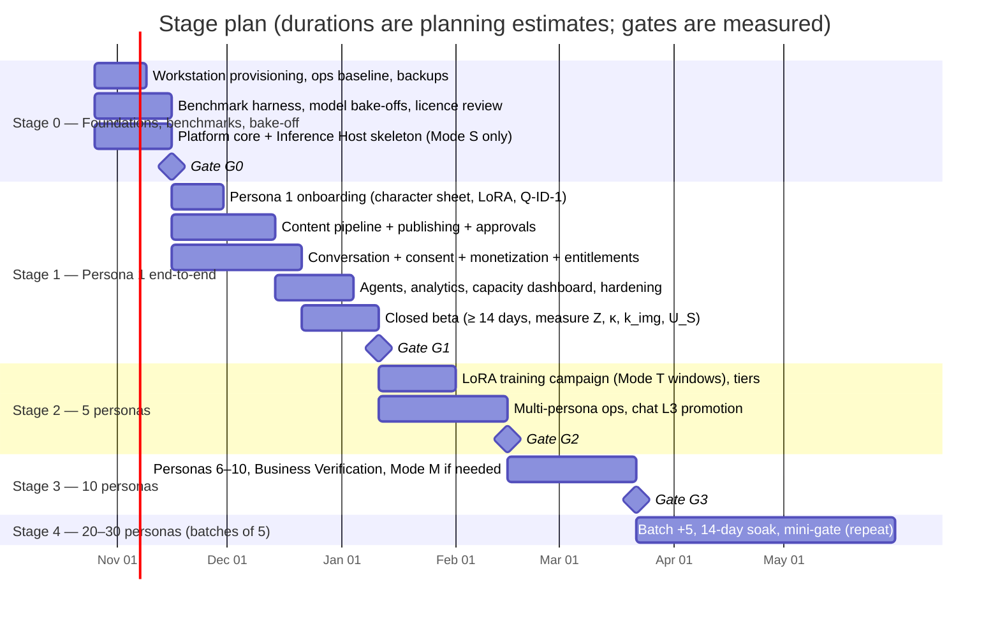

# 10 — Phased Implementation Plan

> Status: Proposed — **rewritten 2026-10-18 for the single-workstation, local-inference MVP (1 → 5 → 10 → 20–30 personas)** · Gate tests: [doc 11](11-mvp-acceptance-criteria.md) · Capacity: [doc 13](13-gpu-scheduling-and-capacity.md) · Benchmarks: [doc 14](14-benchmark-protocol.md)
>
> **Principle: build one complete persona end-to-end first. Add personas only when the previous stage's measured gate passes.** If measurements show the workstation's limit is below 30 at acceptable quality, the plan stops at that measured limit. The response is to reduce content tiers or add a second inference node, never to lower the quality or safety bars.

## 1. Stage overview

| Stage | Personas live | Planning duration | Exit gate (doc 11) |
|---|---|---|---|
| **0** | 0 (staging only) | ~3 weeks | **G0**: fingerprinted machine; engines and models chosen by evidence; Mode S measured; restore drill passed |
| **1** | 1 | ~8–9 weeks incl. ≥ 14-day beta | **G1**: complete end-to-end acceptance for one persona + calibrated capacity model |
| **2** | 5 | ~5 weeks | **G2**: multi-persona fairness, chat L3 promotion, projection for 10 ≤ 80% |
| **3** | 10 | ~5 weeks | **G3**: account scaling, mode transitions (if any), full-size restore |
| **4** | 15 → 20 → 25 → 30 | ~2–3 weeks per batch of 5 | **G4.n** per batch; stop at measured `N_max` |
| **5** (optional) | > 30 or standby | — | Second inference node and/or warm standby (doc 13 §10, doc 09 §9) |

Durations are planning estimates for a team of 2 engineers + 1 content/persona lead + part-time reviewers and operators. **Gates are pass/fail on measurements, not dates.**

## 2. Stage 0 — Foundations, benchmarks and bake-off (~3 weeks)

**Goal:** a hardened, observable, recoverable workstation, plus evidence-based choices of engine and models. No personas live yet.

| Workstream | Deliverables |
|---|---|
| **Hardware & OS** | Inventory vs. doc 15 §4 (RAM, NVMe, backup disk, adapter rating). Windows 11 Pro; update deferrals; power, lid and battery settings; BitLocker (TPM); service account + auto-login; NVIDIA "Prefer No Sysmem Fallback"; display on the iGPU; router UPS (doc 09 §11) |
| **Runtime** | WSL2 distro (Ubuntu LTS, systemd), `.wslconfig`, keep-alive task, host agent (Windows), `cloudflared` service, Cloudflare Access + SSO, Healthchecks.io heartbeats |
| **Data & backups** | Postgres 16 + WAL archiving; pgBackRest (≥ 2.59.3) + restic to the local backup disk and offsite (B2 or R2). **First restore drill (B-FAIL-7).** |
| **Observability** | Prometheus, Grafana, Loki; GPU telemetry from the host agent; smart plug with energy metering; alert routing to the ops Telegram bot + email |
| **Benchmark harness** | `bench` CLI, samplers, LLM load generator with the production prompt shape, ComfyUI driver (doc 14 §2). Suites B-SYS, B-IO, B-THERM, B-PWR baseline. |
| **Licence registry** | `inference.licenses` rows for every candidate; counsel review of doc 15 §6 items L1–L6 started; excluded-model list enforced |
| **Bake-offs** (decide by evidence) | (1) **LLM engine:** llama.cpp vs. vLLM (B-LLM-1…6). (2) **Chat model:** Qwen3.5-9B vs. Ministral 3 vs. Gemma 4 (Q-CHAT-1 quick version, 100 cases; B-LLM-4 prefix caching). (3) **Image base:** Z-Image-Turbo vs. Qwen-Image-2512 vs. ERNIE-Image vs. HiDream-O1 (Q-IMG-1 on 50 finals each; B-IMG-1/2). (4) **Video feasibility:** Wan2.2-I2V-A14B vs. TI2V-5B in Mode S (B-VID-1/2). (5) **Guard:** Q-GUARD-1. (6) ComfyUI **inside WSL vs. native Windows** (B-IMG-2). |
| **Platform code** | Platform core (tenancy, SSO/RBAC, audit, Postgres queue, idempotency ledger, poll cursors, flags); schema migrations from `docs/schema/schema.sql`; invariant suite in CI. Inference Host skeleton: arbiter in **Mode S only**, leases, heartbeats, recovery sweep, ComfyUI driver, Inference Port contract. |
| **Platform verification** | Doc 02 §8 checklist (16 items), incl. `is_ai_generated`, Stars test flows, webhook-outage behavior, bot/tester limits |
| **Legal & accounts** | Counsel engaged (licences, DPIA, privacy policy, crisis protocol, terms); accountant engaged; Meta app; **Meta Business Verification started**; two BotFather owner accounts; persona #1 accounts created |

## 3. Stage 1 — One complete persona, end-to-end (~8–9 weeks)

**Goal:** everything the brief requires, working for one persona under real (beta) load, with the capacity model calibrated from real data.

| Workstream | Deliverables |
|---|---|
| **Identity (A)** | Persona #1: persona version, canon, character sheet, real-person review, **LoRA trained (Mode T)**, Q-ID-1 passed, calibration set + thresholds |
| **Content (B)** | W1–W3 ComfyUI workflows registered with measured profiles; local validators (W2); captions (W6); C2PA signing; renditions |
| **Publishing (C)** | IG (feed, carousel, Reel, Story) via signed URLs on the tunnel; TG free/premium channels; scheduler; reconciliation of `unknown`; insights + `story_insights`; comment ingestion + backfill polling; Meta auto-resubscribe |
| **Approval (I)** | Reviewer UI, hash binding, batch approval, two-approval rules |
| **Conversation (D)** | Long-poll ingestion; consent gate; disclosure engine; guard (input/output); debounce; context assembly; **chat admission control, priority classes, holding messages**; memory with consent; operator console (L2 drafts, takeover, escalations); crisis protocol |
| **Monetization (E)** | Catalog; pre-checkout fast path; VIP bot subscription + `subscription` updates; entitlements; join-request gating; expiry sweeper; membership audit; PPV; credits + daily allowances; refunds and `/paysupport`; reconciliation; **outage recovery (doc 08 §4.8a)** |
| **Agents (H)** | Production (L3 within budget), Social Media (L2), QA & Compliance (block/hold L4), Strategist (L2), Analytics (L3 internal); runner with schema-constrained outputs; traceability |
| **GPU & capacity** | Arbiter Mode S in production: fair share (trivial with 1 persona, but exercised in tests with synthetic personas), campaigns, thermal governor, OOM ladder, load shedding; capacity dashboard (doc 13 §7.4) |
| **Analytics & costs (G)** | KPIs; GPU-second attribution; energy readings; `ops.cost_entries` monthly ledger (doc 12) |
| **Hardening** | Resilience drills B-FAIL-1…7; runbooks; alert tuning; external review of tunnel/Access configuration |
| **Closed beta** | ≥ 14 days with persona #1, 100–200 invited adult fans, chat in **L2 drafts**, real Stars at low prices. Measure `Z`, `κ`, `k_img`, `k_vid`, `U_S`, review seconds per item and per draft, operator minutes per day. |

## 4. Stage 2 — Five personas (~5 weeks)

| Workstream | Deliverables |
|---|---|
| **Onboarding campaign** | Personas 2–5: character sheets and LoRAs trained in **Mode T windows** (training time measured by B-TRN-1 sets the pace); Q-ID-1 per persona; tiers assigned from the capacity worksheet |
| **Multi-persona scheduling** | Fair-share quotas live; staggered planning schedules; cross-persona duplicate checks; per-persona dashboards |
| **Autonomy** | `reply.send` promoted to **L3 for low-risk intents** (doc 06 §5.1); QA sampling running |
| **Persona isolation tests** | Chat bleed-over evals per persona (Q-CHAT-1 per persona); memory isolation tests |
| **Accounts** | Business Verification complete; staggered creation of IG accounts and bots |

## 5. Stage 3 — Ten personas (~5 weeks)

| Workstream | Deliverables |
|---|---|
| **Personas 6–10** | Same onboarding path |
| **Mode M** | Implemented and enabled **only if** the doc 13 §5.4 rule requires it; transitions validated (0 lost chat requests, measured switch time) |
| **Autonomy** | Offers at L3 within caps; benign IG comment replies and spam hiding at L3 |
| **Resilience** | Full-size restore drill with the real data volume; storage growth projection; thermal re-test |
| **Staffing** | Reviewer and operator coverage sized from measured minutes per persona |

## 6. Stage 4 — 20 to 30 personas, in batches of five (~2–3 weeks each)

For each batch *n* (15, 20, 25, 30):

1. **Pre-check (projection).** The capacity snapshot projects the next batch at ≤ 85% of `G_day` (media) and observed peak `λ` ≤ 0.6 × `ρ·μ*` (chat), with tiers as planned. **If the projection fails, don't onboard.** Choose to lower tiers, pause, or start Stage 5.
2. **Onboard** 5 personas (LoRA training campaign in Mode T windows).
3. **Soak for 14 days**, then run mini-gate **G4.n** (doc 11).
4. **Stop condition:** the first batch whose projection fails defines the measured `N_max` for the current tiers. This is reported to management with the options:
   - (a) lower tiers;
   - (b) fewer personas;
   - (c) a second inference node.

## 7. Stage 5 — Beyond 30, or higher availability (optional)

- **Second inference node** (desktop or another workstation on the LAN): takes H/T classes; node 1 stays chat-first (doc 13 §10).
- **Warm standby** with Postgres streaming replication and synced content store (doc 09 §9, decision D10).
- Multi-workspace onboarding (already in the data model).

## 8. Critical path and dependencies

| Dependency | Affects | Mitigation |
|---|---|---|
| Hardware meets doc 15 §4 (especially RAM for video offload) | Video feasibility, Mode M | Inventory in week 1; buy RAM/disks immediately if short |
| Licence review (doc 15 §6) | Approval of every model | Started in Stage 0 week 1; excluded list avoids surprises |
| Bake-off outcomes | All workflows, LoRA base choice | Done before persona onboarding scales. **Changing the base model later costs a LoRA retraining campaign for every persona.** |
| LoRA training throughput (B-TRN-1) | Onboarding pace for Stages 2–4 | Mode T windows scheduled weekly; onboarding batches sized to training capacity |
| Meta Business Verification | > 50 IG accounts as app roles; headroom for 30 | Started in Stage 0 |
| Operator/reviewer staffing | L2 workloads; crisis SLA | Measured in Stage 1; hiring ahead of each stage |
| Counsel deliverables | Beta and public launch | Kickoff in week 1 |

## 9. Team allocation (indicative)

| Role | Stage 0 | Stage 1 | Stages 2–4 |
|---|---|---|---|
| Eng 1 (platform/backend) | Platform core, queue, ops baseline, backups | Monetization, publishing, conversation orchestration | Multi-persona ops, autonomy promotion tooling, resilience |
| Eng 2 (ML-ops/inference) | Workstation runtime, benchmark harness, bake-offs | Inference Host, arbiter, ComfyUI workflows, validators, LoRA pipeline | Training campaigns, Mode M (if needed), capacity tuning, re-benchmarks |
| Content/persona lead | Image bake-off panels | Persona #1, calibration, reviews | Persona onboarding, tier management |
| Reviewers/operators (part-time) | — | Beta L2 drafts, content reviews | Scaled by measured minutes |
| Counsel / accountant (fractional) | Licences, DPIA, policies | Sign-off before beta | Quarterly reviews |
