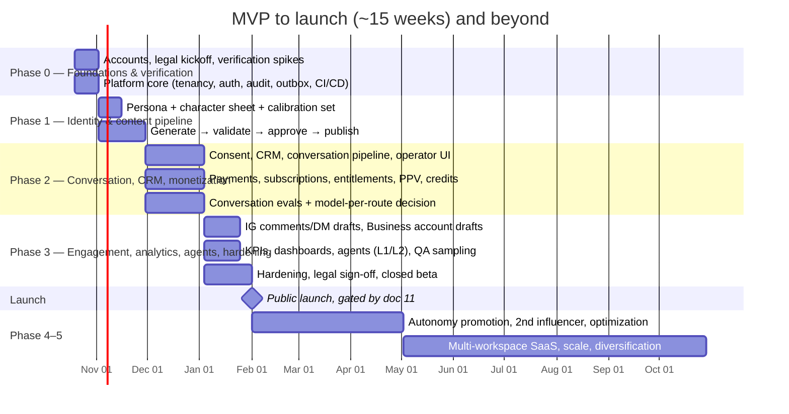

# 10 — Phased Implementation Plan

> Status: Proposed · Assumes the team in AS3 (2–3 engineers, a content/persona lead, part-time operators/reviewers, fractional counsel and accountant)

## 1. Timeline overview

## 2. Phase 0: Foundations and verification (weeks 1–2)

**Goal:** remove unknowns and have a secure, observable skeleton running in staging.

| Workstream | Deliverables |
|---|---|
| **Verification spikes** | Execute the doc 02 §8 checklist with throwaway scripts against test accounts: `is_ai_generated`, IG webhooks for non-role users, Stories on a Business account, Stars test flows and renewal pre-checkout behavior, join-request DM window, business-bot counterpart view. **Update doc 02 evidence tags.** |
| **Accounts** | Meta developer app (staging + prod) and **start Business Verification**. Persona IG **Business** account; begin a manual, human-run warm-up period of organic posting before API automation (recommendation, to reduce spam-signal risk). Telegram: prod and staging bots (BotFather), free and premium channels (bot as admin with minimal rights), persona Telegram account on a company-owned number with 2FA. |
| **Legal & compliance kickoff** | Engage counsel (privacy, consumer, AI disclosure) and an accountant (Stars/TON). Start the DPIA. Draft the privacy policy, terms, AI disclosure text, crisis protocol v1, refund policy, and the persona likeness review. Decide on the static legal page (README decision D2). |
| **Repo & delivery** | pnpm monorepo (`apps/api`, `apps/worker`, `apps/admin`, `packages/domain`, `packages/adapters`, `packages/db`), lint/format/typecheck, Vitest + Testcontainers, Docker, GitHub Actions, Render staging and production projects, Doppler, AWS KMS, Sentry, logs. |
| **Platform core** | Workspaces/users/memberships/roles; OIDC SSO; RBAC middleware; audit log + sealing job; outbox relay + inbox; idempotency ledger; DLQ mirror; feature flags and kill switches; Provider Gateway skeleton (rate limit, retry, circuit breaker, metering); webhook ingress with verification and persistence. |

**Exit criteria**
- Staging deployed through the pipeline.
- SSO login with MFA works.
- RBAC and cross-tenant tests pass.
- A verified Telegram update and a verified Meta webhook are persisted end-to-end.
- Spike results are recorded and doc 02 is updated.
- The legal workplan is agreed.

## 3. Phase 1: Identity and content pipeline (weeks 3–6)

**Goal:** a consistent persona whose approved content is published to all channels without manual handling.

| Workstream | Deliverables |
|---|---|
| **Identity (A)** | Persona version editor, plus approval for canon facts. Character sheet workflow (human-curated generations → canonical references). Real-person resemblance check. Calibration set and threshold report. |
| **Content (B)** | Briefs, prompt templates, provider router (FLUX.2 [pro] primary, Nano Banana 2.1 fallback). Generation jobs. Validation suite W2 (Rekognition, omni-moderation, Claude vision rubric). Captions W6. Renditions plus C2PA re-signing. Basic video W3 (Veo 3.1 Fast, keyframe-first). |
| **Publishing (C)** | Channels; publications with hash-bound authorization; scheduler; Telegram channel publish (photo, album, video); IG publish (image, carousel, Reel, Story) with quota checks and reconciliation of `unknown` outcomes; insights snapshots and the `story_insights` webhook. |
| **Approval (I)** | Approval requests/decisions, reviewer UI with diff and validation results, batch approval, two-approval rule. |
| **Costs (G)** | Price book, usage-event metering on every vendor call, budgets with warn/hard actions, cost-per-item view. |
| **Agents v0 (H)** | Agent runner (structured outputs, budgets, run records, proposals, policy engine). Production agent (L3 within budget), Social Media captions (L2), QA pre-screen (block/hold). |
| **Dashboard (J) v1** | Content board, calendar, approval queue, publication status, DLQ viewer, audit search, cost view. |

**Exit criteria**
- Two consecutive weeks of the planned calendar run through the pipeline in staging, against test IG and Telegram accounts.
- Identity pass rate is measured and on target (≥ 70% first-pass; ≥ 90% of approved items pass the face threshold).
- Zero duplicate publishes in fault-injection tests (forced timeouts).
- Every generation call has a `usage_events` row.

## 4. Phase 2: Conversation, CRM and monetization (weeks 7–11)

**Goal:** fans can talk to the persona safely and pay. Access always matches payments.

| Workstream | Deliverables |
|---|---|
| **CRM (F)** | Fans, identities, consents (with policy-document versions), link tokens, DSR tooling, erasure cascade, segments (basic). |
| **Bot & Conversation (D)** | Onboarding (disclosure + 18+ + terms + **AI-processing consent**); commands (`/about`, `/memory`, `/forget`, `/stopai`, `/deletemydata`, `/paysupport`, `/terms`, `/privacy`, `/limits`). Debounced conversation pipeline; input/output guards; disclosure timer (start + every 3h + after gaps); crisis protocol and de-identified referral log; minor-signal restricted mode. Memory extraction (Batch) with category allowlist. Operator console: inbox, **L2 draft approval**, takeover modes, escalations with SLAs. |
| **Monetization (E)** | Catalog and approvals; orders; **pre-checkout fast path**; payments; VIP bot subscription with `subscription` updates; entitlement engine; premium channel join-request gating, expiry sweeper and membership audit; PPV via `sendPaidMedia` + `purchased_paid_media`; message credits and allowances; refunds and `/paysupport`; daily `getStarTransactions` reconciliation; star valuations; payout ledger. |
| **Evals** | Conversation eval suite (~300 cases incl. red-team). Run on Opus 5.5, Sonnet 5.5 and Haiku 5.5, with the cost per completed conversation. **Decision D3: model per route.** |

**Exit criteria**
- E2E payment scenarios pass in staging: purchase, renewal, cancellation, failed renewal, expiry removal, refund, PPV, credits.
- 7 days of synthetic traffic reconcile with zero unexplained discrepancies.
- Critical eval cases pass 100%.
- No AI processing is possible without consent (tested).
- Erasure cascade test passes.

## 5. Phase 3: Engagement, analytics, agents, hardening and launch (weeks 12–15)

| Workstream | Deliverables |
|---|---|
| **Instagram engagement** | Comment inbox; AI-proposed replies (L2); hide spam (L2); private replies (L2). IG DM drafts within the 24h window (L2). *Depends on the Phase 0 webhook result. If App Review is needed, this ships when access is granted; launch doesn't block on it.* |
| **Telegram Business account** | Connect the business bot (minimal rights); counterpart consent flow; AI drafts → operator approval → send via `business_connection_id`. |
| **Analytics (G)** | Daily KPI rollups (doc 08 §5); dashboards for growth, funnel, revenue (⭐ and est. fiat with valuation label), costs, contribution margin; basic experiments. |
| **Agents** | Influencer Manager, Content Strategist, Monetization (L1/L2), Analytics (L3 internal), Community (L2). Shadow mode; QA sampling; autonomy-policy editor with promotion metrics. |
| **Hardening** | Load tests; external pen test; DR restore drill; runbooks; on-call rota; alert tuning; security review of RBAC and tenancy. |
| **Compliance** | DPIA complete; privacy policy, terms, AI disclosure, crisis protocol and sub-processor list published on the static legal page; Meta privacy-policy and data-deletion URLs; BotFather privacy policy set; counsel sign-off. |
| **Closed beta** | 100–200 invited fans, 2–3 weeks, chat in **L2 drafts**, real Stars at low prices; daily review of QA, escalations, reconciliation and costs. |

**Exit:** all MVP acceptance criteria met ([doc 11](11-mvp-acceptance-criteria.md)), followed by the public launch.

## 6. Phase 4: Autonomy and optimization (months 4–6)

- **Promote** specific action types to L3 by evidence: chat low-risk intents, benign comment replies, spam hiding, scheduled community posts, offers within caps.
- Pricing and offer **experiments** (L2, Monetization agent).
- Identity Tier B (LoRA) if the multi-reference pass rate is insufficient; video quality improvements; lip-sync.
- **Onboard influencer #2** in the same workspace. This proves the multi-influencer path, with a target of < 2 weeks from persona approval to first publish.
- Custom content requests (paid, SLA, human-approved); channel Direct Messages; local Bot API server for large videos.
- Cost optimization from measured data: caching hit rate, allowance sizes, model per route.

## 7. Phase 5: Scale and SaaS (months 6–12)

- Multiple workspaces: self-serve onboarding, per-tenant SSO, quotas and billing. Meta **Advanced Access / App Review** for third-party accounts.
- HA Postgres, read replica, and an event export to a warehouse for analytics.
- **L4** for narrowly defined, well-measured actions (e.g. chat replies for established low-risk intents with continuous auto-demotion).
- Durable workflow engine for long-running agent workflows, if justified.
- Revenue diversification, which reduces Telegram concentration (P13). This requires revisiting "no public website".

## 8. Critical path and dependencies

| Dependency | Affects | Mitigation |
|---|---|---|
| Phase 0 verification spikes | Design details in C, D, E | Done first; the design has fallbacks for each |
| Meta webhook access for non-role users | IG comments/DMs (Phase 3) | Not launch-blocking; App Review started in Phase 0 if needed |
| Counsel deliverables (privacy policy, terms, crisis protocol, DPIA) | Closed beta and launch | Kicked off in week 1 |
| Persona approval and calibration set | All content | Content lead starts in week 2 |
| Conversation eval results | Model per route, free allowance, pricing | Eval suite built during Phase 2, not after |
| Operator staffing | L2 chat during beta; crisis SLA | Hire or contract by week 10 |

## 9. Team allocation (indicative)

| Role | Phase 0 | Phase 1 | Phase 2 | Phase 3 |
|---|---|---|---|---|
| Eng lead (backend/infra) | Platform core, infra | Publishing, gateway | Payments, entitlements | Hardening, launch |
| AI/backend engineer | Spikes | Content pipeline, validation, agent runner | Conversation pipeline, evals | Agents, QA sampling |
| Full-stack/frontend (0.5–1) | Dashboard scaffold | Approval UI, content board | Operator console | KPI dashboards |
| Content/persona lead | Persona brief | Character sheet, calibration, reviews | Conversation tone review | Beta content |
| Operators/reviewers (part-time) | — | Reviews | Draft approvals (staging) | Beta operations |
| Counsel / accountant (fractional) | Kickoff | Policies | DPIA, terms | Sign-off |
