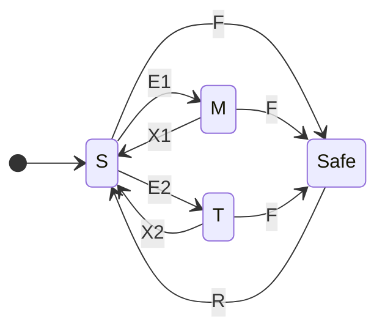
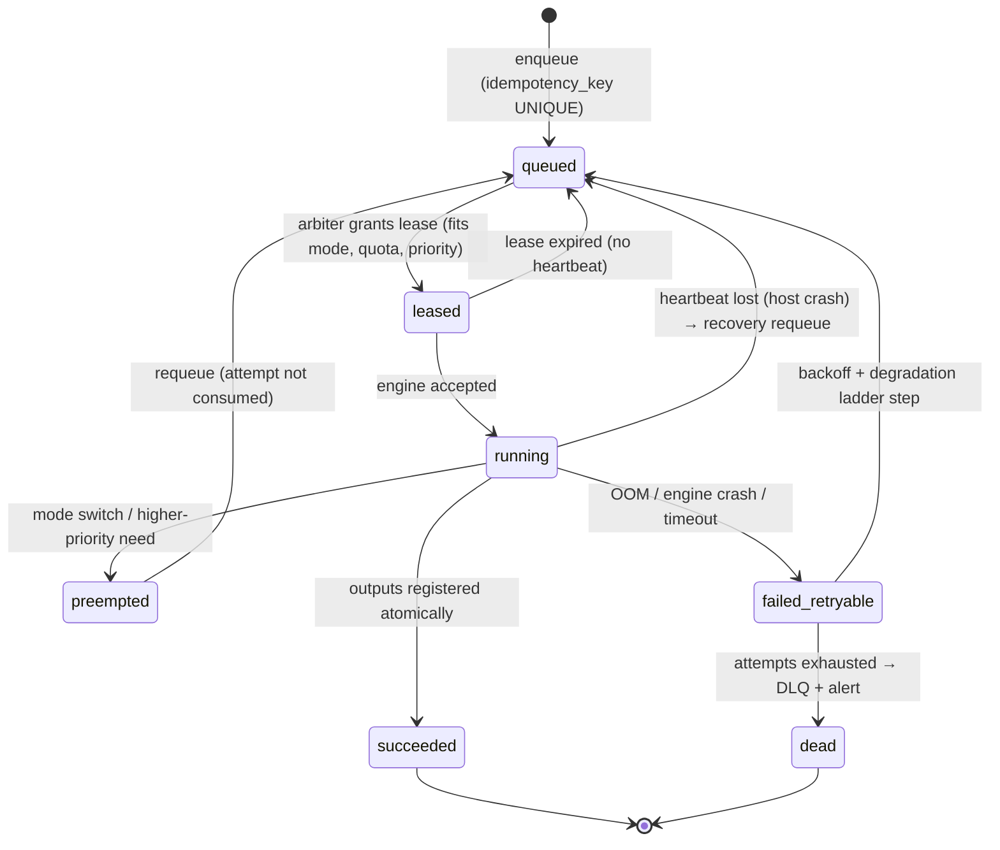

# 13 — GPU Scheduling, Capacity Model & Admission Control

> **Implementation note (2026-10-18):** the media half of the arbiter is implemented in the TypeScript platform (`apps/platform/src/modules/visual/scheduler.ts`, `dispatcher.ts`). It covers priority classes P2–P5, aging, deadlines, per-persona fair share, measured-VRAM admission and engine slots. It talks to ComfyUI only through the Visual Engine Contract, so ComfyUI-internal steps such as model swaps and degradation ladders are Track A's. The chat lane (P1) arrives with the local LLM. Every figure here is still unmeasured: see [doc 16 §5](16-implementation-status.md).

> Status: Proposed (single-workstation MVP) · Related: [04 architecture](04-system-architecture.md), [14 benchmark protocol](14-benchmark-protocol.md), [15 local model stack](15-local-model-stack.md)
>
> **No performance numbers are asserted in this document.** Every value that sizes a budget, limit or SLO is a configuration parameter. Its value comes from a named benchmark in doc 14 (written `⟨B-id⟩`) and is recorded in `ops.benchmark_runs`. Until that benchmark runs on the production workstation, the parameter is `TBD`. The scheduler refuses to enable a workload class whose required parameters are still `TBD`.

## 1. The problem

One GPU (RTX 5090 Laptop, 24 GB VRAM) must serve all of these:

- real-time chat for up to 30 personas and their fans;
- safety classification, vision QA and embeddings;
- image generation and editing;
- video generation;
- agent reasoning;
- periodic LoRA training.

These workloads differ in two ways that matter:

- **Latency:** chat needs seconds; video takes minutes per clip.
- **Memory:** every model competes for the same 24 GB.

A naive "first come, first served" queue would let one video job freeze every fan conversation for minutes. The GPU Arbiter described here prevents that and turns the hardware into **measurable capacity**.

## 2. Principles

1. **Money never waits for the GPU.** Pre-checkout answers, payment processing, entitlement grants and revocations, channel membership enforcement and reconciliation are deterministic CPU code. GPU saturation, a crashed engine or a VRAM error cannot affect them.
2. **Some model always answers fans.** The chat lane is always resident in every mode except a declared maintenance outage. When it is degraded, fans get an honest holding message, never silence.
3. **Postgres is the queue of record.** All GPU work is a row in `inference.gpu_jobs`. Engines are never handed more than one job beyond the one running: ComfyUI's internal queue is ≤ 1, and the LLM engine never receives more requests than the mode's admitted concurrency. A crash or restart therefore loses no queued work, and priorities stay under our control.
4. **Start with the simplest mode set that meets the plan.** A fixed VRAM partition comes first. Time-windowed modes are added only if benchmarks show the fixed partition can't meet the content plan.
5. **Fairness across personas is explicit.** Each persona has a daily GPU-second quota. One persona's backlog can't starve the other 29.
6. **Thermals are a first-class constraint.** A laptop GPU under sustained load may reduce its clocks. The arbiter watches telemetry and slows *media* work. It never slows chat.

## 3. Workload classes

| Class | Examples | Latency target | GPU footprint | Preemptible? | Priority |
|---|---|---|---|---|---|
| **I — Interactive** | Fan chat reply generation; input/output text guard; "are you human?" fast path | Seconds: SLO `chat_gen_p95` ⟨B-LLM-3⟩ | Resident chat lane | No (but admission-controlled) | 1 (highest) |
| **N — Near-interactive** | Operator "regenerate caption", draft suggestions in the operator console, single VLM check requested by a reviewer | ≤ minutes | Chat lane (LLM/VLM) or a small media job | Yes (between requests) | 2 |
| **B — Batch media** | Image generation, edit, upscale, face detail, VLM validation batches, asset embedding | Hours (publish deadline) | Media lane | Yes (at job boundaries; image jobs can be interrupted and requeued) | 3 |
| **H — Heavy media** | Image-to-video, video extension, lip-sync | Hours to a day (publish deadline) | Media lane, largest models | Only at segment boundaries | 4 |
| **A — Agent batch** | Weekly planning, memory extraction, analytics narratives, eval suites | Hours | Chat lane (spare concurrency) | Yes | 5 (fills idle chat capacity) |
| **T — Training** | Persona LoRA training, model conversion/quantization, benchmark suites | Scheduled window | Most of the GPU | Checkpointed | Window-only |
| **C — CPU only** | Payments, entitlements, publishing, schedulers, C2PA signing, ffmpeg, perceptual hashing, small classifiers if benchmarked fast enough on CPU | — | None | — | n/a |

## 4. VRAM model

```text
V_usable  = 24 GB − V_driver − V_display                     ⟨B-SYS-1⟩  (display on the integrated GPU → V_display ≈ 0)
V_reserve = safety margin against fragmentation and spikes   (config; start from measured peak variance)
V_chat    = W_llm + K_llm(mode) + O_engine                   ⟨B-LLM-1⟩  (weights + KV-cache budget + engine overhead)
V_aux     = W_guard + W_embed + W_vlm (if separate)          ⟨B-AUX-1⟩  (0 for components benchmarked as fast enough on CPU)
V_media   = V_usable − V_reserve − V_chat − V_aux             →  the budget ComfyUI may use in this mode
```

- **Planning arithmetic, not measurement.** Model weight sizes can be estimated as params × bits-per-weight / 8. For example, a 14B-parameter model at ~4.5 effective bits is about 8 GB of weights before KV cache and engine overhead.
- **The real numbers come from ⟨B-LLM-1⟩ and ⟨B-IMG-1…⟩ peak-VRAM measurements.** The scheduler uses only measured values.
- **ComfyUI is started with `--reserve-vram`** set to `V_usable − V_media`, so its own memory manager offloads to system RAM instead of colliding with the chat lane. The flag is fixed at process start, so a mode change that alters `V_media` restarts ComfyUI (§5.3).

### Residency table (filled from benchmarks)

| Component | Lane | Resident in modes | VRAM source | Notes |
|---|---|---|---|---|
| Chat LLM (primary) | chat | S, M | ⟨B-LLM-1⟩ | Shared by all personas: a persona is a prompt prefix plus config, not separate weights |
| Chat LLM (fallback/small) | chat | T, Safe | ⟨B-LLM-1⟩ | Smaller model for training windows and degraded operation |
| Guard model | aux | all | ⟨B-AUX-1⟩ | CPU if ⟨B-AUX-2⟩ meets the guard latency budget |
| Embedding model | aux | all or CPU | ⟨B-AUX-3⟩ | Memory retrieval and asset similarity |
| VLM judge | chat or media | S, M | ⟨B-VLM-1⟩ | Preferably the chat model itself if it is multimodal, which saves a resident model |
| Image base model + persona LoRA | media | S, M | ⟨B-IMG-1⟩ | One base model resident at a time; LoRAs hot-swapped |
| Image edit model | media | S, M (campaigns) | ⟨B-IMG-3⟩ | Loaded during edit campaigns |
| Video model | media | M (or S if it fits with offload) | ⟨B-VID-1⟩ | Offload/block-swap to system RAM as measured |
| LoRA trainer | training | T | ⟨B-TRN-1⟩ | Exclusive window |

## 5. GPU modes

### 5.1 Mode definitions

| Mode | Purpose | Chat lane | Media lane | Allowed classes | When |
|---|---|---|---|---|---|
| **S — Shared (default)** | Normal operation | Primary model, full KV budget `K_S` → admitted concurrency `b_S` | `V_media(S)` | I, N, B, A; H only if a video workflow's measured peak ≤ `V_media(S)` with offload | Always, unless another mode is active |
| **M — Media window** (optional; enabled only if needed, §5.4) | Video throughput | Primary model with a reduced KV budget `K_M` (→ `b_M` < `b_S`), or the fallback model | `V_media(M)` > `V_media(S)` | I, H, B | Scheduled low-traffic windows, guarded by live chat load |
| **T — Training** | Persona LoRA training, conversions, benchmarks | Fallback small model, `b_T` | Trainer | I (degraded), T | Weekly maintenance window, lowest measured traffic |
| **Safe** | Fault containment | Fallback model or holding-message only | None | I (degraded) | Automatic after repeated engine failures or a thermal emergency |

Each mode is a row in `inference.gpu_modes`, holding:

- the model keys;
- KV budget, admitted concurrency and `--reserve-vram`;
- the allowed classes;
- the maximum duration.

**A mode can't be activated while any of its parameters is `TBD`.**

### 5.2 Transitions



| Edge | Condition |
|---|---|
| **E1** (S → M) | Media window open **and** chat `λ` < `λ_M_enter` sustained 10 min **and** heavy-media (H) backlog > 0 |
| **X1** (M → S) | Window closes **or** chat `λ` > `λ_M_exit` **or** chat p95 > SLO for 5 min |
| **E2** (S → T) | Maintenance window **and** chat `λ` < `λ_T_enter` **and** a training/benchmark job is queued |
| **X2** (T → S) | Job done **or** window ends **or** chat `λ` > `λ_T_exit` |
| **F** (any → Safe) | ≥ 3 engine crashes in 15 min **or** GPU temperature ≥ `T_crit` |
| **R** (Safe → S) | Operator clears, or the automatic recovery check passes |

- `λ` is the measured chat arrival rate, in replies requested per minute, over a sliding window.
- The enter/exit thresholds differ (**hysteresis**) so the arbiter doesn't flap between modes.
- There is a maximum number of transitions per day (config, e.g. 4), because every transition has a measured cost.

### 5.3 Switch procedure (S → M shown; others are analogous)

1. **Freeze admission.** Stop leasing new B and H jobs.
2. **Drain media.**
   - A running image job either finishes, if its remaining time is below `t_drain_max`, or is interrupted (`/interrupt`) and requeued, keeping its attempt budget.
   - A running video job is allowed to finish its current segment.
3. **Reconfigure chat.** Restart the chat engine with the new KV budget, or the fallback model.
   - During the restart window `T_switch_chat` ⟨B-SYS-3⟩, chat requests queue in Postgres.
   - Fans whose request waits longer than `hold_after_s` get one holding message, e.g. "give me a moment ✨". It is persona-styled, carries the AI disclosure rules, and is never repeated within a conversation turn.
4. **Restart ComfyUI** with the new `--reserve-vram`, then call `/free` to clear any stale cache.
5. **Health check** both engines (warm-up prompt, tiny workflow). **Unfreeze** admission under the new mode's rules.
6. **Record** the transition in `inference.mode_transitions`: durations, jobs interrupted, chat requests delayed.

**Acceptance (doc 11):** measured `T_switch_total` ⟨B-SYS-3⟩ ≤ the configured maximum, with no chat request lost.

### 5.4 Escalation rule: when to introduce Mode M

Run Mode S only. Compute, from measured data (§7.2):

- the daily heavy-media demand `D_H` (GPU-seconds of video needed by the content plan);
- what Mode S can deliver for H, `G_H(S)`.

Then apply this rule:

- **If `D_H ≤ 0.7 × G_H(S)`:** no Mode M is needed. Simplest wins.
- **Otherwise:** enable Mode M windows, sized so `D_H ≤ 0.7 × (G_H(S) + G_H(M))`, while the chat SLO holds during those windows at the measured traffic for those hours.
- **If no window satisfies both:** reduce video in the content tiers (§8), or add a second inference node (§10). Never trade away chat reliability.

## 6. The GPU Arbiter

The arbiter is part of the **Inference Host** process (doc 04). It is the only component that starts work on the GPU.

### 6.1 Job lifecycle



- **Heartbeats.** Running jobs heartbeat every few seconds. On restart, the recovery sweep requeues every `leased` or `running` job whose heartbeat is older than `lease_ttl`.
- **Idempotent outputs.** Outputs go to a staging directory, then the job is registered in `content.media_assets` with a unique `(gpu_job_id, output_index)`. A replayed job never double-registers.

### 6.2 Scheduling policy (media lane)

The arbiter picks the next media job like this:

1. **Eligibility.** The job's class is allowed in the current mode; its measured `est_vram_mb` ≤ `V_media(mode)`; the persona isn't paused; required models are licensed and approved (`inference.models.status = 'approved'`).
2. **Urgency first.** Any job with deadline slack < `slack_urgent` is chosen by **earliest deadline first**. Slack is `due_at − now − est_duration`.
3. **Otherwise, fair share.** Deficit round-robin across personas, weighted by each persona's tier quota (`gpu_quota_seconds_day`). Every persona accumulates "credit" in GPU-seconds and the arbiter serves the persona with the most unused credit. This guarantees that 30 personas progress together.
4. **Model affinity ("campaigns").** Among equally ranked candidates, prefer jobs that use the **currently loaded base model** (and then the loaded LoRA). A different base model is chosen only when:
   - a deadline forces it; or
   - the current campaign has run for `campaign_max_s`; or
   - the backlog for another model exceeds `campaign_switch_backlog`.

   Model load cost `T_load(model)` ⟨B-SYS-2⟩ is the switching cost the policy weighs.
5. **Class order within the same urgency:** N > B > H. **Aging** raises a waiting job's priority over time, so H is never starved.

### 6.3 Chat admission control (chat lane)

- **The chat engine batches continuously.** The arbiter limits in-flight chat requests to `b_mode`, the admitted concurrency from ⟨B-LLM-3⟩. Extra requests wait in a priority queue.
- **Priority within chat:**
  1. safety-critical (crisis template, escalation acknowledgements);
  2. paid VIP / active subscribers;
  3. fans spending credits;
  4. free-allowance fans;
  5. class-A agent calls, which use only idle slots.
- **Deadline handling.** Each chat request carries a deadline (`hold_after_s`). On expiry the fan gets a single holding message, and the request stays queued until its hard timeout (`chat_timeout_s`). Then the conversation is flagged for an operator.
- **Debounce.** Consecutive fan messages within `debounce_s` become one request (doc 06 §6). This reduces load and reads more naturally.

### 6.4 Load shedding (applied in order, automatically, and reversed in reverse order)

When measured chat queue wait p95 > `shed_threshold`:

1. Pause class A (agents, memory extraction).
2. Pause new B/H leases. A running media job finishes its current step or segment.
3. Shorten replies (`max_tokens` → the reduced profile) and widen debounce.
4. Defer free-allowance replies beyond `free_defer_s`, with honest wording ("I'll reply in a bit").
5. Holding messages for everyone except the safety-critical class. **Payments are unaffected at every step.**

Each step is logged and alerted. Sustained shedding (> `shed_alert_min`) pages the on-call operator.

### 6.5 Thermal and power governor

- **Telemetry.** NVML is polled every 5 s: temperature, power draw, SM clock, memory clock, VRAM used, and throttle reasons (thermal, power cap, HW slowdown). Raw samples go to Prometheus; daily rollups go to `ops.gpu_daily`.
- **Policy** (thresholds from ⟨B-THERM-1⟩):

  | Condition | Action |
  |---|---|
  | Thermal or HW-slowdown throttle reason present for > `therm_window_s` | Insert a cool-down gap of `cooldown_s` between media jobs (duty-cycle the media lane) |
  | Temperature ≥ `T_warn` | Pause H; B continues with gaps |
  | Temperature ≥ `T_crit` | Enter **Safe** mode; page on-call |

  Chat is never throttled by the governor. It is the last workload left running.
- **Capacity accounting.** `G_day` (§7.2) uses the **sustained** throughput measured in the 60-minute thermal soak ⟨B-THERM-1⟩, not burst numbers.

### 6.6 OOM degradation ladder

When a media job fails out of memory, the ladder's **next** step is applied before the requeue:

1. Enable tiled VAE decode, or increase tiling.
2. Increase block swap / offload for that workflow.
3. Reduce batch size to 1.
4. Reduce resolution or frames to the workflow's documented minimum profile, then upscale afterwards.
5. Mark the workflow `needs_profile_review` and send the job to the DLQ.

The successful step is recorded per workflow, so the default profile learns from failures.

**An OOM in the chat engine is treated as an incident:** it means the residency budget is wrong. The arbiter restarts the engine at the safer KV budget and alerts.

### 6.7 Engine watchdogs and crash recovery

| Failure | Detection | Automatic recovery |
|---|---|---|
| Chat engine crash / hang | Health endpoint + request timeout | Restart the engine (measured `T_restart_llm` ⟨B-SYS-3⟩); queued chat requests resume; holding messages per §6.3 |
| ComfyUI crash / hang | `/system_stats` health, websocket silence > `comfy_hang_s`, job timeout | Kill + restart ComfyUI; requeue the running job (attempt consumed) |
| GPU driver reset (TDR) / CUDA errors in all engines | Engine errors + `nvidia-smi` failure | Restart all inference processes; if it repeats → **Safe** mode + page |
| WSL2 VM restart | Host watchdog (Windows Task Scheduler) | WSL auto-starts at boot/login task; systemd brings up services; recovery sweep requeues |
| Host reboot / power loss | External dead-man's switch (doc 09) | Auto-power-on + auto-login + WSL autostart; Telegram long polling resumes from the stored offset (updates retained ≤ 24 h); reconciliation repairs payments (doc 08 §4.8) |

## 7. Capacity model

### 7.1 Configured personas vs. concurrent users

These are **different limits**. The system reports them separately.

| Quantity | What bounds it | Unit |
|---|---|---|
| **Configured personas** (config, LoRA, bots, channels, accounts) | Storage, account operations, human review time, and the **content plan's GPU demand**. *Not* chat: personas share one chat model. | personas |
| **Concurrent active chatters** | Chat-lane throughput at the SLO | fans actively in a conversation at the same time |
| **Daily active fans** | Concurrent chatters ÷ measured peak-concurrency ratio | fans/day |
| **Media output** | Media-lane sustained throughput × hours × utilization | final images/day, video-seconds/day |

**A persona costs ~0 GPU at rest.** Thirty configured personas add these GPU costs:

- one-time LoRA training ⟨B-TRN-1⟩;
- their share of the daily content demand;
- a per-persona prompt prefix, whose cache efficiency is measured in ⟨B-LLM-4⟩.

### 7.2 Media capacity

Measured inputs (doc 14):

- `t_img(w)`: sustained seconds per generated image for workflow `w` (generation + VAE + detail) ⟨B-IMG-2⟩.
- `t_val`: seconds of GPU per candidate for validation (VLM judge + classifiers) ⟨B-VLM-1⟩, ⟨B-AUX-*⟩.
- `t_up`: upscale/detail seconds per final ⟨B-IMG-4⟩.
- `t_vid(w)`: sustained GPU seconds per **output** video second for video workflow `w` ⟨B-VID-2⟩.
- `k_img`: candidates generated per accepted final image. Observed in the Stage-1 pipeline, not assumed.
- `k_vid`: attempts per accepted shot, observed.
- `U_mode`: achievable media-lane utilization in a mode, after model switches, cool-down gaps and drains (observed from `inference.gpu_jobs`).

```text
G_day        = Σ_modes  hours(mode) × 3600 × U_mode               [GPU-seconds/day available to media]
c_img_final  = k_img × (t_img + t_val) + t_up                     [GPU-seconds per accepted final image]
c_vid_second = k_vid × t_vid + t_val_video                        [GPU-seconds per accepted video second]
D_persona    = n_img(tier)  × c_img_final
             + n_vid(tier)  × c_vid_second
             + d_train      (LoRA retraining amortized per day)
Feasible     ⇔  Σ_personas D_persona  ≤  (1 − h) × G_day           [h = headroom for regenerations/backlog; default 0.3]
N_max(tier)  = ⌊ (1 − h) × G_day / D_persona(tier) ⌋
```

### 7.3 Chat capacity

Measured inputs, from a realistic load test on the production workstation ⟨B-LLM-3⟩:

- `L_p95(b)`: p95 generation latency at in-flight concurrency `b`, using the real prompt shape: persona prefix + memory + history + structured output, prefix caching on.
- `μ(b)`: completed replies per second at concurrency `b` (closed-loop measurement).
- **Interference factor `φ_media`**: the ratio `μ(b)` with a media job running ÷ `μ(b)` with the media lane idle. Measured separately for an image workload and a video workload ⟨B-LLM-5⟩, because compute and memory bandwidth are shared.

Observed in the beta (not assumed):

- `Z`: mean seconds between consecutive (debounced) requests of one active chatter;
- `κ`: peak concurrent chatters ÷ daily active fans.

```text
b*            = max b such that L_p95(b) × φ_media ≤ chat_gen_slo      (admitted concurrency for the mode)
μ*            = μ(b*) × φ_media                                      [sustainable replies/s while media runs]
λ             = A / Z                                                [request rate of A concurrent active chatters]
Stable at SLO ⇔ λ ≤ ρ × μ*        with target utilization ρ = 0.7
A_max         = ρ × μ* × Z                                           [max concurrent active chatters]
DAF_max       = A_max / κ                                            [max daily active fans]
```

Rules:

- `A_max` and `DAF_max` are computed per mode and shown on the capacity dashboard next to the observed peaks.
- **Scaling gate (doc 10/11):** observed peak `λ` ≤ 0.6 × `ρ × μ*` (a 40% margin), sustained over 14 days, before adding personas.
- Free-allowance size per day is a capacity control. It is set so that the projected free-tier demand fits inside the margin.

### 7.4 Capacity worksheet (filled after benchmarks; stored in `ops.capacity_snapshots`)

| Parameter | Source | Value |
|---|---|---|
| `V_usable`, `V_chat(S)`, `V_media(S)` | B-SYS-1, B-LLM-1 | TBD |
| `t_img` (primary image workflow), `t_val`, `t_up` | B-IMG-2, B-VLM-1, B-IMG-4 | TBD |
| `t_vid` (primary video workflow) | B-VID-2 | TBD |
| `U_S`, `U_M` | Stage-1 operations | TBD |
| `k_img`, `k_vid` | Stage-1 operations | TBD |
| `G_day` | formula | TBD |
| `D_persona` for tiers Lite / Standard / Plus | formula + §8 | TBD |
| **`N_max` per tier** | formula | TBD |
| `b*(S)`, `μ*(S)`, `φ_media(image)`, `φ_media(video)` | B-LLM-3, B-LLM-5 | TBD |
| `Z`, `κ` | Stage-1 beta | TBD |
| **`A_max(S)`, `DAF_max(S)`** | formula | TBD |

### 7.5 Hard limits (configuration, enforced)

| Limit | Purpose |
|---|---|
| `max_configured_personas_stage` | Set by the rollout stage (1 → 5 → 10 → 20–30); raised only by passing a gate (doc 10) |
| `gpu_quota_seconds_day` per persona | Fair share; derived from tier and `G_day` |
| `chat_admitted_concurrency` per mode | `b*` |
| `free_replies_per_day` per persona | Capacity margin; also a cost and wellbeing control |
| `max_candidates_per_item`, `max_video_attempts_per_shot` | Bound `k_img`, `k_vid` |
| `max_mode_transitions_per_day` | Bounds switch overhead |
| Telegram send rate per bot (~30/s total, ~1/s per chat) | Platform limit (doc 02); enforced by the single sender process |
| Instagram publishes per account per 24 h (100) and containers (400) | Platform limit; far above plan |

## 8. Content tiers (demand units per persona per week)

Tiers express demand in **counts**. GPU time follows from §7.2 once the unit costs are measured. Counts are a starting proposal; the content strategy can adjust them.

| Tier | IG feed (single / carousel) | IG Reels | IG Story frames (new / reused) | TG free posts (new / reused) | TG premium items | PPV sets / month | Final images ≈ / week | Video seconds ≈ / week |
|---|---|---|---|---|---|---|---|---|
| **Lite** | 3 / 1 (4 imgs) | 1 (2 shots) | 4 / 6 | 3 / 4 | 4 | 1 (6 imgs) | ≈ 20 | ≈ 2 shots × shot length |
| **Standard** | 4 / 1 (5 imgs) | 2 (2–3 shots) | 7 / 7 | 4 / 6 | 7 | 2 (8 imgs) | ≈ 32 | ≈ 5 shots × shot length |
| **Plus** | 5 / 2 (5 imgs) | 3 (3 shots) | 10 / 10 | 6 / 8 | 10 | 4 (8 imgs) | ≈ 48 | ≈ 9 shots × shot length |

Per-persona tiers mean 30 personas need not be equal. For example, 5 Plus + 10 Standard + 15 Lite. **The total must satisfy the feasibility inequality in §7.2.** The dashboard shows projected vs. available GPU-seconds before a tier change is approved.

## 9. Scheduler metrics and alerts

| Metric | Why | Alert |
|---|---|---|
| Chat queue wait p95, holding-message rate | SLO | p95 > SLO for 5 min (sev2) |
| `λ` vs. `ρ × μ*` per mode | Capacity headroom | > 0.8 for 15 min (sev3) |
| Media backlog in GPU-seconds vs. remaining `G_day` | Deadline risk | Projected miss of any publish deadline (sev3) |
| Per-persona quota consumption | Fairness | A persona at 0% progress for 24 h (sev3) |
| Model switches/day, `T_load` | Campaign efficiency | Above config |
| OOM count per workflow | Profiles | > 0 in production (sev4) |
| Thermal throttle time %, temperature | Hardware health | Thresholds §6.5 |
| Engine restarts | Stability | ≥ 3 in 15 min → Safe mode (sev2) |
| GPU-seconds and energy per persona (attributed) | Cost accounting (doc 12) | — |

## 10. Scale-out path beyond one GPU (no Kubernetes)

The design anticipates a second machine without rework:

- **Postgres (`inference.gpu_jobs`) is already the shared queue.** A second workstation runs another Inference Host and registers as a **node** with its capabilities: VRAM, models, allowed classes.
- **Jobs route by capability.** For example, node 2 takes H (video) and T (training) exclusively. Node 1 keeps chat (I/N/A) and B (images) and can run Mode S permanently.
- **Each node runs its own arbiter for its GPU.** Leases include `node_id`.
- **Media files move** into the shared content store over the LAN, using the same atomic registration.
- **Trigger:** the §5.4 escalation rule fails, or `N_max` measured at Stage 3 is below the business target.
